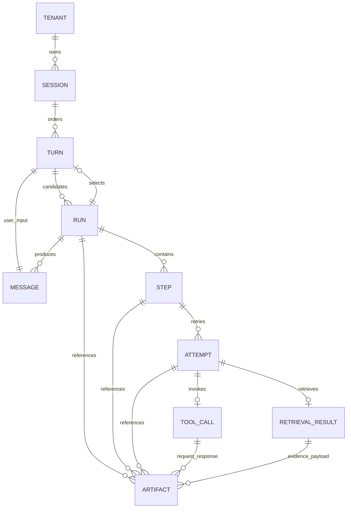
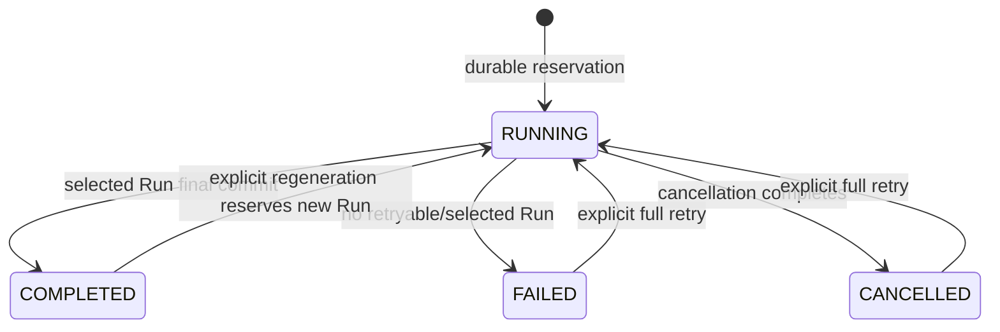
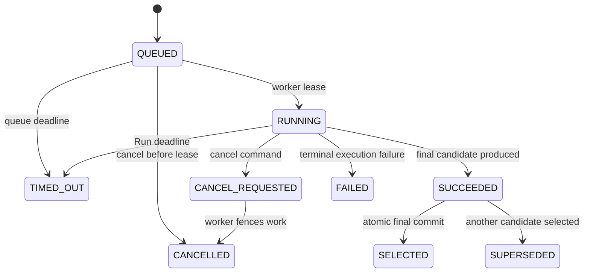

# Requirement P0-05: Domain vocabulary and API contract

- Status: Accepted
- Priority: P0
- Owner: Architecture
- Last reviewed: 2026-08-23
- Depends on: [P0-01 MVP scope](../requirements/0001-mvp-scope.md)
- Machine-readable draft: [OpenAPI v1](openapi-v1.json)
- Source: `AgenticRAG_Go_详细开发计划.xlsx`, task P0-05

## 1. Contract goals

This contract gives every identifier, state transition, idempotency decision and
version conflict one meaning across HTTP, PostgreSQL, queue messages, SSE, logs
and traces. The MVP conversation is linear and does not contain a Branch type.

Normative words `MUST`, `MUST NOT`, `SHOULD` and `MAY` describe implementation
requirements. The OpenAPI file covers the public HTTP surface; this document is
normative for execution and concurrency semantics that OpenAPI cannot express.

## 2. Identifier vocabulary

| Identifier | Meaning | Lifetime and cardinality | Must not mean |
|---|---|---|---|
| `tenant_id` | Trusted SaaS isolation boundary | Server-derived; scopes every business record | User/model-selected filter |
| `session_id` | One linear conversation | Many Turns, one committed head, ≤1 Active Run | Browser connection or Branch |
| `message_id` | One durable content item | User, assistant, system or tool role | LLM request or SSE event |
| `turn_id` | One logical user question | Owns one user Message and one or more Runs | One provider attempt |
| `run_id` | One complete Agent execution candidate | Belongs to exactly one Turn; Runs execute serially within a Session | HTTP request or retry attempt |
| `step_id` | One logical action in a Run | Ordered by `step_no`; context/retrieval/tool/generation | Technical retry |
| `attempt_id` | One physical execution try for a Step | Ordered by `attempt_no`; append-only | Whole-Agent regeneration |
| `tool_call_id` | One validated external tool invocation | Belongs to a Tool Step Attempt | Arbitrary model text |
| `retrieval_result_id` | One authorized ranked result set | Belongs to a Retrieval Step Attempt | Raw vector-backend response |
| `artifact_id` | Immutable large payload plus metadata/hash | Referenced by Run/Step/Attempt/Tool/Retrieval records | Mutable domain aggregate |
| `event_id` | Monotonic durable Run event cursor | Unique and ordered within one Run stream | Global sequence |
| `request_id` | One ingress HTTP attempt | New for every retry/reconnect unless a trusted proxy preserves it | Business deduplication key |
| `trace_id` | Distributed causality tree | Shared across internal calls for one observed flow; links permitted across async boundaries | HTTP request identity |
| `idempotency_key` | Client-chosen logical command identity | Scoped by tenant, actor/subject and operation; retained by policy | Trace or resource ID |

### 2.1 `request_id` versus `trace_id`

`request_id` answers “which HTTP attempt produced this response?” A POST retry
and each SSE reconnect receive a different request ID. `trace_id` answers “which
distributed causal flow do these spans belong to?” The initial POST, outbox
relay and worker may use linked traces when asynchronous delay makes a single
trace impractical. Neither ID deduplicates a command; only the idempotency record
does that.

## 3. Aggregate boundaries and relationships



### 3.1 Session

Session owns linear concurrency control:

- `context_version`: client-visible version of committed conversational context;
- `row_version`: optimistic-lock/fencing version for any control-state mutation;
- `next_turn_sequence`: next reservation number; never reused;
- `committed_turn_sequence`: latest successfully selected Turn sequence;
- `active_run_id`: the only Run allowed to advance the Session, or null;
- `head_turn_id`: latest committed Turn, or null.

### 3.2 Turn and multiple Runs

A Turn is the stable logical question. `POST /sessions/{id}/turns` creates the
Turn, user Message and initial Run atomically. A technical retry of one Step
creates an Attempt, not another Run. A complete restart/regeneration creates a
new `run_id` under the same `turn_id` through `POST /turns/{id}/runs`.

Therefore one `turn_id` MAY correspond to multiple `run_id` values. Only one Run
for that Turn executes at a time in the Session, and exactly one successful Run
can be selected. Selecting a newer regeneration supersedes the previous selected
assistant Message through an explicit final commit; history remains auditable.

### 3.3 ToolCall, RetrievalResult and Artifact

- ToolCall is structured execution metadata: tool name/version, canonical
  argument hash, policy decision, idempotency key, provider operation ID and
  outcome. It is not a conversation Message.
- RetrievalResult is structured evidence metadata: query hash, adapter/index,
  tenant/ACL scope, document/chunk/version identities, scores and ranking stage.
- Artifact is immutable storage for large or sensitive request/response bodies,
  prompt snapshots, chunk payloads and tool results. It carries tenant, content
  type, size, hash, encryption/retention metadata and an object URI.

ToolCall and RetrievalResult MAY reference request/response/evidence Artifacts.
An Artifact does not itself claim that a tool ran or retrieval was authorized;
the owning structured record supplies those semantics. Small structured fields
needed for queries remain in PostgreSQL, while large payloads stay in object
storage.

## 4. Public resources

### 4.1 Session representation

```json
{
  "id": "ses_01...",
  "context_version": 7,
  "row_version": 19,
  "next_turn_sequence": 9,
  "committed_turn_sequence": 7,
  "active_run_id": null,
  "head_turn_id": "trn_01...",
  "created_at": "2026-08-23T00:00:00Z",
  "updated_at": "2026-08-23T00:02:00Z"
}
```

The response `ETag` is derived from `row_version`. Clients submit
`expected_context_version` for conversation commands; repository code uses
`row_version` CAS internally so background control updates cannot be lost.

### 4.2 Create Turn request and response

```http
POST /v1/sessions/ses_01.../turns
Idempotency-Key: 01K...
Content-Type: application/json

{
  "expected_context_version": 7,
  "message": { "content": "How does the retention policy work?" },
  "execution": { "max_steps": 12 }
}
```

```http
HTTP/1.1 202 Accepted
Location: /v1/runs/run_01...

{
  "session_id": "ses_01...",
  "turn_id": "trn_01...",
  "run_id": "run_01...",
  "user_message_id": "msg_01...",
  "turn_sequence": 8,
  "base_context_version": 7,
  "status": "QUEUED",
  "events_url": "/v1/runs/run_01.../events"
}
```

The response means the reservation is durable, not that Agent execution has
started. Retrying the same logical request with the same idempotency key returns
the original identifiers and does not create another Turn.

## 5. Command idempotency

### 5.1 Scope and fingerprint

The idempotency record key is:

```text
(tenant_id, authenticated_subject_id, operation, idempotency_key)
```

The server computes `request_hash` from the operation, canonical path parameters
and canonical JSON body after applying defaults. Transport-only headers,
`request_id`, `traceparent` and JSON object order are excluded. Secrets are not
stored in the fingerprint input after canonicalization.

### 5.2 Outcomes

| Existing record | Incoming hash | Result |
|---|---|---|
| None | any valid hash | Reserve `IN_PROGRESS`, execute once, persist response reference |
| `IN_PROGRESS` | same | Return `409 IDEMPOTENCY_IN_PROGRESS` with retry guidance |
| `SUCCEEDED` | same | Replay original status/body/resource references |
| `FAILED_FINAL` | same | Replay stable final error |
| any | different | Return `409 IDEMPOTENCY_KEY_REUSED` |

The main-chain idempotency key prevents duplicate durable business commands when
the client cannot know whether a response was lost. It does not make every
downstream provider call safe. Each Step Attempt and ToolCall derives a separate
server-controlled idempotency key from tenant/Run/Step/Attempt/tool/argument hash.

Idempotency records are retained at least 24 hours and never less than the
maximum client retry window. A key that has expired may create new work; clients
therefore use high-entropy keys and do not intentionally reuse them.

## 6. Version and concurrency semantics

### 6.1 Two versions

- `context_version` changes only when a final assistant Message is selected and
  committed. It tells clients which conversational context their question used.
- `row_version` changes on every Session control mutation, including Active Run,
  cancellation bookkeeping and final commit. It is the database CAS/fencing
  value and response ETag.

These versions are deliberately not interchangeable. A background lease/control
update can change `row_version` without changing user-visible context.

### 6.2 Create-Turn decision order

Inside one short PostgreSQL transaction:

1. claim/read the idempotency record;
2. lock/read the tenant-scoped Session;
3. reject if `expected_context_version != context_version`;
4. reject if `active_run_id` is non-null;
5. reserve `turn_sequence`, create user Message, Turn and initial Run;
6. set `active_run_id`, increment `row_version`, append outbox event;
7. persist idempotent response reference and commit.

Decision order makes stale context deterministic. If the same Session is busy at
the requested version, return `SESSION_BUSY`; after the active Run commits a new
context version, the old client receives `SESSION_VERSION_CONFLICT`.

### 6.3 Conflict errors

| Code | HTTP | Meaning | Client action |
|---|---:|---|---|
| `SESSION_VERSION_CONFLICT` | 409 | Expected context does not equal committed context | Refetch Session/history and obtain user decision before retry |
| `SESSION_BUSY` | 409 | Another Active Run owns the Session | Observe active Run; retry with backoff only if still desired |
| `IDEMPOTENCY_IN_PROGRESS` | 409 | Same command is still being processed | Poll/retry same key |
| `IDEMPOTENCY_KEY_REUSED` | 409 | Same key has a different fingerprint | Generate a new key only for genuinely new intent |
| `RUN_FENCED` | 409 | Worker lease/version is stale | Worker stops; never retry final commit under stale lease |

The MVP never auto-merges stale context and never creates a Branch to hide a
conflict.

## 7. State machines

Run, Step and Attempt execution history is immutable after its terminal state.
A Turn lifecycle MAY reopen through an explicit retry/regeneration command, but
prior Runs, Attempts, Messages and Artifacts are never rewritten.

### 7.1 Turn



### 7.2 Run



`SELECTED`, `SUPERSEDED`, `FAILED`, `CANCELLED` and `TIMED_OUT` are terminal.
`SUCCEEDED` means execution has finished but selection is pending, so the Run is
not yet lifecycle-terminal. Selection does not rerun the Agent.

### 7.3 Step and Attempt

Step transitions:

```text
PENDING → RUNNING → SUCCEEDED
                  → FAILED
                  → CANCELLED
PENDING → SKIPPED
```

Attempt transitions:

```text
STARTED → SUCCEEDED
        → FAILED
        → UNKNOWN
```

`UNKNOWN` is terminal for that Attempt and requires reconciliation before an
unsafe side effect can be retried. A transient failed Attempt may be followed by
a new Attempt while the Step remains RUNNING.

### 7.4 Message visibility

User Messages are `COMPLETED/CONVERSATION` at Turn reservation. Assistant deltas
are durable events, not repeatedly updated Message rows. A candidate assistant
Message remains `COMPLETED/CANDIDATE` until the final transaction changes it to
`COMPLETED/CONVERSATION` and selects its Run. Failed/internal/tool content is not
returned by normal conversation history.

## 8. Main-chain sequence

```mermaid
sequenceDiagram
    autonumber
    participant C as Client
    participant A as HTTP API
    participant I as Idempotency Store
    participant P as PostgreSQL
    participant O as Outbox Relay
    participant Q as Run Queue
    participant W as Agent Worker
    participant X as Context Manager
    participant R as Retriever
    participant M as Knowledge MCP
    participant L as LLM / Tool
    participant S as SSE Gateway

    C->>A: POST Turn (Idempotency-Key, expected_context_version)
    A->>I: claim(scope, request_hash)
    I-->>A: NEW or replay/conflict
    A->>P: BEGIN; lock tenant Session
    A->>P: verify context_version and active_run_id
    A->>P: insert Message + Turn + Run + Outbox; set Active Run
    A->>P: COMMIT
    A-->>C: 202 turn_id, run_id, events_url
    C->>S: GET events (Last-Event-ID optional)
    S->>P: authorize Run and replay cursor
    O->>P: claim outbox event
    O->>Q: publish Run reservation
    W->>P: acquire lease/fencing version
    loop bounded Run Steps
        W->>X: build context at base_context_version
        W->>R: retrieve with trusted tenant/ACL
        opt knowledge MCP adapter
            R->>M: MCP call with server-injected scope
            M-->>R: untrusted candidates
        end
        W->>L: bounded provider/tool call
        W->>P: append Step/Attempt/Artifact refs/events
        S-->>C: SSE durable events/deltas
    end
    W->>P: BEGIN final commit with lease + Session CAS
    W->>P: insert final Message; select Run; advance context; clear Active Run; outbox terminal
    W->>P: COMMIT
    S-->>C: run.completed after durable commit
```

No provider, MCP, retrieval or tool network call occurs inside a PostgreSQL
transaction. Final commit fails closed if lease, Run version, Session Active Run
or base context no longer matches.

## 9. SSE contract

Endpoint: `GET /v1/runs/{run_id}/events`

Response headers:

```http
Content-Type: text/event-stream
Cache-Control: no-cache, no-transform
X-Accel-Buffering: no
```

Event example:

```text
id: 42
event: assistant.delta
data: {"run_id":"run_01...","sequence":42,"occurred_at":"2026-08-23T00:00:03Z","payload":{"text":"Retention"}}
```

Rules:

- `id`/`sequence` increases monotonically per Run and is never reused.
- The server authorizes the Run before replay and live subscription.
- `Last-Event-ID` resumes strictly after that event. Duplicate transport delivery
  remains possible; clients deduplicate by Run plus sequence.
- Heartbeat comments occur every 15 seconds and are not durable business events.
- Terminal event is published only after the matching terminal database commit.
- A cursor older than retention returns `410 EVENT_CURSOR_EXPIRED` with the
  current Run snapshot URL; reconnect never creates new execution.
- Slow consumers are disconnected with a retry hint rather than receiving an
  unbounded in-memory buffer.

Initial event types:

```text
run.queued, run.started, step.started, retrieval.completed,
tool.started, tool.completed, assistant.delta, step.completed,
run.cancel_requested, run.completed, run.failed, run.cancelled, run.timed_out
```

Public events expose bounded metadata. Raw prompts, chunks, tool arguments,
provider errors and internal chain-of-thought are never SSE payloads.

## 10. Error envelope

```json
{
  "error": {
    "code": "SESSION_VERSION_CONFLICT",
    "message": "The session context has advanced.",
    "retryable": false,
    "request_id": "req_01...",
    "trace_id": "4bf92f3577b34da6a3ce929d0e0e4736",
    "details": {
      "expected_context_version": 7,
      "actual_context_version": 8
    }
  }
}
```

`code` and documented detail keys are stable API contract. `message` is safe for
humans but not intended for program logic. Internal SQL/provider errors, stack
traces, prompts and secrets are never returned.

Core code families:

| HTTP | Codes |
|---:|---|
| 400 | `INVALID_ARGUMENT`, `INVALID_IDEMPOTENCY_KEY`, `INVALID_EVENT_CURSOR` |
| 401/403 | `UNAUTHENTICATED`, `PERMISSION_DENIED` |
| 404 | `SESSION_NOT_FOUND`, `TURN_NOT_FOUND`, `RUN_NOT_FOUND` |
| 409 | version, busy, idempotency and fencing conflicts from §6.3 |
| 410 | `EVENT_CURSOR_EXPIRED`, `RESOURCE_DELETED` |
| 429 | `TENANT_QUOTA_EXCEEDED`, `GLOBAL_CAPACITY_EXCEEDED` |
| 500 | `INTERNAL` |
| 502/503 | `PROVIDER_UNAVAILABLE`, `RETRIEVAL_UNAVAILABLE`, `SERVICE_UNAVAILABLE` |
| 504 | `RUN_DEADLINE_EXCEEDED`, `PROVIDER_TIMEOUT` |

Unknown internal errors map to `INTERNAL` with a correlation ID. Whether a code
is retryable is defined per occurrence and never inferred from HTTP status alone.

## 11. Public endpoint set

| Method and path | Purpose | Idempotency |
|---|---|---|
| `POST /v1/sessions` | Create empty linear Session | Required |
| `GET /v1/sessions/{session_id}` | Read Session control snapshot | Safe read |
| `GET /v1/sessions/{session_id}/messages` | Read committed conversation history | Safe read, cursor pagination |
| `POST /v1/sessions/{session_id}/turns` | Create Turn, user Message and initial Run | Required |
| `GET /v1/turns/{turn_id}` | Read logical question and Run candidates | Safe read |
| `POST /v1/turns/{turn_id}/runs` | Explicit retry/regeneration under same Turn | Required |
| `GET /v1/runs/{run_id}` | Read durable Run snapshot | Safe read |
| `GET /v1/runs/{run_id}/events` | Resume/live SSE | Transport reconnect, not command idempotency |
| `POST /v1/runs/{run_id}:cancel` | Request cancellation | Required |

Create/command responses include `request_id` and tracing response headers.
Collection responses use opaque stable cursors, never offset pagination over a
mutating history.

## 12. API compatibility

- `/v1` preserves field meaning and error-code meaning.
- Additive optional fields and new SSE event types are backward compatible;
  clients must ignore unknown optional fields/event types.
- Removing/renaming fields, changing an ID meaning, making an optional field
  required or changing a state transition requires a new API version.
- Enum additions are reviewed for old-client behavior. Clients must handle an
  unknown status as non-terminal unless the resource also supplies `terminal`.
- Timestamps are RFC 3339 UTC; durations are not encoded as ambiguous integers.
- JSON numbers used for versions/sequences are non-negative and remain within
  signed 64-bit range.

## 13. Acceptance checklist

- [x] Object and identifier boundaries are unambiguous.
- [x] One Turn may own multiple Runs without introducing Branch.
- [x] ToolCall, RetrievalResult and Artifact relationships are explicit.
- [x] `request_id`, `trace_id` and idempotency key have different purposes.
- [x] Context version, row version and conflict ordering are explicit.
- [x] Turn/Run/Step/Attempt/Message states and terminal rules are explicit.
- [x] Main-chain transaction/network boundaries are shown in a sequence diagram.
- [x] POST command, resumable GET SSE, cancellation and regeneration are defined.
- [x] Stable error envelope and core error codes are defined.
- [x] OpenAPI draft represents every public endpoint.

## 14. Change control

P0-05 freezes semantics, not implementation package shapes. Any later code that
needs a new state, public field, conflict interpretation, ID meaning or endpoint
must update this document and OpenAPI in the same reviewed commit. Branch remains
out of scope until a superseding architecture decision is accepted.
