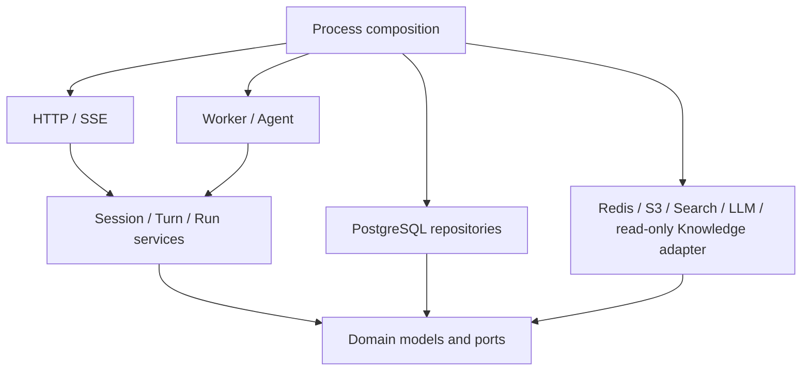

# Core Module Design

This document groups packages by the system problem they solve. Each section records responsibilities, mechanisms, tradeoffs, source locations, and design-review questions.

## 1. Session, Turn, and Run

### Responsibility

These modules define the identity and visibility of a question. A Session is a linear context, a Turn is the logical question, and a Run is one execution attempt. Their main concern is concurrency and commit semantics rather than CRUD.

### Mechanisms

- A Session tracks both `context_version` and `row_version`.
- One Session permits one Active Run; Turn creation reserves that slot transactionally.
- An idempotency key is bound to a request fingerprint. Reusing the key with the same request returns the original result; a different request conflicts.
- One Turn may own multiple Runs, but only one Run can produce the committed assistant Message.
- Final Commit checks expected context version, row version, and Run fencing authority.

`context_version` changes only when visible conversation context changes. `row_version` detects any competing storage mutation. Keeping them separate avoids treating metadata maintenance as a semantic conversation update while still preventing lost writes.

### Source locations

- `internal/domain/session.go`, `turn.go`, and `run.go`
- `internal/session`, `internal/turn`, and `internal/run`
- `internal/repository/conversation.go`
- `internal/repository/final_commit.go`
- `internal/idempotency`

### Design-review questions

- Why does logical regeneration create a new Run while a provider retry creates another Attempt?
- Why does the MVP reject a second Active Run instead of queueing it?
- Which races are prevented by uniqueness constraints, and which require version CAS?
- What happens if Message insertion succeeds but terminal event creation fails? The shared transaction rolls back.

## 2. Transactional Outbox

### Responsibility

Outbox records bind a committed business transition to its asynchronous delivery intent. They remove the unsafe window created when API or Worker code writes PostgreSQL and then publishes directly to a queue or Redis.

### Mechanisms

- Business rows and Outbox rows use the same `DBTX`.
- Relay discovers ready tenants and claims bounded batches with `FOR UPDATE SKIP LOCKED`.
- Claims carry owner, token, and expiry. ACK/NACK operations must match the active fenced claim.
- Publishers are selected by event type. Unknown event types fail closed.
- Failure uses bounded exponential backoff and eventually transitions the event to `DEAD`.
- For one Run, `RunEvent.v1` claims are serialized by event sequence.

### Failure windows

| Window | Result |
|---|---|
| process fails before business commit | business state and Outbox both roll back |
| Relay is unavailable after commit | Outbox remains pending |
| publish fails | claim is released with retry delay |
| publish succeeds before ACK failure | publication repeats and requires downstream idempotency |
| stale Relay resumes | fencing prevents it from acknowledging a newer claim |

### Source locations

- `internal/outbox/repository.go`
- `internal/outbox/relay.go`
- `internal/outbox/component.go`
- `internal/outbox/router.go`
- `internal/events/repository.go`

### Design-review questions

- Why does Outbox not provide exactly-once delivery?
- Why must the business repository and Outbox share one transaction object?
- How does the claim query preserve per-Run SSE order across Relay replicas?
- How should a `DEAD` event be inspected and replayed without duplicating a business effect?

## 3. SSE Gateway

### Responsibility

The Gateway exposes durable lifecycle progress separately from short-lived assistant output. SSE observes a Run; a disconnected client does not own or cancel it.

### Dual-path delivery

- **Durable path:** `run_events` stores lifecycle events with a monotonic per-Run sequence and supports bounds plus paginated replay.
- **Live path:** Relay writes `RunEvent.v1` to a tenant-scoped Redis Stream.
- **Recovery:** `Last-Event-ID` identifies the last acknowledged durable sequence.
- **Reconciliation:** periodic PostgreSQL high-water checks repair gaps.
- **Degradation:** PostgreSQL polling replaces the live subscriber when Redis is unavailable.

Redis Stream IDs are derived from event sequences. A Lua script makes Relay retries safe: a missing ID is added, the same ID and bytes are accepted as an idempotent replay, and the same ID with different bytes is rejected.

The `/events` endpoint uses the durable sequence. The `/output` endpoint uses an independent Redis Stream cursor for `assistant.delta`; an output cursor is intentionally not interchangeable with a durable event cursor. A slow consumer is disconnected instead of growing memory without limit.

Provider token fragments pass through `internal/streaming.Batcher` before the Redis-only output path. PostgreSQL rejects attempts to append `assistant.delta`. Redis failure can reduce live output fidelity but cannot lose the final Message or terminal Run state.

### Source locations

- `internal/events`
- `internal/streaming`
- `internal/transport/sse/handler.go`
- `internal/transport/sse/broker.go`
- `internal/transport/sse/outbox.go`
- `internal/transport/sse/output.go`
- `internal/transport/sse/polling.go`
- `internal/platform/redis/stream.go`

### Design-review questions

- How is the race between PostgreSQL replay and Redis subscription repaired?
- Why is Redis not the lifecycle-event or final-result source of truth, even
  though it is the intentionally ephemeral source for provisional output?
- What should happen when a cursor predates retained history?
- How should polling and heartbeats be budgeted for 20,000 connections?

## 4. Run Queue, Worker, and Run Lease

### Responsibility

The Queue provides at-least-once Run delivery. Worker enforces global and per-tenant concurrency. Run Lease identifies the only process authorized to mutate a Run.

### Mechanisms

- The PostgreSQL Queue separates ready-tenant discovery from batch claim.
- `SKIP LOCKED` allows replicas to claim different rows concurrently.
- Deliveries support fenced renew, ACK, and NACK operations.
- Per-tenant concurrency prevents one tenant from occupying all execution slots.
- Graceful drain stops new claims and releases work at a durable safe point.
- Agent checkpoints allow a new worker to continue without relying on an in-memory call stack.

Queue Lease and Run Lease are separate. Queue Lease identifies responsibility for a delivery. Run Lease identifies authority over business execution state. They cannot be merged because queue delivery may be replayed or moved to another broker while Run fencing must remain part of authoritative state.

### Source locations

- `internal/queue`
- `internal/worker/worker.go`
- `internal/runlease/manager.go`
- `internal/agent/checkpoint.go`
- `internal/agent/postgres_store.go`

### Design-review questions

- Why does successful lease renewal still require fencing?
- What happens when a provider returns successfully before its result checkpoint commits?
- How does graceful drain avoid manufacturing duplicate execution?
- How should tenant concurrency interact with provider quotas?

## 5. Agent State Machine

### Responsibility

The Agent Machine coordinates Planner decisions and Executor actions as durable Steps and ensures every Run terminates within explicit budgets.

### Execution boundary

1. Load the fenced checkpoint.
2. Ask Planner for a structured Directive.
3. Allocate and persist a stable Step identity.
4. Execute LLM, retrieval, or read-only knowledge work outside the database transaction.
5. Store Outcome through a fenced CAS.
6. Continue until Done or a budget becomes terminal.

Planner and Executor are ports rather than vendor implementations. Model output passes through a strict action protocol; unknown fields, illegal actions, and out-of-range arguments do not enter the executor.

Budgets cover Steps, Attempts, wall time, tokens, provider calls, tool calls, and estimated cost. Consumed budget is durable, so process restart does not reset allowance.

### Whose phase is it?

`READY`, `EXECUTING`, `COMPLETED`, and `FAILED` are phases of the durable
**Agent Checkpoint for one Run**. They are not Run, Step, or Attempt statuses.
Each state machine answers a different question:

| State | Object | Question answered |
|---|---|---|
| `RunStatus` | Run | What is the business lifecycle of the whole execution? |
| Checkpoint `Phase` | Agent loop inside the Run | Where must a replacement Worker resume the control loop? |
| `StepStatus` | One logical action | Has this logical action completed? |
| `AttemptStatus` | One technical try of a Step | What happened to this particular provider attempt? |

A valid executing snapshot can therefore be:

```text
Run.status       = RUNNING
Checkpoint.phase = EXECUTING
Step.status      = RUNNING
Attempt.status   = STARTED
```

The Checkpoint phases mean:

| Phase | Recovery meaning |
|---|---|
| `READY` | No active Step is pending; Planner may choose `next_step_no`. |
| `EXECUTING` | The Step, Attempt, and Directive were durably recorded, but the provider outcome was not durably completed. |
| `COMPLETED` | Planner declared the Agent loop complete; do not plan or execute another Step. |
| `FAILED` | The Agent loop reached a durable terminal failure; return that failure rather than replanning. |

### Planner and Executor

Planner is the decision port for the next logical action. It reads the durable
Agent `state` and `next_step_no`, then returns either `Done` or a structured
Directive containing the Step kind, stable operation key, bounded JSON input,
and unknown-outcome retry policy. Planner does not perform the action or write
execution state directly.

Executor receives a validated Directive and performs the corresponding context,
retrieval, read-only `knowledge.search`, or generation action. It returns an
Outcome and optional updated Agent state. Planner can be implemented as a fixed
RAG flow, deterministic rules, or a schema-constrained LLM; the interface is not
synonymous with an LLM. Production Planner/provider implementations are supplied
by deployment composition.

```text
durable Agent state
        |
        v
     Planner -- Done --> COMPLETED checkpoint
        |
        | Directive
        v
persist Step + Attempt + EXECUTING checkpoint
        |
        v
     Executor
        |
        | Outcome
        v
persist completed Step + Attempt + next READY checkpoint
```

For example, a knowledge-grounded answer may proceed as follows:

```text
READY(next=1)
  -> Planner chooses RETRIEVAL
  -> EXECUTING(Step 1, Attempt 1)
  -> retrieval succeeds
  -> READY(next=2, state contains bounded evidence references)
  -> Planner chooses GENERATION
  -> EXECUTING(Step 2, Attempt 1)
  -> generation succeeds
  -> READY(next=3, state contains the candidate answer)
  -> Planner returns Done
  -> COMPLETED
```

The durable boundary is intentional: before an external call, one PostgreSQL
transaction creates the Step and Attempt and saves `EXECUTING`; after success,
another transaction completes the Attempt and Step and advances to `READY`.
If a Worker takes over an `EXECUTING` Checkpoint, the old Attempt has an unknown
outcome. The Machine marks or retries it according to the Directive and Attempt
budget. Because the composed knowledge tool is read-only, retry cannot create an
external business mutation. Lease fencing still prevents the displaced Worker
from committing any later result.

### Source locations

- `internal/agent/machine.go`
- `internal/agent/checkpoint.go`
- `internal/agent/modes`
- `internal/agent/action`
- `internal/agent/budget`
- `internal/llm`

### Design-review questions

- Why can Planner output not invoke a tool directly?
- How are transient failure, permanent failure, and unknown outcome distinguished?
- How does recovery preserve Step identity?
- Where should token streaming end and durable Step checkpointing begin?

## 6. LLM Gateway

The LLM Gateway provides common request and response types, model-to-provider routing, response validation, error classification, cost metadata, timeout handling, and circuit breaking. Retry respects provider `Retry-After` information and the Run's total budget.

The repository provides the Gateway and Provider contract but no directly deployable vendor HTTP adapter. Vendor credentials, transport, rate limits, model mappings, and the connection from provider fragments to `streaming.Batcher` remain deployment composition concerns.

Source locations: `internal/llm/gateway.go`, `internal/llm/breaker.go`, and `internal/llm/types.go`.

## 7. Ingestion and retrieval

### Ingestion path

```text
Document → Parser → normalized chunks → Embedding Pipeline → versioned Search Index
                 ↘ immutable Artifact / metadata / checksum
```

- Parser bounds input type, size, and normalized output.
- Chunk, Document, and KnowledgeBase identities are stable and tenant-scoped.
- Embedding runs in rate-limited batches with durable progress.
- Index writes carry schema and index versions for rebuild and migration.

### Online retrieval path

```text
Query → Rewrite → authorization filters → hybrid retrieval → rerank → evidence/audit
```

- Rewrite may change query expression but cannot widen tenant, knowledge-base, or ACL scope.
- Authorization filters are applied before recall and ranking.
- Hybrid retrieval preserves keyword and vector score explanation.
- Reranking has an independent token budget and input-compression boundary.
- Evidence stores document, chunk, version, and score identity.

### Embedding result reuse

The `embedding.Pipeline` Store behaves like durable content-addressed reuse rather than a simple Redis TTL cache. A safe identity includes normalized-text hash, model, dimensions, preprocessing version, and tenant or sharing policy. Model and preprocessing changes invalidate entries through key versioning. TTL is a capacity policy, not the primary correctness mechanism.

Source locations: `internal/ingestion`, `internal/embedding`, `internal/knowledge`, `internal/searchindex`, `internal/retrieval`, `internal/rerank`, and `internal/repository/retrieval_audit.go`.

## 8. Tool Gateway

### Responsibility

The Tool Gateway converts a model-proposed knowledge lookup into a policy-controlled,
read-only operation. The server must prevent the model from widening permissions,
crossing tenant or ACL boundaries, repeating work unnecessarily, or returning
unbounded data.

### Mechanisms

- The Registry denies by default and requires input/output schemas, capabilities, read-only effect, and limits.
- Server policy evaluates Principal, tenant policy, and tool policy.
- Only `knowledge.search` is composed. Write and destructive definitions/adapters
  cannot be registered in this MVP, so there is no runtime approval state.
- Deterministic `rag.retrieve` and ReAct `knowledge.search` share the single
  `internal/knowledge.QueryService`; the tool is a validated Agent-facing adapter,
  not a second search implementation.
- Executor bounds timeout, concurrency, output size, and reader lifetime.
- Tool Call Ledger records invocation identity, state, and result for duplicate handling and diagnostics.
- Audit records who invoked which tool and why without persisting unredacted secrets.

Source locations: `internal/tools`, `internal/tools/executor`, `internal/tools/builtin`,
`internal/audit`, and `internal/repository/tool_ledger.go`.

## 9. Authentication and tenant isolation

Development supports an explicit static Bearer token. Production `serve` resolves API keys from PostgreSQL, where only SHA-256 digests are stored. Authentication creates a trusted Principal consumed by handlers and application services.

Tenant isolation is structural and appears in:

- domain identities and Principal;
- repository arguments and SQL predicates;
- composite keys and constraints;
- Redis key construction;
- Outbox, Queue, and Event identities;
- retrieval filters;
- telemetry redaction.

Application tenant scope remains mandatory even if a deployment adds PostgreSQL Row-Level Security.

Source locations: `internal/auth`, `internal/domain/tenant.go`, `internal/platform/redis/key.go`, `internal/redaction`, `internal/compliance`, and the [threat model](../security/threat-model.md).

## 10. Artifacts

Large prompts, retrieval contexts, and tool outputs would expand hot PostgreSQL rows and increase WAL, replication, and data-exposure costs. Artifact storage moves immutable bytes to an S3-compatible store while PostgreSQL retains tenant-scoped metadata, content hash, media type, size, and lifecycle state.

Artifacts are immutable. Reads revalidate tenant metadata. Uploads enforce streaming size and hash checks. Deletion follows retention and compliance workflows rather than removing only the database reference.

Source locations: `internal/artifact`, `internal/artifact/s3`, and artifact metadata repositories.

## 11. Observability, quota, and compliance

- **Logs:** structured context with redaction at error boundaries.
- **Traces:** propagation/link/redaction helpers exist; HTTP, PostgreSQL, Redis,
  LLM, and tool span instrumentation still requires composition.
- **Metrics:** bounded-cardinality collectors exist; Session and Run IDs are not
  permanent labels, and process registration/recording remains to be wired.
- **Quota:** hierarchical quota primitives exist; only controls explicitly
  connected at a command/Worker boundary should be treated as enforced.
- **Compliance:** auditable retention and deletion cover database, Artifact, and derived data.
- **Operations:** checked-in alerts and runbooks cover SLO, queue and Outbox
  backlog, lease churn, provider failure, and SSE recovery. They become live
  only after deployment wiring supplies the metrics/exporters; `serve` does not
  currently expose `/metrics`.

Source locations: `internal/observability`, `internal/quota`, `internal/compliance`, `deploy/monitoring`, and `deploy/dashboards`.

## 12. Dependency direction



- Domain code does not depend on infrastructure SDKs.
- Application services own use-case and transaction boundaries.
- Repositories and adapters implement domain-facing ports.
- Transports own protocol decoding, trusted auth context, and error mapping.
- `internal/process` is the production composition root.

## 13. Tradeoff summary

| Decision | Benefit | Cost or boundary |
|---|---|---|
| PostgreSQL source of truth | strong transactions, audit, and one recovery path | queue and Outbox load share the database |
| PostgreSQL Queue | one fewer durable system and simple transaction bridge | migration required at much higher scale or multi-region |
| Redis for lifecycle live tail and transient output | low latency without delta writes in PostgreSQL | output gaps recover to final Message, not every delta |
| Linear Session | deterministic concurrency and final commit | no Branch or parallel conversation writes |
| At-least-once plus idempotency | verifiable behavior under real failures | every provider invocation needs a stable identity |
| Lease plus fencing | stale workers cannot mutate state | every critical write carries authority |
| Artifact separation | lower database/WAL pressure | object lifecycle and retention coordination |
| Provider ports | replaceability and fault-contract testing | concrete production adapters remain explicit work |
