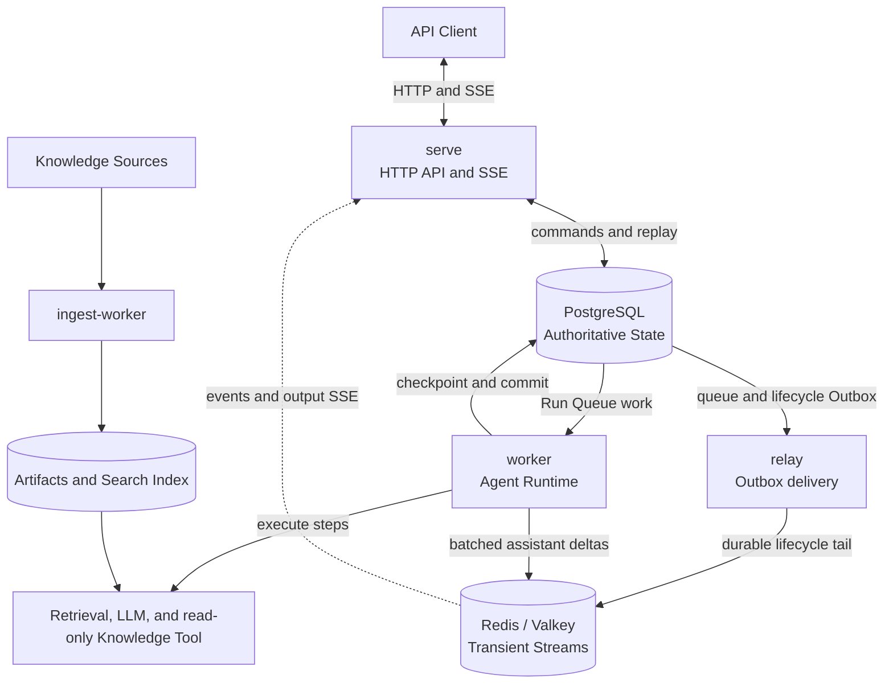
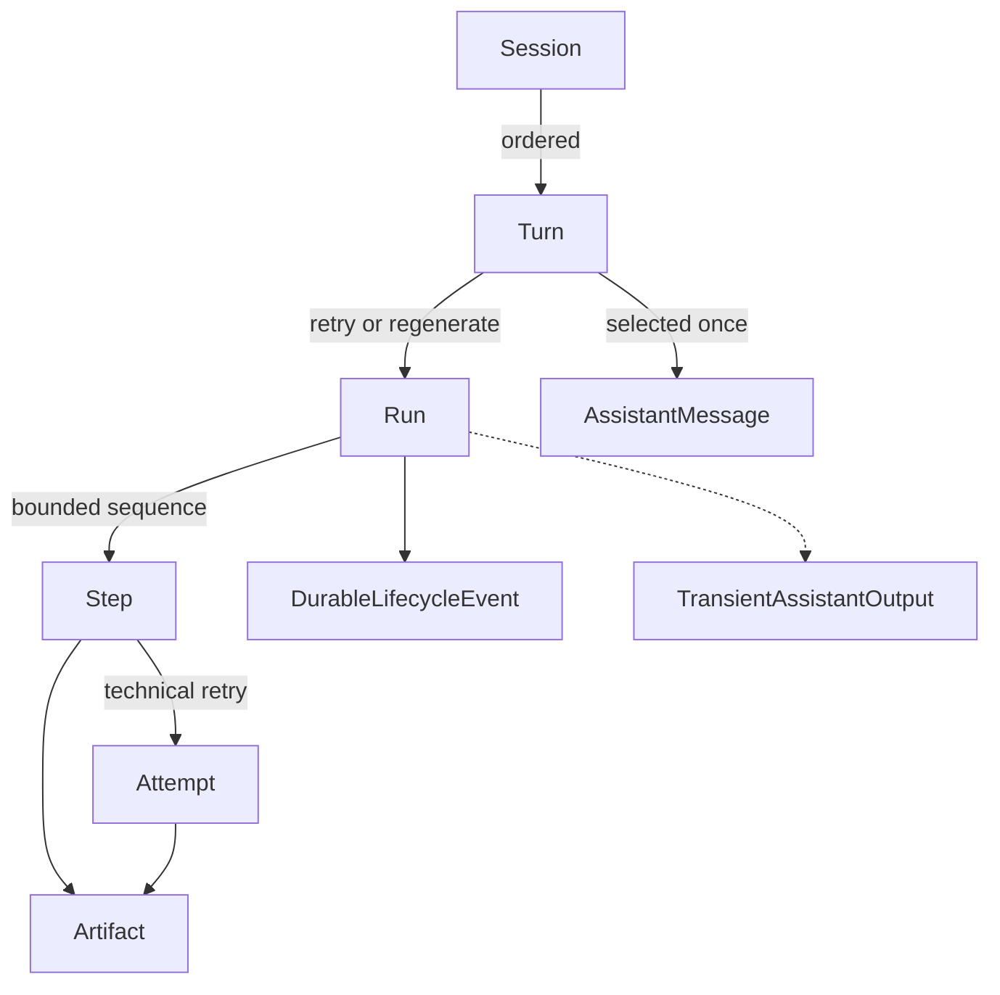
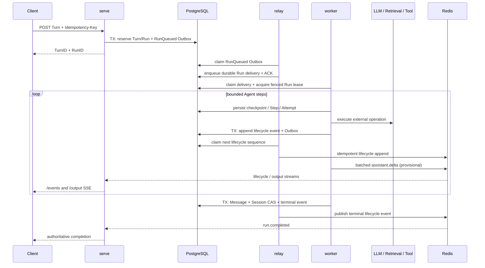

# AgenticRAG Architecture Overview

## 1. Design goals

A synchronous RAG endpoint can retrieve context, call a model, and return a response within one request. An Agentic RAG execution may instead span multiple planning, retrieval, generation, and tool steps across unreliable providers. It introduces a different set of backend problems:

- concurrent writes must not corrupt a linear conversation;
- a worker crash must not corrupt durable state or create unbounded provider replay;
- database, queue, and Redis updates must not rely on unsafe dual writes;
- an SSE client must resume without creating a new logical request;
- model output must not widen tenant, retrieval, or tool authorization;
- every Run must terminate within explicit time, step, token, tool, and cost budgets.

AgenticRAG addresses these problems by turning an execution into a durable state machine. PostgreSQL owns authoritative state. Leases, fencing, idempotency, and Transactional Outbox records govern concurrency and failure recovery. Redis, object storage, and search indexes provide replaceable acceleration or large-object storage.

## 2. System context

The main path is `Client -> serve -> PostgreSQL -> worker -> providers`.
Event delivery and knowledge ingestion are supporting paths rather than part of
the authoritative execution chain. PostgreSQL remains the system of record;
Redis and the search index can be rebuilt or bypassed without losing committed
conversation state.

### Reliable work and event delivery

The Outbox Relay routes committed delivery intents, while Worker output uses a separate transient path:

```mermaid
flowchart LR
    TX[API or Worker<br/>business transaction]
    Outbox[(PostgreSQL<br/>Transactional Outbox)]
    Relay[Outbox Relay]

    RunQueue[(PostgreSQL<br/>Run Queue)]
    Worker[Agent Worker]

    Redis[(Redis / Valkey<br/>transient streams)]
    EventSSE[Lifecycle SSE]
    OutputSSE[Output SSE]
    Client[API Client]

    TX -->|commit state and intent atomically| Outbox
    Outbox -->|claim committed record| Relay

    Relay -->|RunQueued: create durable delivery| RunQueue
    RunQueue -->|lease and claim| Worker

    Relay -->|lifecycle event: idempotent publish| Redis
    Redis -->|durable live tail| EventSSE
    EventSSE -->|/events| Client

    Worker -->|assistant.delta: best effort| Redis
    Redis -->|short-lived output| OutputSSE
    OutputSSE -->|/output| Client
```

`durable work` means a Run delivery persisted in the PostgreSQL Run Queue. A
Worker claims it under a lease; it is not an in-memory task owned by Relay.
`relay` means the Outbox delivery process: it reads only committed Outbox
records, routes `RunQueued` records to the durable Run Queue, and publishes
durable lifecycle events to Redis. Assistant deltas bypass Outbox because they
are provisional presentation data; the final Message remains authoritative.

### Infrastructure responsibilities

- **PostgreSQL** stores Session, Message, Turn, Run, Step, Attempt, queue, lease, event, Outbox, idempotency, and audit state.
- **Redis/Valkey** provides the low-latency SSE tail and transient coordination. Its availability is not a correctness requirement.
- **S3-compatible storage** holds immutable prompts, retrieval payloads, and tool outputs; PostgreSQL keeps metadata, hashes, and references.
- **Search indexes** provide hybrid and vector retrieval through a versioned port and can be rebuilt from durable knowledge identities.
- **LLM, Tool, and MCP providers** are untrusted external execution boundaries behind repository-owned interfaces.

## 3. Process topology

| Role | Responsibility | Scaling signal | Composition status |
|---|---|---|---|
| `serve` | HTTP commands, queries, authentication, and SSE | request rate and open SSE connections | complete |
| `relay` | Outbox discovery, routing, retry, and publication | Outbox backlog and publish latency | complete |
| `worker` | Run Queue consumption and Agent execution | active Runs and provider quotas | framework complete; provider adapters required |
| `ingest-worker` | parsing, chunking, embedding, and index updates | document and embedding throughput | pipeline complete; source/provider adapters required |

Separating roles prevents long provider calls from consuming API capacity, allows Relay capacity to follow backlog, and isolates online execution from offline ingestion. The tradeoff is a larger deployment surface that requires common configuration, observability, and lifecycle management.

## 4. Domain model

- **Session** is a linear conversation with a context version and a storage row version.
- **Turn** is one logical user question. Regeneration does not create another question identity.
- **Run** is one complete execution attempt. A Turn may own multiple Runs, but only one result can be committed.
- **Step** is one logical Agent action, such as retrieval, read-only knowledge lookup, or generation.
- **Attempt** is a technical retry of a Step and does not change the logical action identity.
- **Message** becomes visible in committed conversation history only through the atomic final transaction.

The MVP has no Branch entity. One Session permits at most one Active Run. A conflicting write is rejected instead of introducing implicit queueing, merge, or head-selection semantics.

## 5. Online execution flow

Durable business transitions never publish directly to a queue or Redis. A business mutation and its delivery intent commit in one PostgreSQL transaction. Relay publishes that intent after commit. Provisional assistant output is deliberately Redis-only and may be lost without affecting the final Message.

## 6. Consistency and recovery

### Authoritative and derived state

Business correctness depends on PostgreSQL. Redis streams, caches, and search indexes may expire, fail, or be rebuilt. This boundary keeps committed conversations readable during Redis failure and prevents cache availability from becoming a correctness condition.

### At-least-once delivery

Queue and Outbox delivery can repeat. Duplicate effects are constrained by:

- command idempotency keys and request fingerprints;
- stable queue delivery and tool invocation identities;
- deterministic Redis Stream IDs;
- final-commit version checks and uniqueness constraints.

This is at-least-once transport with application idempotency, not distributed exactly-once execution.

### Lease and fencing

A timeout alone cannot prevent split brain. A worker may pause long enough for its lease to expire, then resume after another worker takes over. Every takeover advances a fencing token or execution version. Critical writes carry that authority, so PostgreSQL rejects stale workers even if they resume.

### Atomic final commit

The final transaction validates Run authority, inserts the assistant Message, selects the winning Run, advances the Session context version, and appends the terminal event and its Outbox record. Any failure rolls back the complete transition.

## 7. Durable lifecycle SSE and transient output

The lifecycle SSE Gateway uses two complementary paths:

1. The client reconnects with `Last-Event-ID`.
2. The Gateway replays the missing sequence range from PostgreSQL.
3. It subscribes to the Redis Stream for low-latency events.
4. Periodic PostgreSQL high-water checks repair Redis gaps and subscription races.
5. If Redis is unavailable at startup, the Gateway falls back to PostgreSQL polling.

For a given Run, only the smallest pending `RunEvent.v1` sequence is claimable by Relay. This prevents multiple Relay replicas from publishing sequence 2 before sequence 1. Redis publication uses Lua so replaying the same sequence and payload succeeds, while reusing a sequence for different bytes fails closed.

### Transient assistant output

Raw provider fragments are not durable Run events. A Worker-side batcher accumulates assistant text and flushes when the batch reaches 512 bytes, the oldest fragment waits 75 ms, or the Worker reaches an explicit Step/final boundary. Batches are split only on UTF-8 boundaries and cannot exceed the public 8 KiB delta limit.

The flush sink publishes to a run-scoped Redis output Stream and never appends `assistant.delta` to PostgreSQL or the transactional Outbox. `/v1/runs/{run_id}/output` uses an independent short-lived Redis cursor; `/events` continues to use the durable PostgreSQL sequence. Mixing the two cursors is rejected by their endpoint-specific parsers.

If Redis or its retained output is unavailable, the Run continues. Clients fetch the current Run and, once terminal, the authoritative final Message. The product deliberately does not promise replay of every presentation delta across Redis loss; it promises durable lifecycle state and final-result recovery.

## 8. Multi-tenant security

- `tenant_id` originates from the authenticated server-side Principal.
- Repository methods, SQL identities, Redis keys, events, queue messages, and retrieval filters carry tenant scope.
- Tenant, knowledge-base, document, and ACL filters are applied before ranking.
- The Tool Registry denies by default, accepts only `READ_ONLY`, and requires
  declared schemas, capabilities, tenant scope, and limits. The composed tool is
  `knowledge.search`; mutating tools are outside the MVP.
- MCP content, search results, tool output, and model output are untrusted data and cannot alter server-injected authorization.
- Logging/redaction, metrics, and trace primitives use bounded safe fields. The
  current `serve` composition has not yet installed HTTP metrics/tracing
  middleware or a `/metrics` endpoint; deployment artifacts are not evidence
  that telemetry is already emitted.

## 9. Failure behavior

| Failure | System behavior | Correctness effect |
|---|---|---|
| Redis unavailable | lifecycle SSE uses PostgreSQL polling; transient output pauses | higher latency or missing animation frames, no final-result loss |
| Relay crash | the claim expires and another Relay retries | possible duplicate publication |
| Worker crash | queue and Run leases expire; another worker resumes the checkpoint | read-only provider work may repeat; durable writes remain fenced |
| LLM timeout or throttling | errors are classified, retried within budget, or circuit-broken | explicit delay or Run failure |
| Search unavailable | retrieval fails without bypassing ACLs or inventing evidence | reduced availability, unchanged authorization |
| SSE client disconnect | the Run continues and the client resumes from its cursor | no new Run and no implicit cancellation |

## 10. Capacity and evolution

The current baseline targets approximately 50 accepted Turns/s, 3,000 concurrent Runs, 20,000 SSE connections, and up to 50 million searchable chunks. At this scale, a PostgreSQL lease queue reduces the number of durable systems and integrates naturally with business transactions.

If sustained backlog, lock waits, connection pressure, or multi-region requirements exceed the baseline, the Queue port permits migration to an external broker. Transactional Outbox remains necessary because changing brokers does not remove the database/message dual-write problem.

## 11. Current implementation boundary

The repository implements the core mechanisms and verification suites. `serve` and `relay` have production composition roots. `worker` requires concrete LLM planning/execution and retrieval adapters; its only supported Tool Gateway capability is the read-only `knowledge.search` adapter. Provider fragments must flow through `streaming.Batcher` and flush before Step completion and Final Commit. `ingest-worker` requires an external task source plus artifact and embedding providers. Controlled providers in tests verify state-machine, delta aggregation, and failure semantics; they are not production integrations.
