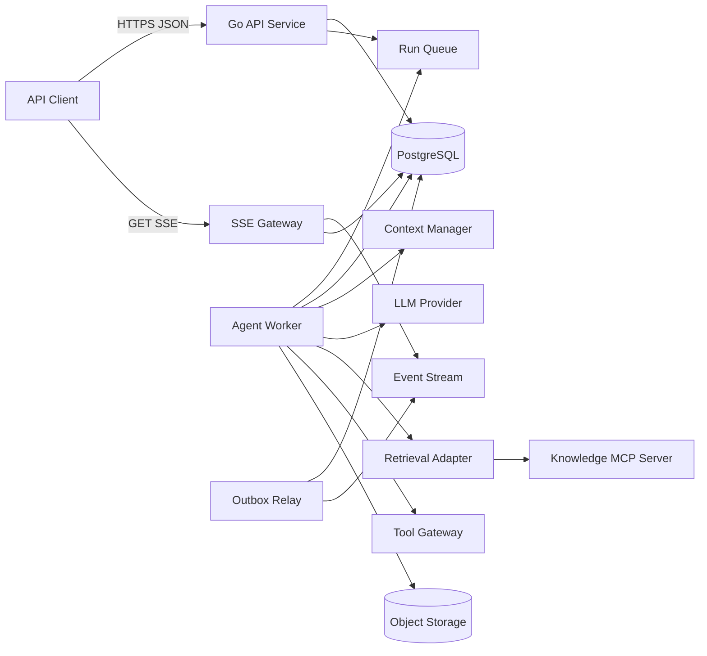

# Requirement P0-01: MVP scope and success baseline

- Status: Accepted
- Priority: P0
- Owner: Architecture
- Last reviewed: 2026-08-23
- Source: `AgenticRAG_Go_详细开发计划.xlsx`, task P0-01

## 1. Purpose

This document freezes the first open-source release boundary for AgenticRAG.
The MVP is a multi-tenant, online Agentic RAG backend implemented in Go. It
accepts a logical question, executes a bounded Agent Loop, retrieves tenant-
authorized knowledge, streams durable progress, and commits one final answer to
a linear conversation.

The baseline prevents later tasks from silently expanding the product. Any
change to a must-have capability, non-goal, or success gate requires an ADR and
an explicit plan update.

## 2. Product boundary

### 2.1 Actors

| Actor | Responsibility | Trust boundary |
|---|---|---|
| Tenant administrator | Configures tenant policies, knowledge sources and provider credentials | Authenticated control plane |
| End user | Creates sessions and submits questions | Untrusted request content |
| API client | Calls JSON APIs and consumes SSE | Untrusted network peer |
| Agent worker | Executes leased Runs and bounded Steps | Trusted workload identity |
| Knowledge MCP server | Exposes retrieval capabilities | External tool boundary; output is untrusted data |
| LLM/tool provider | Performs model or tool operations | External provider boundary |

### 2.2 System context

PostgreSQL is the final source of truth. Queue, event-stream and cache entries
are reconstructable delivery accelerators and must not be required to read the
committed conversation result.

## 3. Must-have MVP capabilities

### 3.1 Multi-tenant isolation

- Every business operation carries a trusted `tenant_id` derived from the
  authenticated principal, never from model-generated arguments.
- Persistence keys, repository methods, cache keys, events, retrieval filters
  and observability dimensions are tenant-scoped.
- A knowledge MCP call receives server-injected tenant and ACL context. Model
  output cannot widen that context.

### 3.2 Linear Session semantics

- A Session is one ordered conversation with a monotonically increasing context
  version and turn sequence.
- A Turn is one logical user question. A Turn can have multiple Run records for
  retry or regeneration, but exactly one result can be selected and committed.
- At most one Active Run may mutate a Session at a time. The MVP busy policy is
  `REJECT`: a conflicting Turn request returns a versioned conflict response.
- The MVP has no Branch entity, fork API, branch merge or parallel history head.

### 3.3 Command and streaming protocol

- `POST /v1/sessions/{session_id}/turns` validates an idempotency key, reserves a
  Turn and Run transactionally, and returns stable identifiers.
- `GET /v1/runs/{run_id}/events` is an SSE subscription endpoint. SSE is used
  only for server-to-client events; commands remain regular HTTP requests.
- Events have monotonic IDs and can be resumed with `Last-Event-ID`. A reconnect
  must not create another Turn or Run.
- Cancellation is a separate idempotent command. Client disconnect is not, by
  itself, a cancellation request.

### 3.4 Bounded Agent Loop

- A Run contains ordered Steps; a Step contains one or more execution Attempts.
- The loop may build context, decide, retrieve, invoke a tool and generate a
  final answer.
- Hard limits cover step count, wall-clock time, tokens, provider/tool calls and
  estimated cost. Limit exhaustion produces an explicit terminal reason.
- Retry occurs at Attempt scope for transient technical failure. Re-running the
  complete logical execution creates another Run under the same Turn.
- Tool calls with side effects require declared risk, idempotency semantics and,
  where policy requires it, approval.

### 3.5 RAG and knowledge MCP

- The runtime depends on a repository-owned `Retriever` contract rather than on
  a vendor SDK or MCP transport.
- Vector/search backends and a knowledge MCP server are adapters behind the same
  contract. MCP participation is supported, but MCP is not the core domain.
- Retrieval enforces tenant, knowledge-base, document and ACL filters before
  ranking. Returned text is treated as untrusted context, not instruction.
- Retrieval evidence records document/chunk/version identity and score details
  sufficient to reproduce or explain an answer.

### 3.6 Context and persistence

- Context Manager builds input from the committed linear history, a captured
  base context version, summaries, memory and the current token budget.
- Session, Message, Turn, Run, Step, Attempt, event metadata and Artifact
  references are durable.
- Large prompts, retrieval payloads and tool results are immutable Artifacts in
  object storage; PostgreSQL stores their metadata, hashes and references.
- A final assistant Message becomes visible only through an atomic final commit
  that also advances the Session context version.

### 3.7 Operability and open-source readiness

- Structured logs, traces and metrics correlate tenant-safe identifiers,
  `request_id`, `trace_id`, Session, Turn, Run, Step and Attempt.
- Configuration is explicit, validated and environment-independent. Secrets are
  never committed or emitted in logs.
- The repository supplies license, contribution, security, CI, test and release
  guidance before the first public release.

## 4. Explicit MVP non-goals

The first release does not include:

1. Branch, fork, merge or DAG conversation history;
2. more than one Active Run mutating the same Session;
3. multi-region active-active writes or transparent regional failover;
4. a visual Agent workflow builder or arbitrary user-supplied Go plugins;
5. a claim of end-to-end exactly-once delivery—business effects use at-least-once
   delivery plus idempotency and reconciliation;
6. autonomous execution of destructive tools without policy and approval;
7. model training, fine-tuning, evaluation-data labeling UI or prompt CMS;
8. billing, invoicing, marketplace or customer-facing chargeback;
9. every vector database, queue, object store or LLM provider at launch;
10. high-compliance certifications. The design preserves audit, retention and
    encryption extension points without claiming certification.

## 5. Success baseline

### 5.1 Release gates

| Dimension | MVP gate | Evidence owner |
|---|---|---|
| Scope | 100% of P0 acceptance criteria are mapped to docs, code or tests | Project lead |
| Tenant isolation | Zero successful cross-tenant access in repository, API, retrieval and tool security suites | Security |
| Linear concurrency | Under a same-Session race, no more than one Active Run is accepted and no context update is lost | Backend |
| Idempotency | Repeating a command with the same tenant/key/fingerprint returns the original result; a different fingerprint conflicts | Backend |
| Recovery | A worker crash or SSE reconnect does not duplicate the logical Turn or selected final Message | Backend/SRE |
| Agent safety | Every Run terminates within configured step/time/token/tool/cost limits | Backend |
| RAG evidence | Every cited result resolves to tenant-authorized document, chunk and version metadata | Search |
| Quality | Required CI, unit, integration, concurrency, security and end-to-end gates pass with no P0/P1 defect open | QA |
| Open source | License, provenance, contribution, security and reproducible build checks pass | Maintainers |

Numerical latency, availability, capacity and error-budget targets are not
invented here. P0-02 establishes workload assumptions and P0-03 derives SLOs
from them. Until those tasks are accepted, performance numbers are hypotheses,
not release promises.

### 5.2 Required demonstration

The MVP release candidate must demonstrate this uninterrupted scenario:

1. Tenant A creates a Session and submits a Turn with an idempotency key.
2. A worker builds context, retrieves through the knowledge MCP adapter, records
   evidence, performs a bounded Agent Loop and streams durable SSE events.
3. The client disconnects and resumes with `Last-Event-ID` without duplication.
4. The final Message is committed once and is readable from PostgreSQL even if
   Redis/event delivery is unavailable.
5. Tenant B cannot read the Session, Run, events, Artifacts or retrieval evidence.
6. A concurrent Turn against the busy Session receives the documented conflict.

## 6. Traceability

| Baseline decision | Downstream plan tasks |
|---|---|
| Linear Session and single Active Run | P2-01, P2-04, P3-04, P8-04 |
| POST command plus resumable GET SSE | P3-04, P3-06, P3-07, P8-06 |
| Run/Step/Attempt and bounded loop | P4-03, P4-06, P4-09, P8-03 |
| Knowledge MCP behind Retriever | P5-04, P6-01, P6-02, P8-05 |
| PostgreSQL final truth and durable artifacts | P2-02, P2-08, P4-10, P7-04 |
| Tenant isolation everywhere | P0-04, P1-02, P5-06, P8-08 |

## 7. Acceptance checklist

- [x] Linear Session semantics are explicit.
- [x] Same-Session concurrency is limited to one Active Run with `REJECT` policy.
- [x] Agent Loop, RAG and knowledge MCP participation are in scope.
- [x] Command/SSE responsibilities and reconnect behavior are explicit.
- [x] Branch is an explicit non-goal.
- [x] Success gates are measurable and mapped to later implementation tasks.
- [x] Capacity and SLO numbers are deferred to their owning tasks.

## 8. Change control

Changing any checked acceptance item requires a superseding ADR. Additive detail
that stays inside this boundary may update this requirement through normal review.
If implementation pressure conflicts with the baseline, the plan is changed
first; code must not silently redefine product semantics.
