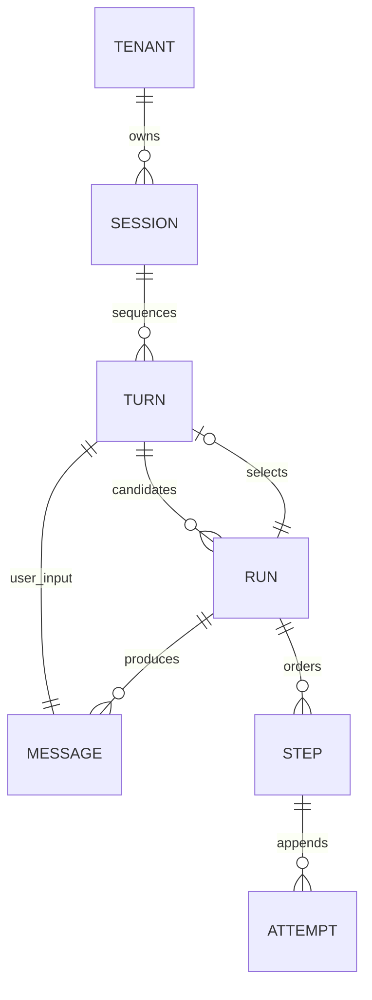

# Requirement P2-01: Core domain aggregates and state machines

- Status: Implemented
- Priority: P0
- Owner: Backend
- Last reviewed: 2026-08-23
- Depends on: [P0 API contract](../api/0005-domain-and-api-contract.md), [P1-01 Go foundation](0007-go-project-foundation.md)
- Source: `AgenticRAG_Go_详细开发计划.xlsx`, task P2-01

## 1. Objective

Implement the database-independent domain vocabulary for Tenant, Session, Turn,
Message, Run, Step and Attempt. The package is the only place allowed to decide
whether an execution-state transition is legal. It deliberately does not model
Branch: an MVP Session is one linear conversation with at most one active Run.

## 2. Aggregate boundaries

- Tenant is the mandatory isolation owner. Every aggregate carries a typed
  `TenantID`; cross-tenant composition is rejected before persistence.
- Session owns `context_version`, `row_version`, turn sequencing, committed head
  and the single `active_run_id`. It performs version check before busy check.
- Turn is one logical question. It owns exactly one user Message and one or more
  Run candidates; regeneration appends a Run and never rewrites history.
- Run is one complete Agent execution candidate. Step is one logical ordered
  action. Attempt is one append-only physical try of that Step.
- Message is durable content metadata. Assistant streaming deltas are events,
  not Message mutations; only candidate visibility may be promoted at commit.

ToolCall, RetrievalResult and Artifact are intentionally deferred to their
planned tasks. Their future attachment point is Attempt, while large payloads
remain immutable Artifacts rather than fields added to these aggregates.

## 3. Value objects and construction

Resource identifiers are distinct Go types (`TenantID`, `SessionID`, etc.), so
an ID from one aggregate cannot accidentally be supplied as another. A valid ID
uses its required prefix, is 8–128 characters, and otherwise contains only
ASCII letters, digits, `_` or `-`. Zero IDs are never valid.

All entity fields are private. Constructors validate required IDs, ownership,
positive sequence numbers, UTC-normalize timestamps and defensively copy text.
Read methods return values or copied slices. Persistence code will use validated
restore constructors rather than setting fields directly.

Domain failures are typed as `ValidationError` or `TransitionError`. They expose
stable sentinel identities through `errors.Is`, contain no HTTP/SQL/provider
types, and leave the aggregate unchanged when an operation fails. Application
boundaries translate them to the public `apperror` registry.

## 4. Session concurrency invariants

`ReserveTurnRun(expectedContextVersion, runID)` applies the frozen decision order:

1. compare expected and committed context versions;
2. reject a non-empty active Run;
3. reserve the next non-reusable turn sequence;
4. set the active Run and increment `row_version`.

`CommitRun` succeeds only for the active Run, its owned candidate assistant
Message, the reserved sequence, and a Turn in the same tenant. After validating
every participant it promotes the Message, completes/selects the Turn/Run,
advances `context_version` once, replaces the head, clears the active Run and
increments `row_version`.
`ReleaseRun` clears a failed/cancelled/timed-out active Run without changing
conversation context. Repository CAS remains required: the in-memory checks do
not replace `WHERE row_version = ?` at persistence time.

`ReserveRegeneration` atomically reopens the committed head Turn, appends its
next Run and reserves Session ownership at the current context version without
consuming `next_turn_sequence`. This distinction prevents regeneration from
masquerading as a new logical question or leaving Session/Turn half-reserved.

## 5. State machines

| Aggregate | Legal transitions | Terminal rule |
|---|---|---|
| Turn | `RUNNING -> COMPLETED/FAILED/CANCELLED`; terminal -> `RUNNING` only through explicit regeneration/retry | Prior Runs and Messages remain unchanged |
| Run | `QUEUED -> RUNNING/CANCELLED/TIMED_OUT`; `RUNNING -> CANCEL_REQUESTED/SUCCEEDED/FAILED/TIMED_OUT`; `CANCEL_REQUESTED -> CANCELLED`; `SUCCEEDED -> SELECTED/SUPERSEDED` | Selected, superseded, failed, cancelled and timed out are terminal |
| Step | `PENDING -> RUNNING/SKIPPED`; `RUNNING -> SUCCEEDED/FAILED/CANCELLED` | No transition after a terminal state |
| Attempt | `STARTED -> SUCCEEDED/FAILED/UNKNOWN` | Every outcome is immutable; retry appends another Attempt |
| Message visibility | `CANDIDATE -> CONVERSATION` for a completed assistant Message | Content and identity never change |

Run success requires its candidate assistant Message ID. Selection cannot occur
before success. Step attempts must be appended in contiguous order beginning at
one, have unique IDs, and belong to the same tenant and Step.

## 6. Persistence independence

`internal/domain` imports only the Go standard library. It has no struct tags,
driver values, nullable SQL wrappers, repository interfaces or serialization
concerns. A source-level architecture test enforces that the package does not
import `database/sql`, pgx, Redis, transport or `internal/platform` packages.

## 7. Test strategy

- Exhaustive table matrices cover every legal and illegal Turn, Run, Step and
  Attempt transition, including terminal immutability.
- Session tests cover stale-version precedence, single-active-Run exclusion,
  monotonically increasing sequence/version counters, commit and release.
- Relationship tests cover cross-tenant IDs, wrong parents, duplicate IDs,
  discontinuous Run/Step/Attempt numbers and invalid selected candidates.
- Message tests cover role/visibility combinations and one-way promotion.
- Defensive-copy tests prove callers cannot mutate aggregate collections.
- Architecture tests parse imports and prevent database/platform coupling.

## 8. Acceptance criteria

- [x] Tenant, Session, Turn, Message, Run, Step and Attempt are typed aggregates.
- [x] Illegal state transitions fail without partially mutating state.
- [x] One Turn may own multiple Runs without introducing Branch.
- [x] Session concurrency/version invariants are explicit and testable.
- [x] Domain code is independent from database and transport types.
- [x] Table-driven and state-transition tests cover all transition edges.
