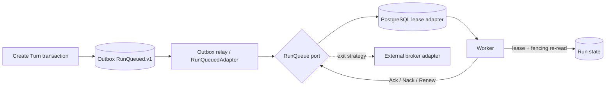
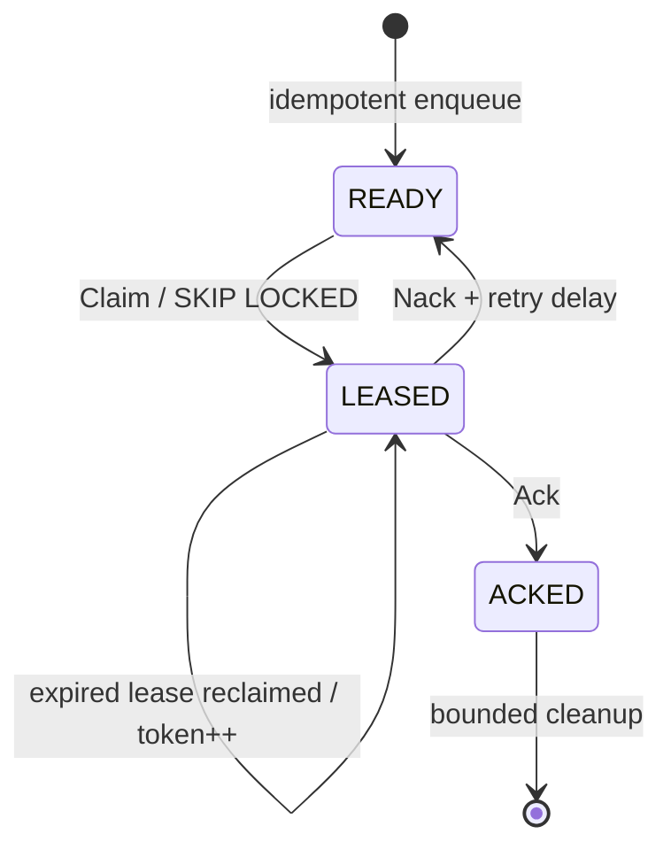

# Requirement P4-01: Replaceable At-Least-Once RunQueue Adapter

- Status: Implemented
- Priority: P0
- Owner: Backend
- Last reviewed: 2026-08-23
- Depends on: P2-07 transactional outbox
- Source: `AgenticRAG_Go_详细开发计划.xlsx`, task P4-01

## 1. Decision and boundary

`internal/queue.RunQueue` is the application port. The reference adapter is a
PostgreSQL visibility-lease queue; workers and Agent code do not depend on SQL,
Kafka, NATS, SQS or vendor acknowledgement types. `RunQueued.v1` transactional
outbox delivery is adapted into one immutable queue envelope. PostgreSQL Run
state remains authoritative; queue presence never proves execution state.

The outbox event ID is the delivery ID. `(tenant_id, run_id)` is unique, so relay
replay is idempotent. Reusing that identity with different Session/Turn/payload
or trace context is a conflict, not an overwrite.

## 2. Envelope and partition

The immutable `Message` contains delivery ID, tenant, Session, Turn, Run,
schema-versioned payload, `traceparent`, optional `tracestate`, availability and
creation timestamps. No credential, prompt, tool output or secret is carried.

The logical partition is `(tenant_id, session_id)`. Claim SQL rejects a later
message while an earlier ready/leased message in that partition is unacknowledged.
The linear Session invariant normally creates only one active Run, but the queue
still enforces ordering during replay and repair.

W3C trace context is immutable queue metadata. Canonical version-00
`traceparent` is validated (lowercase hex, non-zero trace/span IDs); bounded
`tracestate` rejects controls/newlines. Empty context is allowed only for legacy
outbox events and means the worker starts a new trace. Request IDs are not
propagated as distributed trace identity.

## 3. At-least-once state machine

Claim increments `delivery_count` and monotonic `lease_token`. Ack, Nack and
Renew require tenant, Run, owner and exact token while the lease is unexpired.
After takeover, stale mutations return `ErrFenced`. A process crash before Ack
causes redelivery; therefore worker execution is idempotent/fenced and the queue
does not promise exactly once.

## 4. Claim algorithm and fairness

`ReadyTenants` performs a bounded scan of tenants with an unblocked claimable
partition head; it does not lease work. Claims are tenant-scoped. In one statement:

1. choose READY or expired LEASED rows whose `available_at <= now`;
2. exclude a row with an earlier unacknowledged message in the same Session;
3. order by availability, creation and Run ID;
4. lock a bounded batch using `FOR UPDATE SKIP LOCKED`;
5. set owner, expiry, increment token/count, return immutable envelopes.

The worker scheduler supplies tenant fairness above this adapter. Claim limit is
1..100 and visibility timeout is 5 seconds..5 minutes. Empty polling uses the
P4-02 jitter/backoff loop rather than a busy loop.

## 5. Capacity and lifecycle

Default hard bounds follow the capacity baseline: 250 pending per tenant and
6,000 globally. Enqueue obtains one transaction-scoped advisory capacity lock,
counts only READY/LEASED rows, then inserts. Exact replay bypasses a full queue;
new work returns `ErrTenantCapacity` or `ErrGlobalCapacity`. This check is a
safety bound, not the later P7 admission/fairness policy.

ACKED rows retain envelope/audit metadata until bounded cleanup. Cleanup is
tenant-scoped, cutoff-based and limited to 1,000 rows per call. Payload is capped
at 64 KiB and queue indexes cover ready claims, expired leases and cleanup.

## 6. Failure and migration semantics

- Publish succeeds only after durable queue insertion; then the outbox relay may Ack.
- Publish failure leaves Outbox pending for retry.
- Duplicate relay delivery returns success only for byte-equivalent identity.
- Worker Ack loss intentionally redelivers after lease expiry.
- Queue message tenant/Run is always re-read from PostgreSQL before execution.
- External broker migration dual-publishes one delivery ID, compares lag,
  switches consumers by partition and drains the PostgreSQL adapter.

## 7. Test strategy and acceptance

- contract tests run against the adapter port;
- PostgreSQL Testcontainers covers concurrent `SKIP LOCKED` claims, Session
  ordering, expired redelivery, stale-token fencing, tenant isolation and cleanup;
- capacity tests concurrently enqueue beyond tenant/global bounds;
- adapter tests parse current `RunQueued.v1`, preserve trace context and reject
  tenant/identity mismatch;
- CI runs race detection and mandatory Docker integration on Linux.

## 8. Acceptance checklist

- [x] `RunQueue` has no vendor types and PostgreSQL is one replaceable adapter.
- [x] Tenant+Session partition ordering is enforced.
- [x] Trace context survives HTTP-to-Outbox-to-worker delivery.
- [x] Lease expiry redelivers and stale Ack/Nack/Renew is fenced.
- [x] Capacity and tenant isolation tests are checked into mandatory CI.
