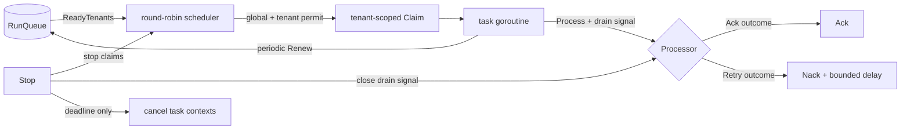
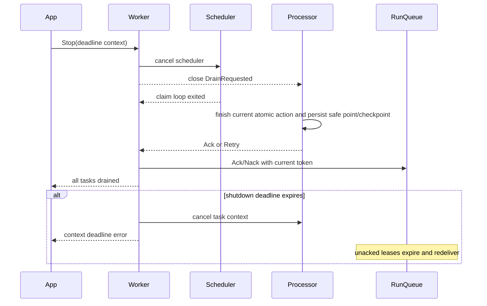

# Requirement P4-02: Bounded Agent Worker and Graceful Drain

- Status: Implemented
- Priority: P0
- Owner: Backend
- Last reviewed: 2026-08-23
- Depends on: P2-06 execution repository, P4-01 RunQueue
- Source: `AgenticRAG_Go_详细开发计划.xlsx`, task P4-02

## 1. Objective and boundary

The Worker owns dispatch, process-local concurrency, queue visibility renewal and
graceful lifecycle. It deliberately does not implement the Agent loop: a
replaceable `Processor` receives one fenced delivery and must return at a durable
safe point. PostgreSQL Run state remains authoritative; queue delivery alone is
never execution authority.

## 2. Scheduling and concurrency invariants

`ReadyTenants` returns only tenants with currently claimable work. The scheduler
rotates the returned list between polls so a hot tenant cannot permanently occupy
the first position. A delivery is launched only after reserving both counters:

- global active tasks are at most `MaxConcurrency`;
- active tasks for one tenant are at most `MaxConcurrencyPerTenant`;
- permits are reserved before `Claim` and unused permits are immediately released;
- claimed work that cannot be launched during a stop race is Nacked, never lost.

These are hard process-instance limits. Cross-instance fairness remains an
admission/control-plane concern; queue leasing prevents duplicate ownership.

## 3. Delivery lifecycle and at-least-once behavior

Each task receives the immutable queue envelope and a `DrainRequested` channel.
The Processor returns an explicit Ack or Retry disposition. Retry delay and safe
reason are validated and bounded before the Worker starts. Panics are recovered
at the task boundary and converted to a generic retry; panic values and payloads
are not logged.

While processing, the Worker renews the visibility lease before expiry. A renew
failure cancels that task context and suppresses Ack/Nack because ownership is no
longer provable; lease expiry then causes redelivery. Ack/Nack failure is logged
and likewise relies on at-least-once redelivery. Processors must therefore use
the Run repository lease token/version for every durable side effect.

## 4. Graceful shutdown protocol

`Start` and `Stop` are idempotence-safe lifecycle operations: double start is an
error, stop-before-start permanently stops the instance, and repeated stop is a
no-op. Graceful stop never cancels admitted work until its supplied deadline.

## 5. Observability and configuration

Structured lifecycle/task logs contain worker, tenant, Session, Turn, Run,
delivery count and trace ID derived from `traceparent`; they never contain queue
payloads or trace state. `Snapshot` exposes state, active/global peak, per-tenant
active counts, claims, completed/retried/fenced/panicked counts and live
goroutines for tests and later metrics export.

Configuration includes global/per-tenant concurrency, polling interval, queue
lease duration, renew interval and retry delay. Validation requires renew to be
strictly shorter than the lease and per-tenant concurrency not to exceed global.

## 6. Test strategy

- deterministic fake queue tests enforce global and per-tenant peak limits;
- stop tests prove no post-drain claims and that admitted work observes the drain
  signal before Stop returns;
- deadline tests prove forced context cancellation and no Worker-owned goroutine
  remains after a cooperative Processor exits;
- lease tests cover renewal, lost authority, Ack, Nack and panic recovery;
- PostgreSQL queue integration remains mandatory in Linux CI, with race detection.

## 7. Acceptance checklist

- [x] Global and per-tenant concurrency are hard bounded.
- [x] Stop prevents new claims and drains admitted tasks at safe points.
- [x] Visibility is renewed and loss of authority suppresses stale settlement.
- [x] Goroutine lifecycle and outcome counters are observable and tested.
