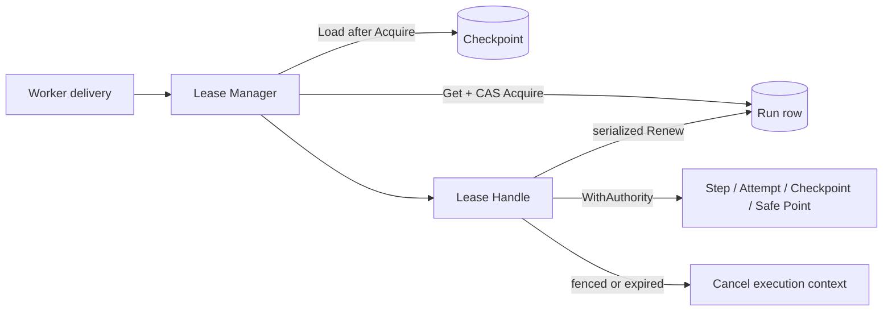
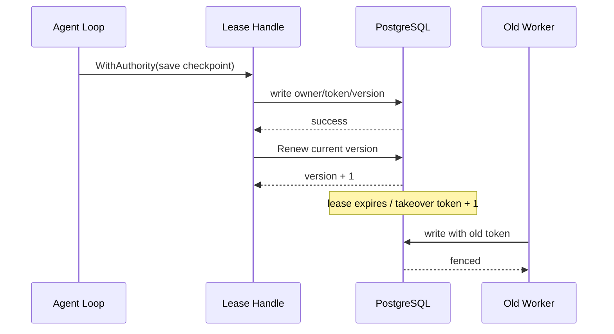

# Requirement P4-03: Run Lease Manager, Renewal and Checkpoint Takeover

- Status: Implemented
- Priority: P0
- Owner: Backend
- Last reviewed: 2026-08-23
- Depends on: P2-06 execution repository, P4-02 Agent Worker
- Source: `AgenticRAG_Go_详细开发计划.xlsx`, task P4-03

## 1. Objective and authority boundary

`internal/runlease` turns the repository's PostgreSQL CAS primitives into one
execution-scoped lease handle. PostgreSQL is the authority; Redis and process
memory are never execution locks. A handle owns exactly one `(tenant, Run,
owner, token)` generation and exposes a context cancelled when authority is
lost.

Queue delivery ownership and Run execution ownership remain independent. A
Worker must obtain this Run lease after queue delivery and before any Agent side
effect.

## 2. Acquire and takeover

Acquire first reads the tenant-scoped Run to obtain its current
`execution_version`, then performs repository CAS acquisition. A missing or
unexpired foreign lease is not overwritten. On success PostgreSQL increments:

- `lease_token`, defining a new execution generation;
- `execution_version`, fencing cached control state;
- `lease_expires_at`, defining bounded authority.

Only after successful acquisition does the manager load the latest Checkpoint.
The checkpoint may carry an older lease token: that is expected during takeover
and proves it was committed by a prior valid generation. The new handle resumes
from its `step_no` and payload but uses only the new token for future writes. If
checkpoint loading fails unexpectedly, acquisition is released best-effort and
the operation fails instead of starting without known recovery state.

## 3. Renewal and serialized mutations

A dedicated heartbeat renews before expiry. Renew requires exact owner, token
and current execution version, and returns the incremented version. Fenced,
expired or CAS-conflicted renewal permanently marks the handle lost and cancels
its execution context.

Renew and version-sensitive database writes must not race inside one process.
`WithAuthority` serializes short durable operations with renewal and supplies the
current `repository.WorkerAuthority`. The callback returns the execution version
after its mutation: child/history writes return the unchanged version; a Run
control or safe-point mutation returns its new version. Slow LLM, retrieval and
Tool calls must occur outside this critical section.

## 4. Close and failure semantics

Graceful `Close` stops heartbeat, serializes behind an in-flight durable
operation and releases the current lease using exact authority. It is
idempotent. Parent-context cancellation is a forced stop: the handle cancels
execution and leaves the lease to expire, avoiding an unsafe release concurrent
with an interrupted operation.

After loss or close, `WithAuthority` rejects all new mutations. Release failure
is returned, while stale authority still cannot write because repository
predicates include owner, token, version and expiry.

## 5. Time, observability and test strategy

Clock and ticker are injected behind small interfaces. Tests advance time
without sleeping and deterministically cover acquisition races, repeated renew,
expiry takeover, parent cancellation and close. Snapshot exposes owner, token,
version, expiry, state and loss cause without checkpoint payloads.

PostgreSQL integration inherited from P2-06 proves single-winner CAS, token
takeover, stale-write rejection and checkpoint fencing. P4-03 tests add manager
lifecycle and prove a new generation receives the last durable checkpoint.
Linux CI runs the combined suite with mandatory Docker and race detection.

## 6. Acceptance checklist

- [x] Only one contender acquires a current Run generation.
- [x] Renewal and durable writes share a current serialized execution version.
- [x] Old owner/token cannot commit after expiry takeover.
- [x] Takeover resumes from the latest durable Checkpoint.
- [x] Lease loss cancels execution and graceful close releases idempotently.
