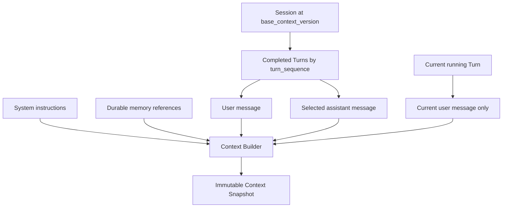

# Requirement P4-04: Immutable Linear Session Context Builder

- Status: Implemented
- Priority: P0
- Owner: Backend
- Last reviewed: 2026-08-23
- Depends on: P2-05 conversation repository, P2-08 Artifact Store
- Source: `AgenticRAG_Go_详细开发计划.xlsx`, task P4-04

## 1. Boundary and consistency point

The Context Builder creates one immutable input snapshot for a Run. There is no
Branch model. The request identifies tenant, Session, current Turn, Run and the
Run's `base_context_version`. A repeatable-read transaction verifies that:

- the Session belongs to the tenant;
- Session `context_version` exactly equals the requested base version;
- Session `active_run_id` is the requested Run;
- the current Turn belongs to that Session and Run context.

This equality check is intentional: a Context Snapshot is built only while the
Run still owns the linear Session head. The system does not attempt an unreliable
historical reconstruction after later commits.

## 2. Included conversation data

Historical input contains only `COMPLETED` Turns. For each completed Turn the
query selects exactly its durable user message and the assistant message owned
by `selected_run_id`; candidate, internal, failed, cancelled and running content
is excluded. The current running Turn is the sole exception: only its immutable
user message is included because it is the question being answered.

## 3. Trust and priority lanes

Priority is metadata for P4-05 token budgeting, not permission to reorder a
conversation arbitrarily. The fixed trust/retention order is:

1. system instructions — trusted policy, never supplied by retrieved content;
2. current user message — the active task;
3. recent completed conversation history;
4. curated durable memory;
5. RAG evidence — untrusted quoted evidence added later by retrieval.

RAG content can never become a system instruction. Tool output and raw
retrieval results are not conversation history; they enter later as bounded,
source-labelled evidence or Artifact references.

## 4. Immutability and determinism

The Snapshot stores private slices and byte/string copies. Accessors return
copies, so caller mutation cannot alter the built value. Entries have stable
source, role, tenant/Session/Turn/Run identity, sequence and content. Ordering is
deterministic: system input order, completed Turn sequence with user before
selected assistant, memory input order, then current user.

A SHA-256 digest over the canonical snapshot contract supports tests, audit and
later prompt-cache keys. The digest is not a security signature and excludes
mutable runtime budgets.

## 5. Failure semantics

- missing tenant-scoped Session/Turn returns not found without cross-tenant leak;
- stale base version or wrong active Run returns fenced/version conflict;
- malformed, duplicate or incomplete completed-turn rows fail closed;
- empty/oversized external instruction or memory inputs are rejected;
- the builder never silently includes a candidate assistant response.

## 6. Test strategy and acceptance

Snapshot tests fix canonical ordering and digest. Repository scripted and
Testcontainers tests include running/failed/cancelled Turns, multiple Run
candidates and a selected assistant, proving only completed selected history is
read. Mutation tests modify every caller/result slice and require the Snapshot
and digest to remain unchanged. Concurrent Session commit versus repeatable-read
construction must produce either one coherent old snapshot or a version conflict.

## 7. Acceptance checklist

- [x] Snapshot is fenced by exact `base_context_version` and active Run.
- [x] History contains only completed Turns and selected assistant messages.
- [x] Current Turn contributes only its user message.
- [x] Priority/trust lanes prevent RAG or Tool content becoming system policy.
- [x] Snapshot ordering, digest and accessors are deterministic and immutable.
