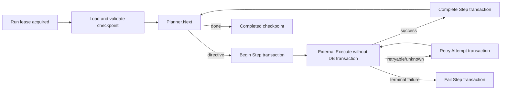

# Requirement P4-06: Recoverable Agent Run/Step State Machine

- Status: Implemented
- Priority: P0
- Owner: Backend
- Last reviewed: 2026-08-23
- Depends on: P2-01 domain state machines, P4-03 fenced Run lease
- Source: `AgenticRAG_Go_详细开发计划.xlsx`, task P4-06

## 1. Objective and boundaries

`internal/agent` coordinates a bounded sequence of logical Steps for one leased
Run. A Step is a logical action; an Attempt is one physical invocation of that
action. A retry therefore appends an Attempt to the same Step and retains one
stable operation key. The machine never opens a database transaction around a
planner, LLM, retrieval or Tool call.



The P4-06 machine owns orchestration state only. Provider adaptation is P4-07,
prompt assembly is P4-08, policy guards are P4-09 and final Run/Turn selection
is P4-10. Existing domain Run/Step/Attempt transition rules remain authoritative.

## 2. Durable checkpoint

Checkpoint schema version 1 records:

- phase: `READY`, `EXECUTING`, `COMPLETED` or `FAILED`;
- `next_step_no`, bounded by the persisted Run `max_steps`;
- opaque planner state, defensively copied JSON;
- while executing: Step/Attempt IDs and numbers, kind, stable operation key,
  input, and their expected row versions;
- after failure: a bounded, non-sensitive failure class rather than raw provider
  response or prompt content.

Every checkpoint is JSON-validated, size-bounded by the repository and checked
against the acquired Run. Unknown schema versions, impossible phases, invalid
IDs, non-positive versions or a step beyond `max_steps` fail closed.

## 3. Transaction and CAS protocol

Each Store method below is one PostgreSQL transaction, executed inside
`runlease.Handle.WithAuthority`:

| Operation | Atomic writes |
|---|---|
| Begin Step | insert PENDING Step; CAS to RUNNING; insert STARTED Attempt 1; save EXECUTING checkpoint |
| Retry Attempt | CAS prior STARTED Attempt to FAILED/UNKNOWN; insert next STARTED Attempt; replace EXECUTING checkpoint |
| Complete Step | CAS Attempt to SUCCEEDED; CAS Step to SUCCEEDED; save READY checkpoint with next state |
| Fail Step | CAS Attempt to FAILED/UNKNOWN; CAS Step to FAILED; save FAILED checkpoint |
| Complete loop | save COMPLETED checkpoint without an external call |

All writes include tenant ID, Run ID, lease owner, fencing token, execution
version, lease expiry and child row version. A transaction rollback leaves both
state and checkpoint unchanged. Heartbeat renewal and mutations are serialized
by the lease handle.

```mermaid
sequenceDiagram
    participant A as Agent Machine
    participant H as Lease Handle
    participant DB as PostgreSQL
    participant E as External Executor
    A->>H: WithAuthority(BeginStep)
    H->>DB: BEGIN; Step RUNNING + Attempt STARTED + checkpoint; COMMIT
    A->>E: Execute(operation_key, input)
    Note over A,E: no database transaction is open
    E-->>A: outcome
    A->>H: WithAuthority(CompleteStep)
    H->>DB: BEGIN; Attempt SUCCEEDED + Step SUCCEEDED + next checkpoint; COMMIT
```

## 4. Crash, takeover and retry semantics

An `EXECUTING` checkpoint means the previous worker may have called the
external system. On takeover, its STARTED Attempt is atomically marked UNKNOWN
and a new Attempt is appended to the same Step. The executor receives the same
operation key, so retry-capable providers/tools must deduplicate it. If a
directive forbids unknown-outcome retry, the machine records a terminal failed
Step and returns `ErrUnknownOutcome` for reconciliation.

Ordinary retryable errors mark the current Attempt FAILED and append the next
Attempt until `max_attempts`. Non-retryable errors or exhaustion fail the Step.
Lease loss cancels the external call context and prevents every subsequent
commit; a late response from an old worker is rejected by fencing predicates.

## 5. Limits and validation

- `max_steps` is the persisted Run value (1..20); the machine cannot override it.
- `max_attempts` is configuration (1..5) and counts physical invocations.
- operation keys are stable printable values and inputs/state must be valid JSON.
- planner completion is durable, so redelivery returns the same result without
  repeating external work.
- panics from planner/executor are not converted to success; worker recovery
  leaves the EXECUTING checkpoint available for takeover.

## 6. Test strategy

Table/state tests cover clean completion, multiple Steps, ordinary retry,
unknown takeover retry, unsafe unknown outcome, non-retryable failure, attempt
exhaustion, max-step enforcement and malformed checkpoints. Fault injection at
every transaction boundary proves no external call occurs before Begin commits,
no checkpoint advances on rollback, and no transaction spans Execute. CAS and
fencing errors must stop the machine immediately.

## 7. Acceptance checklist

- [x] Step and Attempt transitions follow the domain state machines.
- [x] Every durable boundary atomically includes its checkpoint.
- [x] External calls execute with no database transaction held.
- [x] Takeover converts abandoned work to UNKNOWN and resumes safely.
- [x] Retries append Attempts to one logical Step using one operation key.
- [x] Step and Attempt row versions plus Run fencing authority are enforced.
- [x] Step/Attempt limits and malformed checkpoint data fail closed.
