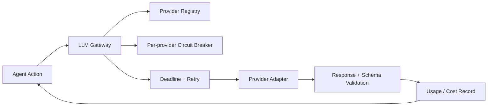

# Requirement P4-07: Provider-Neutral LLM Gateway

- Status: Implemented
- Priority: P0
- Owner: Backend
- Last reviewed: 2026-08-23
- Depends on: P1-04 error model, P2-08 Artifact metadata
- Source: `AgenticRAG_Go_详细开发计划.xlsx`, task P4-07

## 1. Boundary and objective

`internal/llm` is the only package that exposes model invocation semantics to
the application. Provider SDK request/response/error types stay inside future
adapters. The Gateway accepts canonical messages, exact provider/model IDs, a
stable operation key and an optional structured-output contract, then returns a
normalized response, usage, cost and attempt count.

## 2. Canonical contract

The Provider interface receives only `llm.Request`: canonical roles/content,
exact model ID, positive output limit, stable operation key and JSON schema.
It returns normalized text/structured JSON, finish reason and token usage. A
Provider must return a typed `ProviderError`; unknown errors are treated as
non-retryable adapter defects rather than guessed from strings or HTTP text.

Registry keys and response model IDs are exact, trimmed values. Unknown
providers/models fail before circuit admission or a network call. Provider
adapters may translate SDK types internally, but those types cannot appear in
`internal/agent`, domain entities or checkpoint schema.

## 3. Timeout and retry policy

Every physical attempt receives its own deadline, bounded by the caller's
earlier deadline. Retries occur only for explicitly typed `RATE_LIMITED`,
`TIMEOUT` or `UNAVAILABLE` errors. Authentication, invalid request, safety
rejection, malformed structured output and unknown adapter errors are never
retried.

Delay uses overflow-safe exponential backoff capped by configuration and full
jitter. A valid provider `retry_after` is a lower bound but remains capped.
Caller cancellation interrupts both an attempt and a backoff immediately.
`max_attempts` counts all billable physical calls and is bounded to 1..5.

## 4. Circuit breaker

One concurrent-safe breaker protects each provider, preventing one failing
upstream from consuming all worker capacity:

```mermaid
stateDiagram-v2
    [*] --> CLOSED
    CLOSED --> OPEN: consecutive call failures >= threshold
    OPEN --> OPEN: cooldown not elapsed
    OPEN --> HALF_OPEN: cooldown elapsed; one probe admitted
    HALF_OPEN --> CLOSED: valid response
    HALF_OPEN --> OPEN: relevant failure
```

The breaker observes the final logical-call outcome after internal retries.
Timeout, unavailable, rate limit and malformed provider responses are relevant.
Caller cancellation and local validation errors do not poison provider health.
Exactly one half-open probe is admitted; other callers fail fast.

## 5. Structured output and accounting

When a response schema is supplied, the provider result must contain exactly
one valid JSON value and pass the injected schema validator before success.
Unstructured text is rejected for that request. Finish reason and usage shape
are always validated; token counts are non-negative and total tokens must equal
input plus output.

Pricing is registered by exact `(provider, model)` in integer nanocurrency per
million tokens. Cost calculation uses checked integer arithmetic and rounds up,
avoiding floating-point billing drift. Every logical call emits one immutable
record containing provider/model, attempts, elapsed time, success/failure kind,
usage and calculated cost. Recorder behavior is non-blocking and cannot cause a
second billable invocation; the successful response also carries the same
accounting fields for durable persistence by later orchestration work.

## 6. Test strategy

Fake Provider tests cover successful text and structured calls, schema failure,
unknown provider/model, exact retry classification, backoff/cancellation,
attempt timeout, response/usage validation and cost rounding. Deterministic
clock/random/sleeper tests cover breaker threshold, open rejection, one
half-open probe under concurrency, recovery and re-open. Repetition tests assert
attempt limits and immutable request/response/record slices.

## 7. Acceptance checklist

- [x] Provider SDK types do not leak through the Gateway contract.
- [x] Every attempt has a deadline and caller cancellation is preserved.
- [x] Only explicitly retryable Provider errors are retried.
- [x] Circuit breaker is concurrency-safe and admits one half-open probe.
- [x] Structured output, finish reason and usage are validated before success.
- [x] Exact model pricing produces overflow-safe Token/cost accounting.
- [x] Each admitted logical call emits one immutable usage record.
