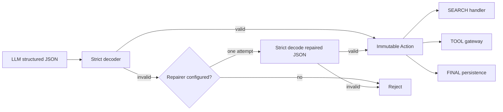

# Requirement P4-08: Strict Agent Action Protocol

- Status: Implemented
- Priority: P0
- Owner: Backend
- Last reviewed: 2026-08-23
- Depends on: P4-07 LLM Gateway
- Source: `AgenticRAG_Go_详细开发计划.xlsx`, task P4-08

## 1. Objective

`internal/agent/action` is the trust boundary between structured model output
and executable Agent behavior. It defines a versioned, strict discriminated
union with exactly one of `SEARCH`, `TOOL` or `FINAL`. The parser returns only a
validated immutable Action; raw model output is never part of the result.

## 2. Wire contract

All Actions contain:

- `schema_version: 1`;
- `type: SEARCH | TOOL | FINAL`;
- `reason_code`: stable uppercase machine code, never free-form reasoning;
- exactly one payload whose name matches the discriminator.

`SEARCH` contains query, bounded `top_k`, unique knowledge-base IDs and an
optional JSON-object filter. `TOOL` contains a canonical dotted tool name and
JSON-object arguments. `FINAL` contains the user-visible answer and unique
Artifact citation IDs.

The exported JSON Schema uses `oneOf`, `const` discriminators,
`additionalProperties: false`, field sizes/patterns and exact payload
requirements. The package validator implements the LLM Gateway's structured
validator contract and still runs the semantic parser after schema generation;
JSON Schema is guidance and boundary validation, not a substitute for semantic
checks.

## 3. No hidden chain-of-thought persistence

Free-form `reason`, `analysis`, `thought`, `thinking`, `chain_of_thought` and
provider-specific reasoning fields are not in the schema and are rejected as
unknown. Only `reason_code` crosses the boundary. Parser errors contain stable
failure categories and never quote raw output, prompts, Tool arguments or
answers. The returned Action has no raw-response field.

Application persistence may store the validated Action, `reason_code`, timing
and usage metadata. It must not store rejected/repaired raw output. Logs may
record only failure category and trace identifiers.

## 4. Repair protocol

Repair is optional and bounded to exactly one invocation. The Repairer receives
the invalid bytes plus a stable failure code in memory, and returns replacement
bytes. The replacement goes through the identical strict decoder; it cannot
bypass validation. Parser Result exposes only `Repaired: true`, not original or
replacement raw JSON. Repair errors are wrapped without embedding model bytes.

No repair is attempted for oversized input or caller cancellation. This avoids
amplification and prevents work after Run fencing/cancellation.

## 5. Validation and limits

- raw and repaired documents are at most 1 MiB and contain exactly one JSON value;
- query is 1..8 KiB, `top_k` is 1..100, knowledge-base IDs are unique;
- Tool name is lowercase dotted canonical form; arguments must be a JSON object;
- final answer is 1..1 MiB; citation Artifact IDs are valid and unique;
- filters/arguments are size bounded and defensively copied;
- unknown fields, wrong payload/discriminator combinations and JSON `null` fail.

## 6. Test strategy

Contract tests cover all three variants, schema-copy immutability, Gateway
validator integration, one-shot repair, repair failure and sensitive-field
rejection. Table tests cover every field boundary, duplicate IDs, non-object
JSON and union ambiguity. Go fuzz tests feed arbitrary bytes into strict decode
and assert it never panics, never returns an invalid Action and never includes
input bytes in error text.

## 7. Acceptance checklist

- [x] SEARCH, TOOL and FINAL form an exact versioned discriminated union.
- [x] Unknown/ambiguous/oversized Action data fails closed.
- [x] Only stable `reason_code`, never free-form chain-of-thought, is accepted.
- [x] Optional repair executes at most once and cannot bypass validation.
- [x] Parser errors/results do not retain or disclose raw model output.
- [x] Exported schema and semantic validator integrate with LLM Gateway.
- [x] Fuzz and boundary tests prove panic-free strict parsing.
