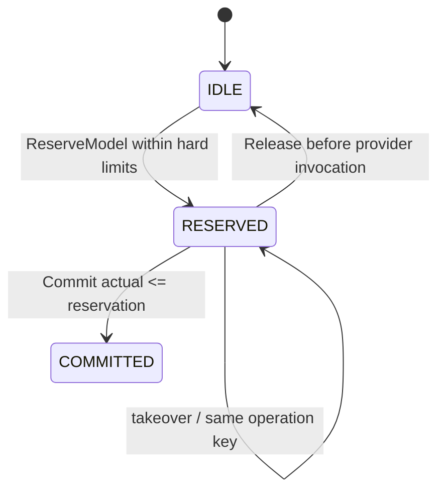

# Requirement P4-09: Durable Agent Execution Budgets and Loop Detection

- Status: Implemented
- Priority: P0
- Owner: Backend
- Last reviewed: 2026-08-23
- Depends on: P4-06 Agent state machine, P4-08 Action protocol
- Source: `AgenticRAG_Go_详细开发计划.xlsx`, task P4-09

## 1. Objective and invariant

`internal/agent/budget` implements a checkpointable immutable Ledger for one
Run. Step, wall-clock, model Token, Tool-call and cost budgets are hard limits:
the controller returns `COMPLETED_WITH_LIMIT` before an operation whose reserved
worst case could exceed any configured limit.

```text
committed_tokens + outstanding_reserved_tokens <= max_tokens
committed_cost   + outstanding_reserved_cost   <= max_cost
steps <= max_steps; tool_calls <= max_tool_calls
```

Limit completion is a controlled Agent outcome, not an infrastructure failure.
The existing domain Run is finalized by P4-10; P4-09 returns a stable limit
reason for that transaction and for SSE/audit metadata.

## 2. Pre-call reservation and post-call settlement

Model calls use a two-phase budget protocol:

1. `ReserveModel` checks time and reserves known prompt tokens, maximum output
   tokens and a checked worst-case cost under the stable operation key.
2. The reservation is checkpointed with the EXECUTING Attempt before calling
   the LLM Gateway.
3. `CommitModel` requires the same operation key and actual usage/cost no larger
   than the reservation, then atomically moves reserved amounts to committed.
4. `ReleaseModel` is allowed only when the caller knows no provider invocation
   occurred (for example, Begin transaction rollback).

Repeated reserve with the same operation key is idempotent, enabling takeover
to reuse the durable reservation. A different operation cannot begin while one
reservation is outstanding. Arithmetic is checked before addition; overflow
fails closed.



## 3. Action admission

`AdmitAction` executes after model settlement and before Step/external action
execution. It checks wall time, next Step count, next Tool count and loop rules,
then returns a new Ledger with the counters/fingerprint appended. A rejected
Action leaves the Ledger unchanged and returns `COMPLETED_WITH_LIMIT`.

Action fingerprints exclude `reason_code`, so changing superficial rationale
cannot evade detection. Canonical JSON normalizes property order. The controller
detects:

- more than the configured consecutive identical executable Actions;
- repeated multi-action suffix cycles such as `A,B,A,B,A,B` within a bounded
  checkpoint history window.

FINAL is counted as a Step but not a Tool call. Time is checked at or after the
absolute deadline and before every reservation/admission/check operation.

## 4. Durable Ledger

Snapshot schema version 1 stores UTC start time, committed counters, bounded
fingerprint history and optional model reservation. Restore validates every
counter against Limits, operation-key shape, reservation arithmetic, history
digest format and deadline consistency. Slices and snapshots are defensively
copied. Unknown schema versions and corrupt/over-budget checkpoints fail closed.

Stable completion reasons are `MAX_STEPS`, `MAX_DURATION`, `MAX_TOKENS`,
`MAX_TOOL_CALLS`, `MAX_COST` and `ACTION_LOOP`. No prompt, answer, Tool arguments
or raw model output is included in decisions.

## 5. Test strategy

Boundary tables cover exact fit and one-unit overflow for every counter,
idempotent reserve, mismatched settlement, release, arithmetic overflow,
deadline equality and corrupt Restore. Action tests prove reason-code-independent
consecutive and alternating-cycle detection. Deterministic randomized/property
tests generate thousands of reservations, settlements and Actions and assert
every returned Ledger satisfies all hard invariants and rejected operations do
not mutate prior state.

## 6. Acceptance checklist

- [x] Step, duration, Token, Tool and cost hard limits are checked pre-call.
- [x] Model reservation/settlement is idempotent and never exceeds a hard limit.
- [x] Exact limit fits; one-unit overflow returns `COMPLETED_WITH_LIMIT`.
- [x] Consecutive identical and bounded repeating Action cycles are detected.
- [x] Action fingerprint ignores `reason_code` but includes executable payload.
- [x] Ledger snapshot/restore is immutable and rejects corrupt state.
- [x] Property tests prove every successful state remains within all limits.
