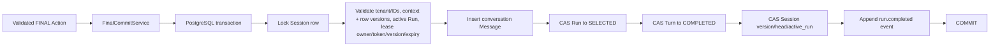

# Requirement P4-10: Fenced Atomic Final Commit

- Status: Complete
- Priority: P0
- Owner: Backend
- Last reviewed: 2026-08-23
- Depends on: P3-04 Create Turn, P4-06 Agent state machine, P4-07 LLM Gateway
- Source: `AgenticRAG_Go_详细开发计划.xlsx`, task P4-10

## 1. Objective and source of truth

`internal/turn.FinalCommitService` and the PostgreSQL adapter publish one final
Agent answer. PostgreSQL is the only final-state authority. The Assistant
Message, selected Run, completed Turn, advanced Session and durable
`run.completed` event either commit together or all roll back.



## 2. Command and authority

The command contains tenant/session/Turn/Run IDs, stable Message ID, final
content, expected Session context version and row version, current Run lease
owner/token/execution version, occurrence time and event retention. Message ID
comes from the durable Agent checkpoint and is reused after redelivery; it is
not generated inside a retrying transaction.

Normal commit requires all of the following at the same locked snapshot:

- Session identity, exact context/row versions and `active_run_id`;
- Turn identity, RUNNING status, sequence ownership and base context version;
- Run identity, current base version and QUEUED/RUNNING/SUCCEEDED status;
- exact unexpired lease owner, fencing token and execution version.

Run may still be QUEUED when older pipeline components have not emitted the
optional start transition. The final CAS accepts QUEUED/RUNNING/SUCCEEDED and
publishes SELECTED directly; the durable result is the same and the lease proof
is repeated in that SQL statement.

## 3. Aggregate and SQL transitions

The transaction locks a joined Session/Turn/Run snapshot and applies the same
invariants as `Session.CommitRun` through explicit PostgreSQL CAS transitions:

- Message is inserted once as COMPLETED/ASSISTANT/CONVERSATION;
- Run becomes SELECTED with `output_message_id`;
- Turn becomes COMPLETED with `selected_run_id`;
- Session increments context and row versions, advances committed sequence/head
  and clears `active_run_id`;
- `run.completed` event is appended using the same transaction.

For head regeneration, the previous selected Run becomes SUPERSEDED and its
old answer visibility becomes CANDIDATE before the new selection is published.
This prevents conversation listing and context reconstruction from exposing two
answers for one logical Turn.

## 4. Idempotency, fencing and concurrency

The Session row is locked first, serializing final commits for that Session.
After waiting, a contender reloads current state. An exact existing tuple
`(Turn selected Run, Run output Message, Message content)` is an idempotent
replay even if the lease was subsequently released. A different Message ID,
content or selected Run is a conflict and can never overwrite the answer.

Every normal SQL mutation repeats tenant/identity/version/lease predicates.
Lease expiry or takeover makes the old worker fail before Message insertion;
even a late provider response cannot publish. Row/context version changes and a
different active Run are separately classified for safe retry/audit behavior.

```mermaid
sequenceDiagram
    participant O as Old Worker token 7
    participant N as New Worker token 8
    participant DB as PostgreSQL
    N->>DB: lock + final commit token 8
    DB-->>N: COMMIT selected answer B
    O->>DB: lock + final commit token 7 / answer A
    DB-->>O: fenced/conflict; zero writes
    O->>DB: exact retry of already selected B
    DB-->>O: idempotent replay; zero writes
```

## 5. Failures and observability

Errors contain stable invalid/not-found/version/fenced/conflict categories and
never include answer content. Event retention is 1 hour..30 days. Transaction
errors are returned without claiming completion; queue redelivery reloads
PostgreSQL. Redis/SSE delivery state cannot alter the final answer.

## 6. Test strategy

Service tests cover validation and store-error mapping. Transaction-level fault
injection after all participant writes but before COMMIT proves rollback leaves
Message/Run/Turn/Session/event unchanged. A checked-in Testcontainers test races
identical commands and asserts one selected message, one context increment and
one completion event. Authority-table tests cover stale owner/token/version and
expiry, plus new-Turn and regeneration version rules. Exact replay succeeds
without a second event; conflicting replay is rejected.

## 7. Acceptance checklist

- [x] Message, Run, Turn, Session and completion event commit atomically.
- [x] Tenant, identity, context/row version and lease fencing are all checked.
- [x] Old/expired/taken-over workers cannot insert or overwrite the answer.
- [x] Exact redelivery is idempotent and emits no duplicate event.
- [x] Regeneration supersedes/demotes the previous selected answer atomically.
- [x] Fault injection and concurrent contenders prove one final winner.
- [x] PostgreSQL, not Redis or process state, determines the final result.
