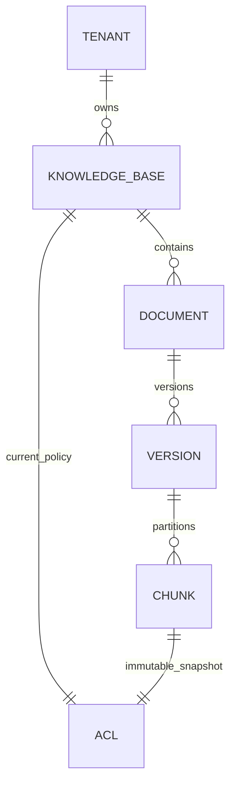

# Requirement P5-01: Multi-tenant Knowledge Domain

- Status: Complete
- Priority: P0
- Owner: Go Backend
- Last reviewed: 2026-08-23
- Depends on: P0-04 Security, P2-01 Core domain model
- Source: `AgenticRAG_Go_详细开发计划.xlsx`, task P5-01

## 1. Objective

Define persistence-independent `KnowledgeBase`, `Document`, `Version`, `Chunk`
and `ACL` models for ingestion and retrieval. Every object carries an explicit
tenant owner. A Chunk additionally embeds the complete lineage, immutable
content hash and an ACL snapshot so a retrieval result can be authorized
without an unsafe cross-table or cross-cluster fallback.

## 2. Aggregate boundaries and identity

- Typed IDs use `kbs_`, `doc_`, `ver_`, and `chk_`; they are never accepted as
  interchangeable strings inside constructors.
- KnowledgeBase owns display name, lifecycle and monotonically increasing ACL
  revision. It does not own document payload bytes.
- Document identifies one logical source inside a KnowledgeBase. Source key is
  unique only within the parent and does not contain credentials or raw URLs.
- Version is an immutable source generation with an append-only state machine:
  `PENDING -> PROCESSING -> READY/FAILED`; READY may later become SUPERSEDED.
- Chunk is immutable and belongs to exactly one tenant/KB/document/version. Its
  positive ordinal, token count, content, SHA-256 and ACL snapshot are fixed at
  construction.

## 3. ACL semantics

ACL is a tenant-local, default-deny value object. Entries use USER, GROUP or
ROLE principals and grant READ, WRITE or ADMIN. Permissions are hierarchical:
ADMIN implies WRITE and READ; WRITE implies READ. Entries are canonicalized by
principal type and ID, duplicate principals are rejected, caller slices are
defensively copied, and at least one grant is required.

The ACL revision is positive. A KnowledgeBase may replace its ACL only with the
same tenant and exactly the next revision. A Chunk stores the ACL revision and
entries used when it was produced. Later ACL changes require an explicit
re-authorization/reindex workflow; a query must never silently substitute a
newer or foreign policy for the indexed snapshot.

## 4. Hash and lineage invariants

Chunk content is non-blank UTF-8 and bounded to 1 MiB. SHA-256 is calculated
from the exact UTF-8 bytes retained in the Chunk; callers cannot supply a hash
that disagrees with content. All five tenant IDs and all parent IDs must match
before construction. Version READY state is required for publishable Chunks.
Empty/zero identifiers, zero ordinal/token count, duplicate Chunk ordinal and
cross-tenant/parent composition are rejected without mutation.

## 5. Test strategy

- table tests cover ID, text, time, lineage and content/hash boundaries;
- exhaustive Version transition tests cover every state pair and terminal
  immutability;
- ACL tests cover default deny, permission implication, canonical order,
  duplicate rejection and defensive copies;
- randomized property tests create tenant/parent mismatches and verify none can
  produce a Chunk;
- hash tests mutate one content byte and require a different digest.

## 6. Acceptance checklist

- [x] Every entity is tenant-scoped and has a typed identity.
- [x] Every Chunk contains KB, Document, Version, ACL revision and SHA-256.
- [x] Cross-tenant and mismatched lineage construction is impossible.
- [x] ACL is canonical, default-deny and defensively immutable.
- [x] Version lifecycle rejects illegal and terminal transitions.
- [x] Package contains no SQL, vector database or transport dependencies.
