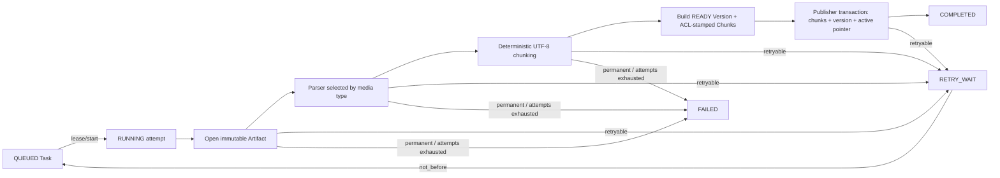

# Requirement P5-02: Retry-safe Asynchronous Ingestion Pipeline

- Status: Complete
- Priority: P1
- Owner: Go Backend
- Last reviewed: 2026-08-23
- Depends on: P5-01 Knowledge domain, P2-08 Artifact Store
- Source: `AgenticRAG_Go_详细开发计划.xlsx`, task P5-02

## 1. Objective

Turn one immutable uploaded Artifact into a parsed Document Version and bounded
Chunks. Processing may be redelivered or retried, but readers see either the
previous READY version or the complete new version—never partial chunks.

## 2. Contracts

- `Source` returns a closeable stream plus trusted media type, byte size and
  SHA-256 from Artifact metadata. The pipeline always closes it.
- `Parser` is selected through a bounded media-type registry. Parsers return
  normalized logical text, never storage handles or executable markup.
- `Chunker` is replaceable. The initial rune-safe fixed-window implementation
  validates UTF-8, size and overlap, produces stable ordering, and delegates
  token accounting to an injected counter.
- `Publisher.Publish` is the sole write boundary. Its implementation must insert
  the Version and every Chunk, supersede the old READY version and change the
  active pointer in one database transaction. The pipeline never publishes
  incrementally.

## 3. Retry and idempotency

Task state is QUEUED, RUNNING, RETRY_WAIT, COMPLETED or FAILED. Each Start
increments attempt and row version. Retry requires a safe reason code and
positive delay; `Ready` moves RETRY_WAIT back to QUEUED only after `not_before`.
Terminal Tasks cannot reopen. Maximum attempts are fixed at construction.

Version and Chunk IDs are supplied durably in the command or derived
deterministically from `(VersionID, ordinal)`. Publisher treats the same
publication digest as replay and rejects different content for the same IDs.
No random identity is generated in a retrying publish transaction.

## 4. Failure isolation and security

Parser errors, oversize/invalid UTF-8 output, chunk/token failures, premature
EOF, source close errors and publisher failures cannot change the active
version. Error records contain safe reason codes only; source content and
credentials are never copied into errors. Chunk ACL must exactly equal the
current KnowledgeBase ACL snapshot. Tenant and complete lineage are revalidated
by the knowledge constructors.

## 5. Test strategy

Fixture tests cover plain text and Markdown-like inputs, Unicode rune boundaries
and deterministic overlap. Failure injection covers source open/read/close,
unknown media type, parser, token counter and publisher. Retry tests prove
attempt bounds, backoff gates and terminal immutability. An atomic fake catalog
proves failed publication retains the previous live version and successful
redelivery switches it exactly once without duplicate chunks.

## 6. Acceptance checklist

- [x] Artifact upload output can feed an extensible parser registry.
- [x] Parsing and chunking are bounded, deterministic and UTF-8 safe.
- [x] Tasks retry only retryable failures within attempt budget.
- [x] Version activation and all Chunks publish through one atomic call.
- [x] Failures never expose a partial or new active index version.
- [x] Redelivery is idempotent and terminal Tasks cannot reopen.
