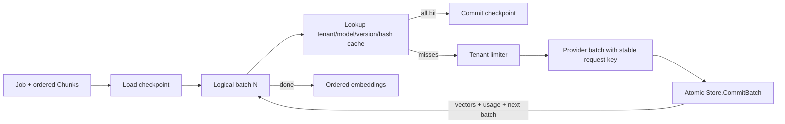

# Requirement P5-03: Recoverable Embedding Pipeline

- Status: Complete
- Priority: P0
- Owner: Go Backend
- Last reviewed: 2026-08-23
- Depends on: P5-02 Ingestion, P4-07 Provider Gateway
- Source: `AgenticRAG_Go_详细开发计划.xlsx`, task P5-03

## 1. Objective

Embed ordered Chunks in configurable batches with tenant-safe caching, admission
control, immutable model provenance, durable progress and idempotent usage/cost
records. A failed job resumes at its first uncommitted logical batch.

## 2. Invariants

- Cache identity is `(tenant, model, model_version, content_sha256)`; Chunk ID is
  deliberately excluded so identical content may reuse a vector without
  crossing tenant or model boundaries.
- Input text must reproduce its declared SHA-256. Provider output count,
  dimension and every finite float are validated before persistence.
- Batch size is configurable 1..256. Provider receives only cache misses and a
  stable idempotency key derived from job ID and logical batch number.
- Tenant limiter admission occurs before every provider call and counts missing
  inputs, not cache hits.
- Durable Store atomically writes vectors, one idempotent usage/cost record and
  next-batch checkpoint. PostgreSQL implementations must use one transaction.
- Model name/version and provider request ID are present in every vector and
  usage record. Token and cost values are nonnegative and bounded integers.

## 3. Recovery semantics

Logical batches never change across retries. A crash before CommitBatch leaves
the checkpoint unchanged and repeats the same provider idempotency key. A crash
after commit resumes at the next batch. CommitBatch replay with identical data
is a no-op; conflicting data is rejected. Final assembly reloads every vector
through the same scoped keys and preserves Chunk input order.

## 4. Test strategy

Fake Provider integration tests assert batch boundaries, stable request keys,
cache-hit suppression, tenant/model-version isolation, limiter calls and exact
usage totals. Failure injection at provider and atomic store boundaries proves
resume starts from the durable checkpoint. Invalid hash, vector count,
dimension, NaN/Inf and overflow are rejected without advancing progress.

## 5. Acceptance checklist

- [x] Batch size is configurable and provider calls contain only cache misses.
- [x] Cache keys isolate tenant, model and model version.
- [x] Stable provider request IDs and checkpoints make failures resumable.
- [x] Vector provenance, token usage and cost are durably traceable.
- [x] Invalid provider output cannot enter the cache or advance progress.
