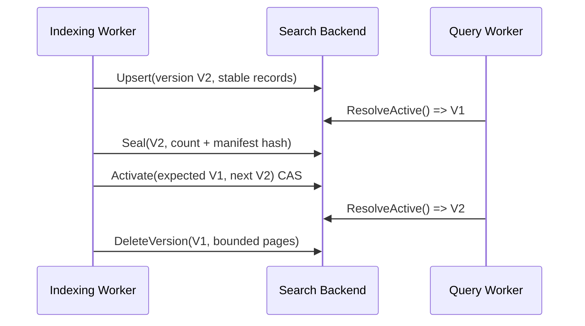

# Requirement P5-04: Versioned Search Index Adapter

- Status: Complete
- Priority: P0
- Owner: Go Backend
- Last reviewed: 2026-08-23
- Depends on: P5-01 Knowledge domain, P5-03 Embedding pipeline
- Source: `AgenticRAG_Go_详细开发计划.xlsx`, task P5-04

## 1. Objective

Define a vendor-neutral write/delete port for hybrid vector and BM25 documents.
Index construction is isolated from visibility: a complete immutable Version is
staged and sealed before one CAS activation changes what queries may read.

## 2. Indexed record and scope

Every record contains tenant, KnowledgeBase, Document, Version and Chunk IDs,
content SHA-256, text for BM25, finite embedding vector with model/version, ACL
snapshot revision and canonical ACL grants. The adapter validates full lineage
and never infers tenant from an index name. Scope is the immutable tuple
`(tenant, knowledge_base, version)`.

Upsert is idempotent by `(scope, chunk_id)`: identical canonical records replay;
different content/vector/ACL under an existing key is a conflict. Batches are
bounded to 1..500. The API does not expose vendor index names, aliases, query
DSL, HTTP clients or provider error bodies.

## 3. Seal and activation

Seal accepts expected record count and a manifest SHA-256 calculated from
sorted `(chunk_id, record_digest)` pairs. It succeeds only when staged storage
exactly matches the manifest and then makes that generation immutable.
Activation requires a sealed nonempty generation and performs compare-and-swap
against the caller's expected active Version. The old version remains readable
until CAS commits; staged and failed generations are never returned by active
resolution. Exact activation replay is successful.

## 4. Deletion

Deletion addresses an explicit non-active Version and removes at most the
configured limit, returning an opaque continuation cursor and deleted count.
Active generations cannot be deleted. Repeating the final page is a no-op.
This bounded contract maps to provider bulk APIs without loading all IDs into
memory or allowing a tenant-wide wildcard delete.

## 5. Reference adapter and tests

An in-memory concurrency-safe reference adapter specifies semantics used by
vendor contract tests. Tests cover identical/conflicting upserts, manifest
sealing, two concurrent activations with one winner, readers observing only old
or new complete generations, tenant isolation, active-delete rejection and
multi-page idempotent deletion. Vendor adapters must pass the same suite plus
their container integration tests.

## 6. Acceptance checklist

- [x] Vector/BM25 records carry tenant, lineage, ACL and model provenance.
- [x] Upsert replay is idempotent and conflicting overwrite is rejected.
- [x] Seal verifies exact count and canonical manifest digest.
- [x] CAS activation exposes only complete versions without dirty reads.
- [x] Explicit non-active versions support bounded batch deletion.
- [x] Vendor-specific details remain behind the adapter contract.
