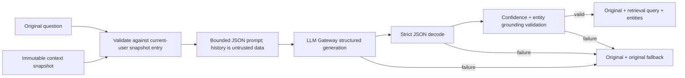

# Requirement P5-05: Session-aware Query Rewriter

- Status: Complete
- Priority: P1
- Owner: Go Backend
- Last reviewed: 2026-08-23
- Depends on: P4-04 Context Snapshot, P4-07 LLM Gateway
- Source: `AgenticRAG_Go_详细开发计划.xlsx`, task P5-05

## 1. Objective

Produce a retrieval-only query that resolves conversational references while
preserving the user's original question as an immutable, separately auditable
field. Rewriting is an optional optimization: any provider, schema, confidence
or grounding failure returns the original question.

## 2. Safety and contract

The request carries the frozen Context Snapshot and original question. The
current-user entry must exactly equal the original, preventing callers from
rewriting a different question against a Session. Only bounded HISTORY and
CURRENT_USER entries are serialized as JSON data; they are explicitly labeled
untrusted and cannot change system instructions.

Provider output is the strict object `{query, resolved_entities, confidence}`.
Unknown fields, trailing JSON, blank/oversized/control-character queries,
duplicate or oversized entities and confidence outside 0..1 are rejected.
Every reported resolved entity must appear verbatim, case-insensitively, in the
frozen context. No chain-of-thought or rationale field is accepted or stored.

## 3. Fallback and observability

Confidence below the configured threshold, timeout, circuit open, safety stop,
invalid schema or ungrounded entity returns the exact original query with a
safe reason code. The original is never mutated. Results expose `Rewritten`
and `Fallback` independently so an identical but valid rewrite is distinguishable
from provider failure. Provider operation key is stable from Run and snapshot
digest, making retries traceable through the LLM Gateway.

## 4. Test strategy

A Golden Set covers pronouns, omitted products and follow-up constraints in
Chinese and English. Additional tests cover original/snapshot mismatch, prompt
injection strings, provider failure, malformed/extra/trailing JSON, low
confidence, invented entities, duplicate entities and size limits. Every
failure case must return byte-identical original text.

## 5. Acceptance checklist

- [x] Original question and retrieval query are separate immutable values.
- [x] Entity references can be completed from the frozen Session context.
- [x] Structured output rejects CoT/unknown fields and ungrounded entities.
- [x] Every provider or validation failure safely falls back to the original.
- [x] Golden Set covers representative Chinese and English follow-ups.
