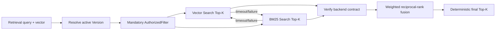

# Requirement P5-06: Authorization-first Hybrid Retriever

- Status: Complete
- Priority: P0
- Owner: Go Backend
- Last reviewed: 2026-08-23
- Depends on: P5-04 Search Index Adapter, P5-05 Query Rewriter
- Source: `AgenticRAG_Go_详细开发计划.xlsx`, task P5-06

## 1. Objective

Run vector and BM25 retrieval concurrently against the same active immutable
index Version, with tenant, KnowledgeBase, metadata and ACL applied inside each
backend query before ranking and Top-K. Fuse authorized candidates
deterministically and degrade to one route when the other times out or fails.

## 2. Authorization boundary

`AuthorizedFilter` always contains tenant, KnowledgeBase, resolved active
Version, at least one tenant-local USER/GROUP/ROLE principal, and bounded
metadata equality predicates. Search ports do not expose an unfiltered method.
Each backend must apply this filter before scoring and limiting.

Returned candidates repeat tenant, KB, Version and ACL. The orchestrator checks
the contract defensively. A mismatched scope or ACL that grants none of the
request principals is a backend violation: that entire route fails and its
candidates are discarded. They are never post-filtered and backfilled, which
would make unauthorized documents consume Top-K slots and leak rank signals.

## 3. Concurrency, fusion and degradation

Both routes receive independent bounded child deadlines and the same frozen
filter. Weighted reciprocal-rank fusion deduplicates by Chunk ID, retains route
scores/ranks for explanation, and sorts by fused score then Chunk ID. Candidate
count and numeric scores are bounded and finite.

One successful route is sufficient and marks the result degraded with a safe
route reason. Parent cancellation stops both and is returned. If both routes
fail, retrieval fails. Empty successful routes are valid; two empty routes
return an empty non-degraded result.

## 4. Test strategy

Integration fakes assert both calls received identical mandatory filters before
Top-K. Tests cover tenant/Version/ACL violations, one-route timeout and failure,
both-route failure, parent cancellation, duplicate fusion, stable tie ordering,
metadata bounds and input immutability. A slow fake proves cancellation does not
leak goroutines.

## 5. Acceptance checklist

- [x] Tenant, active Version, metadata and ACL are mandatory backend filters.
- [x] Unauthorized backend candidates fail a route rather than post-filtering.
- [x] Vector and BM25 execute concurrently with bounded independent deadlines.
- [x] One failed route degrades safely; two failed routes fail retrieval.
- [x] Fusion is deterministic, deduplicated and explainable.
