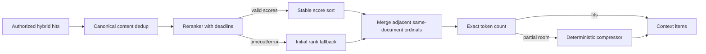

# Requirement P5-07: Stable Rerank and Context Compression

- Status: Complete
- Priority: P0
- Owner: Go Backend
- Last reviewed: 2026-08-23
- Depends on: P5-06 Hybrid Retriever
- Source: `AgenticRAG_Go_详细开发计划.xlsx`, task P5-07

## 1. Objective

Transform authorized hybrid candidates into a compact, stable, citation-ready
context: remove repeated content, optionally rerank under a deadline, merge
adjacent source chunks, and fit the result to an exact token budget.

## 2. Invariants

Candidates carry tenant, Document/Chunk IDs, positive source ordinal, content
and initial rank. Canonical dedup collapses Unicode whitespace and case for the
digest but preserves the highest-ranked original content. Duplicate Chunk IDs
or invalid lineage fail input validation.

The Reranker receives defensive copies and must return exactly one finite score
per candidate. Its independent deadline is bounded. Invalid output, timeout or
error falls back to initial order with a safe flag; it never fails retrieval.
Valid scores sort descending, then initial rank, then Chunk ID.

Only consecutive reranked items from the same Document with adjacent source
ordinals merge. Their contents join with a newline and all source Chunk IDs are
retained for citations. This avoids inventing adjacency across missing chunks.

## 3. Token budget and compression

An injected exact TokenCounter evaluates merged content. Whole items are added
in ranked order. When the next item exceeds remaining budget, a deterministic
Compressor may produce bounded content; its output is recounted and accepted
only when nonblank and within the remainder. Processing then stops, preventing
lower-ranked content from bypassing a truncated higher-ranked item. Total
reported tokens can never exceed the configured budget.

## 4. Test strategy

Golden Set tests cover rerank movement, normalized duplicate removal, stable
ties, adjacent/non-adjacent merge and citation IDs. Failure tests cover timeout,
wrong score count, NaN, counter/compressor errors and over-budget compressor
output. Property tests generate random token sizes and assert the budget. A Go
benchmark tracks allocation and latency for 100 candidates.

## 5. Acceptance checklist

- [x] Rerank order is deterministic and invalid/slow rerank falls back safely.
- [x] Repeated normalized content is removed before provider work.
- [x] Only genuine adjacent chunks merge and retain every citation ID.
- [x] Exact counting and compression never exceed the Token Budget.
- [x] Golden Set and benchmark cover representative candidate volumes.
