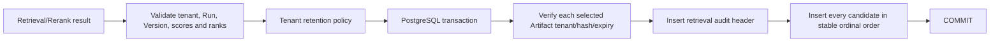

# Requirement P5-08: Durable Retrieval Audit Record

- Status: Complete
- Priority: P1
- Owner: Go Backend
- Last reviewed: 2026-08-23
- Depends on: P2-08 Artifact Store, P5-07 Rerank Pipeline
- Source: `AgenticRAG_Go_详细开发计划.xlsx`, task P5-08

## 1. Objective

Persist an auditable record of every authorized retrieval candidate and the
exact immutable snapshots selected for model context. PostgreSQL stores ranks,
scores, active index Version and Artifact references; large selected content
remains in the encrypted Artifact Store.

## 2. Record shape

Header fields include tenant, retrieval ID, Session/Turn/Run, KnowledgeBase,
active index Version, original question, retrieval query, degraded route,
candidate/selected counts, creation and expiry. Candidate rows include stable
ordinal, Document/Chunk IDs, vector and BM25 ranks, fused and optional rerank
scores, selection flag, and—only when selected—Artifact ID plus content SHA-256.

No full Chunk text, vector, prompt or hidden reasoning is stored in audit
tables. Selected Artifact metadata is checked in the same transaction for exact
tenant/hash and an expiry not earlier than the audit record. This makes the
evidence immutable and readable for the complete configured retention period.

## 3. Invariants and retention

Candidate ordinals are contiguous from one, Chunk IDs are unique, every score
is finite, ranks are nonnegative and at least one source rank is positive.
Selected count must be positive and match selected rows. Selected rows require
valid Artifact and hash; non-selected rows must not carry either.

Retention is resolved by a tenant policy port and bounded to 1 hour..365 days.
The Repository inserts header and all candidates in one transaction. Any
missing/expired/mismatched Artifact or SQL failure rolls back the entire record.
Deletion workers later prune by explicit `(tenant, expires_at, id)` indexes.

## 4. Test strategy

Service tests cover all shape and retention boundaries. PostgreSQL
Testcontainers tests insert real Artifact metadata, save a mixed candidate set,
reload it, and assert all scores/ranks and hashes. Failure injection and a
foreign/short-lived Artifact prove no partial header/candidates survive.
Tenant-scoped reads prove non-enumeration.

## 5. Acceptance checklist

- [x] Every candidate ID, source rank and score is durably recorded.
- [x] Selected Chunks reference tenant-local immutable Artifact snapshots.
- [x] Active index Version and original/retrieval queries remain auditable.
- [x] Header and all candidates commit or roll back together.
- [x] Retention is tenant-configurable and bounded.
