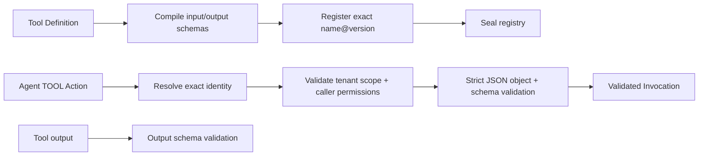

# Requirement P6-01: Deny-by-default Tool Registry Protocol

- Status: Complete
- Priority: P0
- Owner: Go Backend
- Last reviewed: 2026-08-23
- Depends on: P4-08 Action Protocol, P0-04 Threat Model
- Source: `AgenticRAG_Go_详细开发计划.xlsx`, task P6-01

## 1. Objective

Define the only protocol through which an Agent may discover and invoke tools.
Every tool has an exact name/version, compiled input/output JSON Schema,
tenant-aware scope, required permissions and explicit side-effect class.
Unknown identities and missing authorization are denied without enumeration.

## 2. Definition contract

Names are lowercase dotted identifiers and versions are immutable semantic
versions. Definitions include bounded description, input/output schemas,
required canonical permissions, and one scope: TENANT, SESSION or RUN. Scope
shape is exact—extra lower-level IDs are rejected to avoid ambiguous authority.

Every definition declares exactly one effect:

- `READ_ONLY`: cannot alter external or internal state;
- `IDEMPOTENT_WRITE`: writes using a stable invocation idempotency key;
- `DESTRUCTIVE`: potentially irreversible and subject to later approval policy.

There is no implicit default effect. Duplicate names/versions and registration
after registry seal fail. Callers request an exact version; silent version
upgrade is forbidden.

## 3. Schema and authorization

Schemas and payloads are bounded JSON objects. Duplicate object keys, invalid
JSON and trailing values are rejected before schema validation. Schemas compile
at registration so a broken tool cannot fail only after production traffic.
Input and output are validated separately.

At least one required permission is mandatory; permissions are sorted, unique
tokens. A call must carry every
required permission and valid typed tenant/session/run IDs for its declared
scope. Unknown tool/version and unauthorized calls both return the same
deny sentinel. Registry resolution and returned schemas/slices use defensive
copies and are safe for concurrent reads.

Discovery is available only after sealing and returns only tools authorized in
the caller's exact scope. Thus an empty discovery result cannot reveal whether
a definition is absent or merely unauthorized. Resolution and output
validation are likewise disabled before sealing, cleanly separating immutable
runtime configuration from startup registration.

## 4. Test strategy

Contract tests cover all scope/effect combinations, invalid and duplicate JSON,
schema compiler/validator failures, missing permission, unknown name/version,
duplicate registration, seal behavior, result validation and defensive copies.
Concurrent resolution under mutation attempts verifies race-safe immutability.

## 5. Acceptance checklist

- [x] Input and output parameter schemas compile and validate strictly.
- [x] Every tool declares scope, permissions and an explicit effect class.
- [x] Unknown tools/versions and missing permissions default to deny.
- [x] Registry sealing and exact versions prevent runtime definition drift.
- [x] Resolution is concurrent-safe and defensively immutable.
