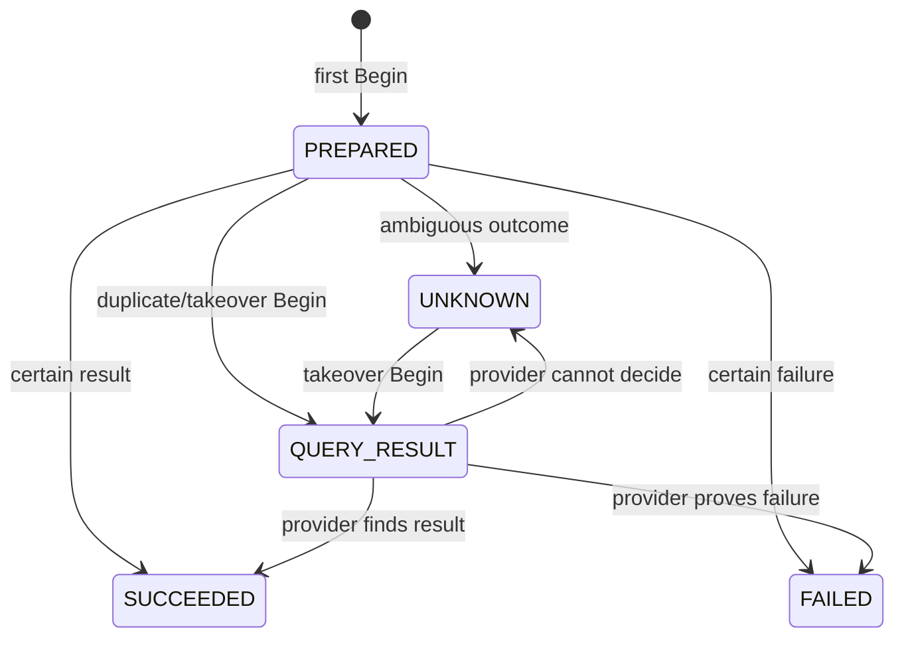

# Requirement P6-02: Durable Idempotent Tool Call Ledger

- Status: Complete
- Priority: P0
- Owner: Go Backend
- Last reviewed: 2026-08-23
- Depends on: P2-06 Run Repository, P6-01 Tool Registry
- Source: `AgenticRAG_Go_详细开发计划.xlsx`, task P6-02

## 1. Objective

Persist one logical Tool Call independently from its physical execution
Attempts. A Worker takeover must never infer that an unfinished database row
means the external side effect did not happen. It receives a result-query
decision and reconciles by the stable invocation key before any further action.

## 2. Identity and immutable request

`ToolCallID` identifies the logical operation. `(tenant, Run, Step)` is unique
because one TOOL Step represents one logical call. Every physical Agent
`AttemptID` may be attached once to that call. The immutable request contains
exact tool name/version, effect, canonical scope, SHA-256 arguments hash and a
server-derived invocation key. Raw arguments and secrets are not stored here.

The invocation key is stable across Worker Attempts and scoped by tenant. It is
the only key passed to an idempotent provider or result-query API; an Attempt ID
must never become an external idempotency key.

## 3. Begin and outcome protocol

The first atomic `Begin` inserts the Tool Call and its first Attempt, returning
`EXECUTE`. An exact duplicate Attempt replays the same decision. A different
Attempt on an unfinished or UNKNOWN call is recorded and returns
`QUERY_RESULT`, never `EXECUTE`. A completed call returns `RETURN_RESULT` or
`RETURN_FAILURE` without contacting the provider.

An existing `(tenant, Run, Step)` with different ToolCall ID, tool identity,
effect, scope or arguments hash is a conflict. Tenant mismatch is indistinct
from absence. Outcome recording uses call row version plus current Attempt ID;
late Workers cannot overwrite a result. Result JSON is strictly bounded and
validated by the P6-01 output schema before this ledger is called.

## 4. UNKNOWN semantics

UNKNOWN means the system cannot prove whether the external operation happened;
it is not equivalent to FAILED. Network timeout after send, Worker death after
provider success, or an unavailable result-query endpoint can all produce it.
Takeover must query by the stable invocation key. P6-03 may safely retry a
READ_ONLY operation, and an IDEMPOTENT_WRITE only when the provider honors that
same key. A DESTRUCTIVE call is never blindly retried and proceeds to policy or
human resolution.

## 5. Persistence and queries

PostgreSQL stores tenant-leading `tool_calls` and `tool_call_attempts` tables.
The result is bounded JSON for this protocol layer; large outputs remain
immutable Artifacts. All reads require `(tenant, call_id)`. Attempts are ordered
by attempt number and preserve STARTED/SUCCEEDED/FAILED/UNKNOWN history.

## 6. Test strategy

Service contract tests cover first execution, exact replay, takeover after an
injected post-provider crash, terminal replay, immutable-request conflicts,
UNKNOWN and stale outcome writers. Repository tests cover atomic call/Attempt
creation, tenant isolation and concurrent contenders. Migration tests enforce
tenant-leading keys, uniqueness, status/result shapes and indexes.

## 7. Acceptance checklist

- [x] One logical Tool Call can own multiple immutable physical Attempts.
- [x] First Begin executes; takeover only queries the stable invocation key.
- [x] A confirmed result is replayed without repeating an external side effect.
- [x] UNKNOWN is durable and distinct from FAILED.
- [x] Immutable request conflicts and stale outcome writers are rejected.
- [x] Tenant-scoped result/Attempt queries and schema constraints are tested.
