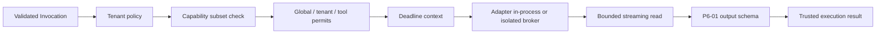

# Requirement P6-03: Bounded Tool Execution Boundary

- Status: Complete
- Priority: P0
- Owner: Security Engineering
- Last reviewed: 2026-08-23
- Depends on: P6-01 Tool Registry
- Source: `AgenticRAG_Go_详细开发计划.xlsx`, task P6-03

## 1. Objective and trust boundary

Execute a previously validated Tool Invocation within tenant policy while
bounding wall time, concurrency and retained output. The in-process executor is
an admission controller, not an operating-system sandbox. Adapters requiring
network or commands must declare those capabilities and use a brokered/isolated
runtime; undeclared direct access is a deployment violation.

## 2. Policy and capabilities

Policy is resolved from trusted tenant plus exact tool name/version after the
Registry has authorized scope and permissions. It explicitly enables the tool,
sets timeout, maximum output bytes, tenant/tool concurrency and independently
allows brokered network and isolated commands. Every field has a platform cap.

Adapters declare `NONE` or `BROKERED` network access and whether they require
an isolated command runtime. Native/unbrokered network is not representable.
Declared destination hosts must be canonical DNS names and a subset of the
tenant allowlist. The broker is responsible for DNS/IP revalidation, redirect
checks and blocking metadata, loopback, link-local and private addresses.

## 3. Resource lifecycle

The deadline covers admission wait, adapter execution and output/schema
validation. Permits are acquired global → tenant → exact tool and released in
reverse order. Adapter execution runs behind a completion channel so the API
returns on deadline even if a faulty adapter ignores cancellation. In that
case permits remain held until the adapter actually exits, preventing leaked
goroutines from bypassing concurrency caps.

Output is an `io.ReadCloser` and read through a limit of `max+1`; oversize data
is rejected and closed without retaining it. Empty/non-object/invalid-schema
output is rejected. Tool arguments, results and raw adapter errors are never
included in public errors.

## 4. Failure classification

Stable categories distinguish DENIED, CAPACITY, TIMEOUT, OUTPUT_LIMIT,
INVALID_OUTPUT and ADAPTER_FAILURE. A timeout does not assert whether an
external side effect occurred; P6-02 records/reconciles UNKNOWN. This executor
does not retry tools and never converts cancellation into success.

## 5. Test strategy

Tests cover default-deny, invalid/excess policy, capability escalation,
destination normalization, global/tenant/tool concurrency, admission timeout,
adapter cancellation, an adapter ignoring cancellation, output truncation,
reader close, schema rejection and defensive result copies. Peak counters prove
limits and cleanup tests prove permits return on every normal/error path.

## 6. Acceptance checklist

- [x] Deadline covers admission, execution, bounded read and validation.
- [x] Global, tenant and exact-tool concurrency caps are enforced without leaks.
- [x] Oversized or schema-invalid output is rejected and closed.
- [x] Tenant policy gates every invocation and capability escalation fails closed.
- [x] Network and external commands are disabled by default.
- [x] Timeout preserves UNKNOWN semantics and never triggers an internal retry.
