# Requirement P6-05: Immutable Tool Audit

- Status: Complete
- Priority: P0
- Owner: Go Backend
- Last reviewed: 2026-08-23
- Depends on: P6-02 Durable Tool Call Ledger
- Source: `AgenticRAG_Go_详细开发计划.xlsx`, task P6-05

## 1. Objective

Create one immutable, tenant-scoped audit record for a logical Tool Call. The
record explains who requested the call, which policy decision was made, what
business-impact class applied, how every execution Attempt ended, and where an
immutable large-result snapshot can be found.

```mermaid
flowchart LR
  L[Terminal Tool Call ledger or policy denial] --> V[Validate identity, hashes, decision and Attempts]
  V --> R[Tenant retention policy]
  R --> T[PostgreSQL transaction]
  T --> A[Verify optional Artifact tenant/hash/size/expiry]
  A --> H[Insert immutable audit header]
  H --> E[Insert ordered Attempt evidence]
  E --> C[COMMIT]
  C --> Q[Query by tenant + Run or Tool Call]
```

## 2. Security and data boundary

The API deliberately has no field for raw arguments, credentials, provider
responses, prompts, hidden reasoning, or raw errors. Requests are represented
by the canonical argument SHA-256 already bound by the ledger. Results are
represented by outcome, result SHA-256 and byte count. A large result may add
an Artifact ID, content SHA-256, size and media type; payload bytes stay in the
encrypted Artifact Store. This is redaction by construction rather than a
best-effort regular-expression scrubber.

Caller subject, failure class, business-impact code and tool identity accept
only bounded machine-safe tokens. Policy decision and outcome are closed
enums. Approval ID is required exactly for `REQUIRE_APPROVAL` and forbidden for
other decisions. Artifact fields are all-or-none.

## 3. Invariants

- IDs and all ownership links are tenant scoped; no global-ID lookup exists.
- One audit header exists per `(tenant_id, tool_call_id)`. Executed calls are
  matched to the ledger in the append transaction; pre-execution denials have
  no ledger row and are identified by `DENY` plus `DENIED` and zero Attempts.
- Attempts are ordered and contiguous from one, have unique Attempt IDs, and
  are terminal with timestamps inside the Tool Call time window.
- Call outcome and final Attempt status agree; `DENIED` has no Attempts.
- Artifact metadata is verified in the insert transaction for exact tenant,
  hash, size, media type, and an expiry at least as long as the audit record.
- Retention is tenant configurable and bounded to 1 hour..365 days.
- Tables expose INSERT/SELECT only through this component; application code
  has no update operation. Cleanup uses the tenant-leading expiry index.

## 4. Query contract

`GetByToolCall` requires tenant plus Tool Call ID and returns not-found for a
foreign tenant. `ListByRun` requires tenant plus Run ID and uses stable
`(created_at,id)` keyset pagination with a bounded page size. Child Attempts
are always returned in Attempt-number order.

## 5. Test strategy

Unit tests cover all enum, identifier, temporal, approval, Artifact and Attempt
shape boundaries; defensive copies; retention limits; duplicate append; stable
pagination; and tenant non-enumeration. Migration contract tests enforce
tenant-leading keys/indexes, append-only shape and the absence of raw payload
columns. PostgreSQL Testcontainers tests cover atomic persistence, query by Run
and Tool Call, tenant isolation, Artifact verification and rollback.

## 6. Acceptance checklist

- [x] Queryable by exact tenant/Run/Tool Call.
- [x] Caller, policy decision, approval reference and business impact persist.
- [x] Every execution Attempt is retained in stable order.
- [x] Sensitive request/result content cannot enter the audit schema.
- [x] Artifact evidence is tenant/hash/size/expiry verified atomically.
