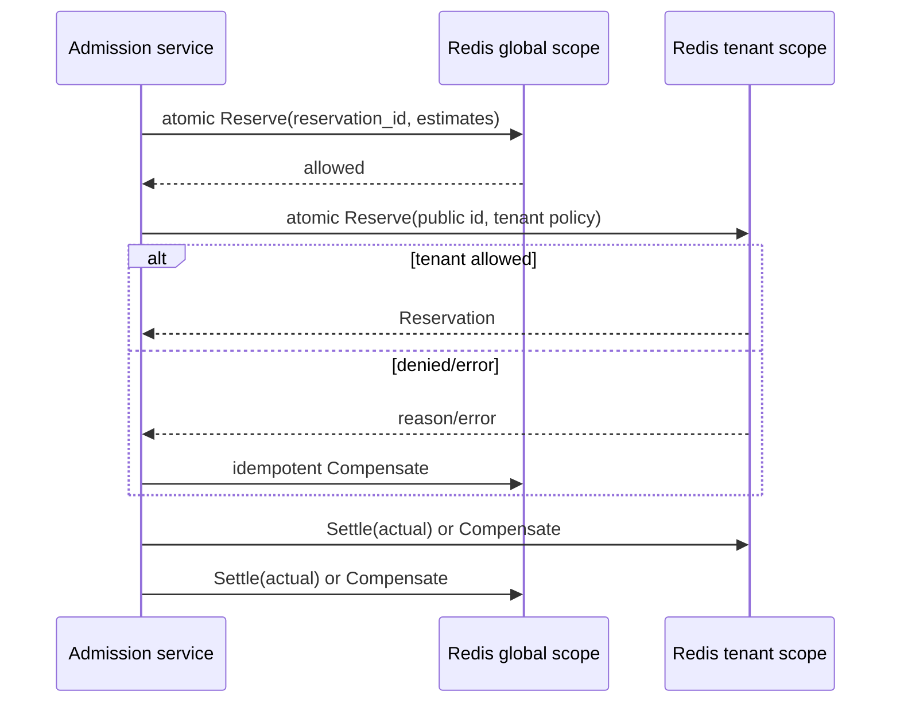
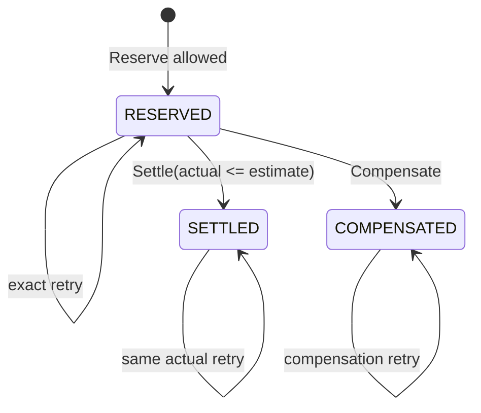

# Requirement P7-03: Hierarchical Tenant Quota

- Status: Complete
- Priority: P0
- Owner: Go Backend
- Last reviewed: 2026-08-23
- Depends on: P3-02 Tenant Context, P7-02 Metrics
- Source: `AgenticRAG_Go_详细开发计划.xlsx`, task P7-03

## 1. Objective

Enforce deployment and tenant QPS, Active Run, period Token and cost limits
before irreversible work. Each scope is reserved atomically in Redis; the
global scope is reserved first and compensated if tenant admission fails.

## 2. Quota dimensions

Each scope uses an integer-bounded token bucket for requests/second plus burst,
an expiring ZSET lease for Active Runs, and aligned-period counters for reserved
Tokens and cost nanos. Limits and estimates use integers; Lua performs checked
comparisons before any mutation. All keys for one scope share a Redis hash tag,
so its state, active leases and reservation receipt are one atomic script even
on Redis Cluster. Token and cost values are capped at `2^53-1`, the largest
integer Redis Lua can compare exactly; Redis `HINCRBY` performs the persisted
integer mutations. Key expiry is only extended, never shortened by a policy
change that could otherwise erase a longer-running Active Run lease.
Production scripts use Redis `TIME` as the single clock authority so skewed API
pods cannot over-refill QPS buckets or expire leases early; the memory adapter
accepts an explicit clock value to keep unit tests deterministic.

Reservation IDs are caller-generated and stable across retries. Same ID plus
same estimates replays; same ID with different estimates conflicts. Settlement
requires actual usage no greater than the reservation, releases the active
lease and refunds unused Token/cost capacity. Compensation refunds all reserved
capacity and one request token. Both are idempotent.

The tenant receipt uses the public reservation ID. The global receipt uses a
SHA-256-derived ID over `(tenant_id, reservation_id)`, preventing two tenants
that submit the same public ID from replaying or conflicting with each other.

## 3. Storage and state machine

| Redis key | Type | Purpose |
|---|---|---|
| `ar:<env>:{<scope>}:rate:quota:state` | Hash | token bucket, period boundary, reserved Token/cost totals |
| `ar:<env>:{<scope>}:rate:quota:active` | ZSET | reservation ID scored by Active Run lease expiry |
| `ar:<env>:{<scope>}:rate:quota:reservation:<id>` | Hash | immutable estimates and reservation status/actuals |

The `{scope}` hash tag guarantees all three keys are co-located. One Reserve
script removes expired leases, refills the token bucket, evaluates all four
dimensions, and only then mutates state. There is no check-then-set window.

Terminal transitions with different arguments return conflict. Receipt TTL is
longer than both the accounting period and Run lease, so ordinary retries see
the terminal state. An expired receipt is treated as a new operation only after
its conservative accounting window has also elapsed.

## 4. Failure and degradation

Mutation admission is fail-closed when policy or Redis is unavailable. A tenant
denial compensates the already acquired global reservation; failure to
compensate is returned together with the denial and is safe to retry using the
same reservation ID. Settlement executes both scopes and joins errors; receipts
make partial success retryable without double release.

Global and tenant scopes deliberately cannot share one Redis Cluster slot, so
the service uses a small saga rather than pretending they form one distributed
transaction. A tenant-side transport error is outcome-ambiguous: the service
attempts idempotent tenant compensation (ignoring only Not Found) and global
compensation, then returns the original failure. A global transport error is
fail-closed and retried with the same ID; its lease bounds Active Run leakage.

Active leases expire at the configured maximum Run lifetime, preventing a dead
Worker from permanently consuming concurrency. Period usage is not silently
discarded by lease expiry: an abandoned reservation remains conservatively
charged until explicit reconciliation/compensation or the next billing period.
Read-only status/SSE paths do not call this mutation admission service and can
remain available during quota-store outages.

## 5. Fairness, privacy and scale

Tenant and global scopes are separate; a tenant cannot consume another
tenant's Active Run or budget counters. Global capacity is still a hard safety
fence. Redis keys contain the validated tenant resource ID inside a cluster hash
tag and never accept model-generated scope. Public denial reasons distinguish
tenant/global QPS, concurrency, Token and cost without revealing configured
numeric limits.

The exact global scope is intentionally a single Redis hash slot and therefore
an operational hot key. It is a safety fuse, not the primary fairness control.
Capacity tests must establish its sustainable script rate. Above that ceiling,
deployments should lease coarse global tokens to regional limiters while
keeping exact per-tenant admission; that optimization trades a bounded amount
of overshoot for throughput and is not silently enabled by this implementation.

## 6. Test strategy

Deterministic memory-store tests cover token refill, period rollover, lease
expiry, idempotent replay, conflict, settlement refund and global compensation.
Concurrent hotspot tests prove one tenant cannot exceed its Active Run cap or
affect a second tenant. Redis Testcontainers tests run the real Lua scripts with
hundreds of goroutines and verify atomic caps, retry, compensation and isolation.

## 7. Acceptance checklist

- [x] QPS, Active Run, Token and cost are checked before admission.
- [x] Each scope is atomic and cross-scope failure is compensated.
- [x] Retry/settle/compensate operations are idempotent.
- [x] Expiring Active Run leases prevent permanent slot leaks.
- [x] Concurrent tenants remain isolated and global capacity remains bounded.
