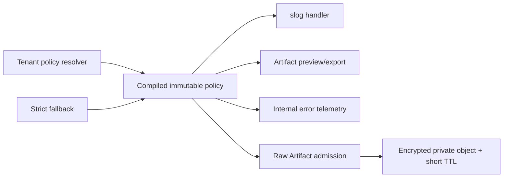

# Requirement P7-04: Unified Sensitive Data Redaction

- Status: Complete
- Priority: P0
- Owner: Security Engineering
- Last reviewed: 2026-08-23
- Depends on: P0-04 Security Baseline, P2-08 Artifact Store
- Source: `AgenticRAG_Go_详细开发计划.xlsx`, task P7-04

## 1. Objective and trust boundaries

Provide one tenant-aware policy engine for logs, bounded Artifact previews and
internal error details. Credentials are always protected; tenant policy can add
PII and custom RE2 detectors but cannot disable the mandatory baseline.

Public API errors remain code-based `apperror.PublicError`; arbitrary internal
details are never added to responses. Redaction is defense in depth for internal
telemetry, not permission to expose provider/database errors publicly.

## 2. Detection and replacement

Sensitive field names replace the entire value before type formatting. The
mandatory set includes credentials, cookies, Prompt/content/tool/retrieval
payloads, raw errors, causes and stacks. String values are additionally scanned
for authorization credentials, JWTs, common API/access keys and key-value
secrets even when a caller uses an innocent field name.

Tenant policy may enable email/phone detection and add at most 32 named custom
patterns of at most 256 bytes. Go's RE2 engine prevents catastrophic
backtracking. Empty-matching patterns, invalid names and oversized policies are
rejected. Replacement is the fixed marker `[REDACTED]`; tenants cannot inject
replacement text into logs.

JSON sanitization is structural: sensitive keys redact the whole subtree,
otherwise string leaves use the same detectors. It is bounded by input bytes,
depth and node count. Invalid JSON is treated as unstructured text. Oversized or
cancelled input fails closed to a single marker.

## 3. Tenant policy and failure behavior

Policies are immutable and versioned. Resolution occurs using the authenticated
tenant ID. On resolver failure the engine applies the strict fallback (including
PII detection), marks the result degraded and never returns the original value.
The logging adapter cannot fail a business request; it emits only the safely
transformed value. It resolves one immutable View per log record, so attributes
cannot cross policy versions and a remote resolver is not called once per field.
Logger-scoped `With` attributes have no request tenant and therefore use the
strict/base resolver path; tenant data belongs on context-aware record calls.
Policy refresh/caching belongs to the resolver adapter.

Raw confidential/restricted Artifacts are not regex-rewritten because payloads
can be multi-terabyte binary streams and later retrieval may require exact
bytes. Admission instead requires `SSE-KMS` or client-side encryption and caps
TTL using tenant policy. Buckets stay private and metadata contains key IDs, not
key material. Preview, audit and export paths must pass bounded text through the
redactor.

## 4. Test strategy

Table tests cover every mandatory detector, false-positive-safe metadata,
nested JSON, custom tenant rules, resolver outages, Artifact encryption/TTL and
log integration including `error` values. Fuzz tests assert no panic, bounded
output and marker-secret non-disclosure for arbitrary strings and JSON bytes.
Concurrent tests reuse immutable policies across tenants and check that one
tenant's custom rule never affects another.

## 5. Acceptance checklist

- [x] Tokens, keys, PII and raw errors cannot enter structured logs.
- [x] Tenant rules are immutable, bounded and isolated.
- [x] Policy outage uses strict fail-safe redaction without failing requests.
- [x] Sensitive raw Artifacts require strong encryption and short retention.
- [x] Fuzz, security, concurrency and full repository gates pass.
