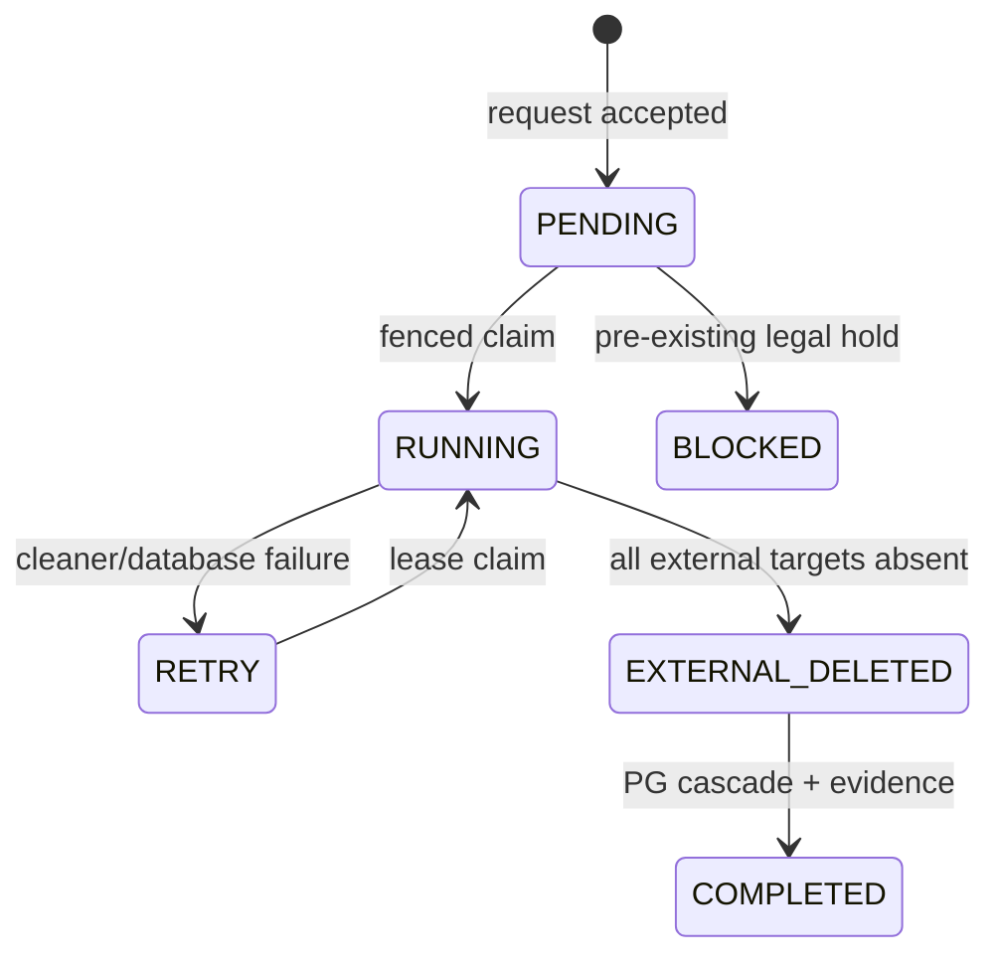

# Requirement P7-05: Session Retention and Auditable Deletion

- Status: Complete
- Priority: P1
- Owner: Go Backend
- Last reviewed: 2026-08-23
- Depends on: P6-05 Tool Audit, P7-04 Redaction
- Source: `AgenticRAG_Go_详细开发计划.xlsx`, task P7-05

## 1. Objective

Delete one tenant Session and all derived data across PostgreSQL, Redis,
object storage and external indexes with an idempotent, restartable workflow.
Retain only minimal cause-free deletion evidence. An active legal hold blocks a
new deletion before any external bytes are removed.

```mermaid
sequenceDiagram
  participant A as Compliance API
  participant P as PostgreSQL authority
  participant W as Deletion worker
  participant X as Object/Redis/Index cleaners
  A->>P: Request(idempotency ID, tenant, session, actor hash)
  P->>P: lock scope; reject hold; snapshot targets; create job+audit
  P-->>A: durable job
  W->>P: Claim(job, lease token)
  P-->>W: immutable manifest
  W->>X: idempotent Delete(targets)
  W->>P: checkpoint EXTERNAL_DELETED
  W->>P: atomic hold check + DELETE session CASCADE
  W->>P: Complete + append audit evidence
```

## 2. Authority, manifest and ordering

PostgreSQL is the workflow authority. Request creation and legal-hold creation
serialize on the same `(tenant_id, session_id)` advisory/row lock. A request is
accepted only if the Session exists, no active hold exists and no different
deletion job owns the Session. Once accepted, a new hold is rejected; this
avoids the impossible promise of preserving an object already deleted outside
the database.

Every session-owned external resource is registered in
`compliance_external_targets` when it is created. Before cascade deletion,
PostgreSQL snapshots that registry into an immutable manifest. Locators are
server-generated opaque IDs/keys, not URLs or credentials. Retrieval/tool audit
references may validate ownership but are not treated as deletion ownership:
shared knowledge-base objects and index generations are never deleted merely
because one Session referenced them. Only explicitly session-owned targets may
enter the registry and manifest.

External targets are deleted first using idempotent provider calls. A crash may
repeat a target. After an `EXTERNAL_DELETED` checkpoint, one PostgreSQL
transaction rechecks ownership/lease and deletes the Session; existing foreign
keys cascade Turns, Messages, Runs, Steps, Attempts, queues/events and per-Run
audit rows. The independent compliance job/evidence tables have no Session FK,
so they survive. Completion after a committed cascade is retryable.

## 3. State, fencing and failures



Every worker mutation requires tenant, job ID, owner, monotonically increasing
lease token and unexpired server-time lease. A stale worker cannot checkpoint,
fail or complete after takeover. Failures store a closed failure class only;
provider errors, object keys and PII never enter audit evidence. Backoff belongs
to the scheduler, and attempts are capped for alerting but not silently dropped.

## 4. Audit query and retention

Evidence records request, phase/result, policy version, actor SHA-256, timestamps
and non-sensitive counts. It never stores message text, Prompt, tool arguments,
raw object keys or provider errors. Query is tenant-scoped, stable
`(occurred_at,id)` cursor pagination. Evidence retention is independently
configured. Bounded tenant-scoped cleanup uses `SKIP LOCKED` and deletes only
evidence whose job is `COMPLETED`; it cannot erase evidence for a legal hold or
unfinished deletion.

## 5. Test strategy

State-machine tests cover exact replay, conflicting requests, hold exclusion,
lease takeover/fencing, target retry, crash boundaries, retention and tenant
isolation. A real PostgreSQL Testcontainers test creates a Session graph plus an
Artifact and all three external target kinds, runs the deletion saga, and proves
absence from PostgreSQL and the three cleaner-owned resource sets while the job
and evidence survive. It also verifies bounded physical evidence expiry. Docker
execution is mandatory in the Linux race CI job.

## 6. Acceptance checklist

- [x] Request/claim/checkpoint/complete are idempotent and fenced.
- [x] Legal hold and deletion request are mutually exclusive atomically.
- [x] PG, Redis, Object and owned Index targets are deleted on retry.
- [x] Minimal deletion evidence survives the Session cascade and is queryable.
- [x] End-to-end deletion, failure recovery and tenant isolation tests pass.
