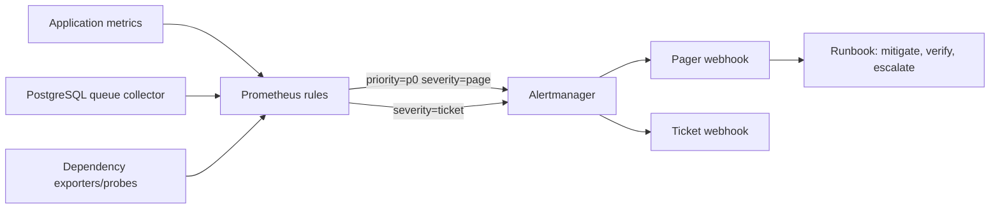

# Requirement P7-06: Production Alerting and Runbooks

- Status: Complete
- Priority: P1
- Owner: SRE
- Last reviewed: 2026-08-23
- Depends on: P7-02 Prometheus Metrics
- Source: `AgenticRAG_Go_详细开发计划.xlsx`, task P7-06

## 1. Objective

Provide actionable production alerts for availability, latency, queue backlog,
error-budget burn, dependency failure and LLM cost. Every page names the first
safe action and links to a versioned runbook. Informational conditions remain
dashboard signals and do not alert.

## 2. Paging policy

A page means an operator can take an immediate action that protects customers,
durability or the error budget. Availability uses the P0-03 multi-window policy:
14.4x burn in both 5m/1h or 6x in both 30m/6h. A single short spike does not
page. Latency and backlog require sustained breach and name safe degradation or
admission-control actions. Cost drift creates a ticket rather than waking an
operator because delayed action does not threaten correctness.

All alerts carry `service`, `component`, `severity`, `priority`, `owner`,
`action`, `impact`, `dashboard` and `runbook_url`. Labels never contain tenant,
Session, Run, request, object or query identifiers. Alertmanager groups only by
bounded operational dimensions and inhibits ticket duplicates while the same
P0 page is firing.

## 3. Signal ownership

Application counters/histograms own HTTP availability/latency, Run latency,
queue wait, worker concurrency, LLM failure and cost. Queue backlog is exported
from the PostgreSQL authority by a read-only collector as a bounded status
gauge; it is not inferred from process-local memory. Dependency alerts are
split by PostgreSQL, Redis, object storage, search index and LLM so each page has
one owner and one recovery procedure.

An exporter-down alert is distinct from a service failure only when an
independent probe exists. Object storage and search use authenticated synthetic
health probes that perform no tenant data access. A missing signal fails visible
through the exporter/probe alert; queries do not use `or vector(0)` to turn
missing telemetry into health.

## 4. Repository layout and validation

- `deploy/monitoring/prometheus/agenticrag-alerts.yaml`: recording/alert rules.
- `deploy/monitoring/alertmanager/alertmanager.yaml`: page/ticket routing and
  inhibition; receiver URLs are mounted secret files.
- `deploy/monitoring/exporters/postgres-queries.yaml`: SQL Exporter read-only
  queue collector; its datasource DSN is injected by the deployment secret.
- `deploy/monitoring/runbooks/agenticrag-alerts.md`: exact mitigation and
  verification steps for every page/ticket.
- `deploy/monitoring/alerts_test.go`: parses all YAML, checks required alerts,
  bounded dimensions, multi-window expressions, actions and valid runbook
  anchors.

## 5. Acceptance checklist

- [x] Availability and error-budget pages use paired short/long windows.
- [x] Latency, backlog, saturation and cost have explicit thresholds/actions.
- [x] PostgreSQL, Redis, Object, Search and LLM alerts are independently routed.
- [x] Every P0 alert has a concrete first action and versioned runbook anchor.
- [x] Config parsing and fire/noise policy contracts pass automated tests.
