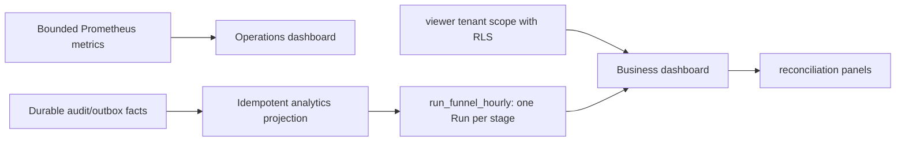

# Requirement P7-07: Business and Operations Dashboards

- Status: Complete
- Priority: P2
- Owner: SRE
- Last reviewed: 2026-08-23
- Depends on: P7-02 Metrics, P7-06 Alerts
- Source: `AgenticRAG_Go_详细开发计划.xlsx`, task P7-07

## 1. Objective

Provision versioned Grafana dashboards for incident diagnosis and governed
business analysis. The operations dashboard follows request, queue, retrieval,
generation and completion health. The business dashboard calculates a logical
Run funnel without treating repeated Agent-loop calls as additional users/Runs.

## 2. Data and cardinality boundaries

Prometheus panels may filter only bounded `plan`, `provider`, `model`, `region`,
`outcome`, `status` and dependency dimensions. Tenant, Session, Turn, Run,
request and query identifiers remain absent from PromQL. Operations can pivot
from an aggregate panel to traces/logs using time and bounded labels, then use
authorized tooling for a specific identifier.

Tenant filtering belongs to the governed analytics datasource. The datasource
authenticates the viewer and exposes `dashboard_tenant_scope`, an RLS-filtered
view returning only authorized opaque tenant keys. Every tenant-bearing panel
uses the selected `${tenant:sqlstring}` predicate. `All` means all tenants in
that already-authorized view, never all platform tenants.

## 3. Logical funnel contract

`analytics_run_funnel_hourly` contains one idempotently projected row per
`(tenant_key, run_id, stage)` with stages `REQUESTED`, `QUEUED`, `RETRIEVED`,
`GENERATION_STARTED`, `TERMINAL`, `COMMITTED`. Retries and multiple retrieval,
Tool or LLM Steps do not add funnel rows. The dashboard uses
`count(distinct run_id)` per stage and shows stage-to-stage conversion.

The projection source is durable PostgreSQL/outbox/audit data, never ephemeral
Redis. `analytics_run_reconciliation_hourly` compares projected terminal/final
commit totals with the source-control totals. A non-zero gap is shown explicitly
and the business dashboard is marked unreliable until replay catches up.
The projection rejects a stage with no required predecessor; aggregate stage
counts must remain monotonically non-increasing through the funnel.

## 4. Dashboard design

The operations dashboard starts with SLO availability/burn and alert state,
then request latency, queue depth/wait, active Runs, terminal outcomes, Run
latency, retrieval SLI, LLM failure/TTFT/tokens/cost and dependency probes. It
uses UTC, a 30-second minimum refresh and links to the P7-06 Runbook.

The business dashboard shows the logical funnel, conversion, committed Runs,
completion rate, cost per committed Run and reconciliation lag/gap. Monetary
Prometheus estimates are not used for billing; business cost comes from the
durable analytics ledger.

## 5. Acceptance checklist

- [x] Request-to-completion technical health is visible in one dashboard.
- [x] Logical funnel counts each Run at most once per stage.
- [x] Tenant filtering is authorized by an RLS scope view and SQL-safe variable.
- [x] PromQL contains no tenant or business-resource identity dimensions.
- [x] Projection lag/gap is visible and can invalidate business interpretation.
- [x] Dashboard JSON/provisioning contracts pass automated tests.
