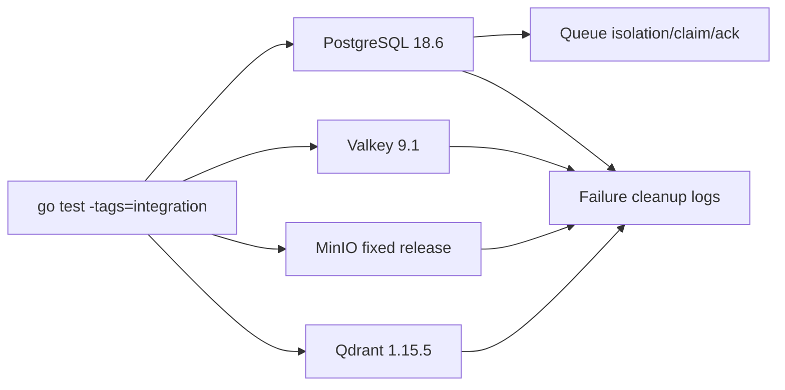

# Requirement P8-02: One-command Integration Suite

- Status: Complete
- Priority: P0
- Owner: QA / Go Backend
- Last reviewed: 2026-08-23
- Depends on: P3-07 SSE, P5-08 Retrieval Audit, P6-06 Built-in Tools
- Source: `AgenticRAG_Go_详细开发计划.xlsx`, task P8-02

## 1. Objective

Provide one explicit integration-tag command that validates PostgreSQL, durable
Queue, Redis/Valkey, S3/MinIO and Vector/Qdrant contracts with fixed container
images. The default unit suite remains Docker-independent.

## 2. Contracts

PostgreSQL applies the complete embedded migration history and Queue tests use
the production adapter. Two tenants enqueue indistinguishable work; a tenant
claim must return only that tenant and a fenced acknowledgement must not affect
the other row.

Valkey uses production typed configuration, client and key builder. Equal
logical segments for two tenants remain physically isolated. MinIO uses the
production SigV4 S3 adapter for bucket creation and tenant-keyed Put/Open/Delete;
deleting one tenant object cannot remove the other.

The codebase currently exposes a vendor-neutral Vector adapter and memory
implementation. The suite therefore pins a Qdrant HTTP compatibility contract:
create a vector collection, upsert same-vector points for two tenant payloads,
query with a mandatory tenant filter and prove only the authorized point is
returned. A future Qdrant adapter must pass this same test before promotion.

## 3. Execution and diagnostics

`make integration` runs `go test -tags=integration -count=1 -v
./tests/integration`. The integration files are excluded from ordinary builds.
CI runs the command on Linux with Docker before the race gate.

Each container registers cleanup and, if its test has failed, reads bounded
stdout/stderr into the test log before termination. Contexts impose a two-minute
suite startup bound and per-request deadlines. Container images are constants
and a Docker-free unit test rejects floating/latest/unapproved tags.

## 4. Acceptance checklist

- [x] PostgreSQL, Queue, Valkey, MinIO and Vector contracts run from one command.
- [x] Cross-tenant isolation is asserted in every data-bearing service.
- [x] Container images use exact approved versions.
- [x] Failed tests automatically attach bounded container logs.
- [x] Integration tag compiles locally and is mandatory in CI.
