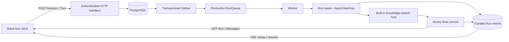
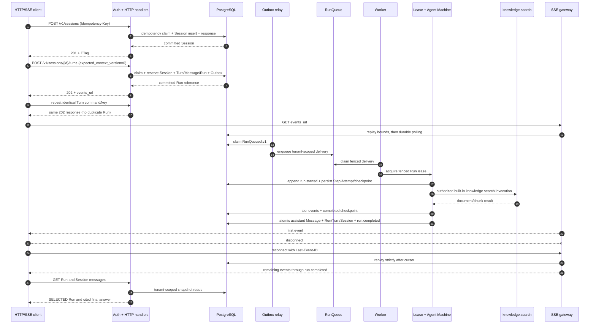

# Requirement P8-03: Black-box AgenticRAG E2E

- Status: Complete
- Priority: P0
- Owner: QA / Go Backend
- Last reviewed: 2026-08-23
- Depends on: P4-10 Agent Loop, P5-08 Retrieval audit, P6-06 Built-in tools
- Source: `AgenticRAG_Go_详细开发计划.xlsx`, task P8-03

## 1. Objective

Prove the principal online path from authenticated HTTP commands through the
durable execution plane and back through resumable SSE. The test client may not
call an application service or repository to advance the workflow. Test-only
composition is permitted because the production executable has not yet reached
its composition-root milestone; every durable boundary in the path remains the
production implementation.

## 2. System under test

The suite starts a fixed PostgreSQL container, applies all embedded migrations,
and composes production Session/Turn/Query handlers, authentication middleware,
Turn and Session repositories, transactional Outbox relay, PostgreSQL RunQueue,
Worker, Run lease manager, Agent state machine, built-in Tool gateway, durable
event repository, SSE handler, and final commit store.

Only nondeterministic external intelligence is replaced:

- the model planner deterministically requests `knowledge.search` and then a
  final answer;
- the knowledge backend returns one tenant-scoped document chunk;
- identifiers are deterministic and valid, which makes failure diagnostics
  reproducible.

The fake is behind the same Planner and Tool adapter ports used in production.
It does not bypass the Tool registry, authorization, schema validation, output
limit, Agent checkpoint, or lease fencing paths.

## 3. Main sequence

## 4. Assertions

The primary scenario must prove:

1. identical Turn retries return the same Turn, Run and user Message IDs and
   create one durable aggregate;
2. reuse of the key with a different body is rejected, and a stale/future
   context version is rejected without creating work;
3. an SSE client can disconnect after a durable event, reconnect with
   `Last-Event-ID`, receive no duplicate sequence, and reach a terminal event;
4. the Agent persists a Tool Step and invokes the real built-in
   `knowledge.search` path under tenant and Run scope;
5. the final commit atomically selects the Run, advances Session context to one,
   clears `active_run_id`, and exposes exactly one assistant message;
6. the final answer contains the document/chunk citation returned by the Tool;
7. the queue message is acknowledged only after the complete processor path.

## 5. Execution and failure policy

`make e2e` runs `go test -tags=e2e -count=1 -v ./tests/e2e`. The default unit
suite remains Docker-free. CI sets `AGENTICRAG_REQUIRE_DOCKER=1`; a missing
Docker daemon is therefore a failure, not a skip. Failed scenarios attach a
bounded PostgreSQL log tail before container cleanup.

The controlled Fake scenario is the release gate. A small real-provider smoke
is opt-in through `AGENTICRAG_E2E_LLM_URL`, `AGENTICRAG_E2E_LLM_TOKEN`, and
`AGENTICRAG_E2E_LLM_MODEL`; it checks credentials and basic compatible response
shape but is deliberately not a merge gate because cost, rate limits, and
provider incidents are external to repository correctness.

## 6. Acceptance checklist

- [x] One command runs the complete black-box scenario.
- [x] Idempotency and optimistic version conflicts are externally observable.
- [x] SSE disconnect/recovery is gap-free and duplicate-free.
- [x] Agent Tool execution and citation propagation are proven.
- [x] Final commit invariants are verified through public queries.
- [x] Linux CI requires the E2E gate; real-provider smoke remains opt-in.
