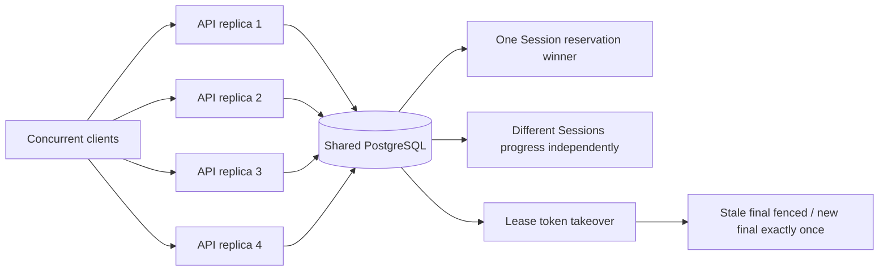

# Requirement P8-04: Multi-replica Concurrency Suite

- Status: Complete
- Priority: P0
- Owner: QA / Go Backend
- Last reviewed: 2026-08-23
- Depends on: P8-02 Integration suite
- Source: `AgenticRAG_Go_详细开发计划.xlsx`, task P8-04

## 1. Objective

Stress the correctness boundaries that cannot be established by sequential unit
tests: competing Turn reservations for one Session, independent progress across
different Sessions, and expired Run-lease takeover. The suite must use multiple
HTTP handler instances backed by the same PostgreSQL database so an in-process
mutex cannot accidentally satisfy the contract.

## 2. Same-Session contention

The test creates one Session, releases 64 clients from a barrier, and distributes
requests across four independently constructed authenticated HTTP replicas.
Every request uses the same expected context version but a distinct valid
idempotency key and message. Exactly one request may return `202 Accepted`; all
others must return `409 SESSION_BUSY`. PostgreSQL must contain one running Turn,
one Run, one user Message, one active Run reference, and one RunQueued Outbox
record for the Session.

This test deliberately does not reuse an idempotency key: it isolates Session
reservation CAS from request deduplication.

## 3. Different-Session parallelism

The suite creates 32 Sessions and concurrently submits one Turn to each through
the same four replicas. Every request must succeed, and every Session must own a
different active Run. The aggregate count must be 32 Turns/Runs/Messages/Outbox
records. This rejects accidental process-global or tenant-global serialization
and confirms the Session row is the contention unit.

## 4. Lease takeover and final uniqueness

The winning Run from the contention scenario is acquired by worker A at logical
time T. Worker B acquires after A's lease expiry using the production execution
repository and Run lease manager. Assertions are:

1. B receives a strictly larger fencing token and execution version;
2. A's final commit is rejected with `ErrFinalFenced`;
3. B commits the assistant Message, selected Run, completed Turn, Session context
   advancement, and terminal event in one transaction;
4. replaying B's exact final commit returns the same result with `Replayed=true`;
5. PostgreSQL contains one visible assistant Message and one `run.completed`
   event, never two.

A test clock advances lease time without sleeping. Its ticker is quiescent, so
heartbeat goroutines cannot make the scenario nondeterministic.

## 5. Execution policy

`make concurrency` runs `go test -race -tags=concurrency -count=1 -v
./tests/concurrency`. The tag keeps Docker out of the default suite. Linux CI
sets `AGENTICRAG_REQUIRE_DOCKER=1`, making Docker absence fatal, and executes the
suite with the race detector. Local non-race compilation and stress repetition
remain required on both supported Go versions.

Container output is bounded to 256 KiB on failure, every goroutine reports one
result through a sized channel, and all waits have context or test deadlines.

## 6. Acceptance checklist

- [x] Four API replicas admit exactly one same-Session Turn reservation.
- [x] Different Sessions all progress under concurrent submission.
- [x] Expired lease takeover strictly advances fencing authority.
- [x] A stale worker cannot final-commit; the winner cannot duplicate final data.
- [x] Tagged race command is mandatory in Linux CI.
