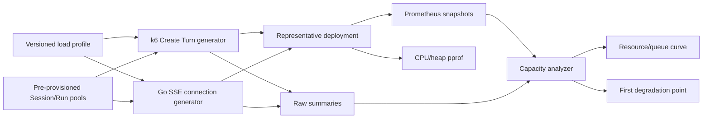

# Requirement P8-06: Production Load and Capacity Evidence

- Status: Implemented
- Priority: P0
- Owner: Performance Engineering
- Last reviewed: 2026-08-23
- Depends on: P8-03 E2E, P7-02 Metrics
- Source: `AgenticRAG_Go_详细开发计划.xlsx`, task P8-06

## 1. Objective and evidence rule

Provide a reproducible load system for Create Turn throughput, SSE connections
and reconnects, time to first assistant token (TTFT), queue growth/wait, database
pressure, and process profiles. The analyzer maps measurements to the accepted
P0 capacity/SLO assumptions and identifies the first failing stage.

A fixture or developer laptop run is never labeled production capacity. A
capacity claim requires an environment manifest, immutable build revision,
profile, raw summary, metrics snapshots, pprof files, and analyzer report from a
representative deployment.

## 2. Workload profiles

The release profile encodes the P0 planning points:

| Stage | Turn rate | Duration | SSE connections | Purpose |
| --- | ---: | ---: | ---: | --- |
| warmup | 5/s | 5 min | 4,000 | stabilize pools/caches |
| sustained | 50/s | 30 min | 20,000 | required P0 peak |
| burst | 100/s | 60 s | 20,000 | bounded backlog absorption |
| reconnect | 50/s | 30 s | 20,000 + 2,000 resumes/s | reconnect degradation point |

A shorter smoke profile has identical schema and assertions but is not capacity
evidence. Session and Run pool files are provisioned before measurement. Turn
iterations use `scenario.iterationInTest` to select a unique idle Session; they
never create a Session in the measured interval or repeatedly target a busy
Session. SSE runs are distinct and non-terminal for the connection interval.

Request bodies are selected from a checked-in distribution matching P0 context
inputs: small 256 B, median 4 KiB, large 16 KiB, and tail 64 KiB with explicit
weights. The generator verifies the serialized byte bucket before sending.

## 3. Measurement contract

Every stage records achieved Turn/s, error ratio, Create Turn p50/p95/p99, active
SSE connections, resume p95/p99, TTFT p50/p95/p99, queue depth at start/end,
queue-wait p95/p99, database CPU/connections/locks, service CPU/RSS/goroutines,
and response/request byte totals.

The analyzer enforces:

- achieved Turn rate at least 98% of target;
- Create Turn p95 ≤250 ms and p99 ≤500 ms;
- successful mutation/error ratio consistent with the 99.95% availability SLO;
- SSE resume p95 ≤1 s and p99 ≤3 s;
- TTFT p95 ≤8 s and p99 ≤20 s;
- sustained queue growth ≤0 and depth below 3,000;
- burst incremental backlog ≤3,000 and total depth below 6,000;
- measured SSE connections at least 98% of target;
- database and process resource values are finite and within the profile's
  declared safety ceilings.

The first stage violating any condition is the degradation point. Violations
are sorted and machine readable; queue slope is `(end-start)/duration`. Resource
curves preserve stage order rather than sorting by observed success.

## 4. Tooling

- k6 drives authenticated Create Turn requests with stable idempotency keys and
  exports its summary.
- `sse-load` is a Go generator because standard k6 does not provide a portable
  long-lived SSE implementation. It parses event IDs/types, distinguishes first
  frame from `assistant.delta`, and retains connections for the configured
  stage duration.
- `loadreport` validates a normalized measurement JSON, applies the versioned
  profile, and emits the capacity/degradation report.
- `run.sh` orchestrates k6, SSE load, Prometheus snapshots, and bounded CPU/heap
  pprof collection. Secrets enter through environment variables and are never
  written to result artifacts.

## 5. Safety and repeatability

The runner requires `AGENTICRAG_LOAD_ACK=production-load-authorized`, refuses a
loopback target for release profiles, and never invents credentials. All files
go into a new caller-supplied result directory. Profiles have fixed durations
and concurrency caps. HTTP clients use bounded dial/TLS/header timeouts; SSE
bodies have a maximum line size and are closed on cancellation.

The test suite uses deterministic contract measurements to verify percentile,
queue-slope, threshold, degradation-point and malformed-data behavior. Those
fixtures are labeled test data and cannot satisfy the representative-environment
evidence rule.

## 6. Acceptance checklist

- [x] P0 sustained, burst, SSE, reconnect and latency thresholds are encoded.
- [x] Realistic request/output-size distributions and pre-provisioned pools are required.
- [x] SSE long connections and assistant-token TTFT are measured separately.
- [x] Queue/resource curves and first degradation point are deterministic.
- [x] k6, Prometheus and pprof orchestration is documented and guarded.
- [x] Capacity report distinguishes executable gates from environment evidence.

## 7. Decision record

The checked-in CI fixture is intentionally `representative=false`, so its
passing report has `capacity_evidence=false`. A release-profile measurement is
classified as capacity evidence only when it is representative **and** passes
all limits. This prevents a smoke fixture, local loopback run, or failed
production run from being cited as proof of the P0 planning assumptions.
