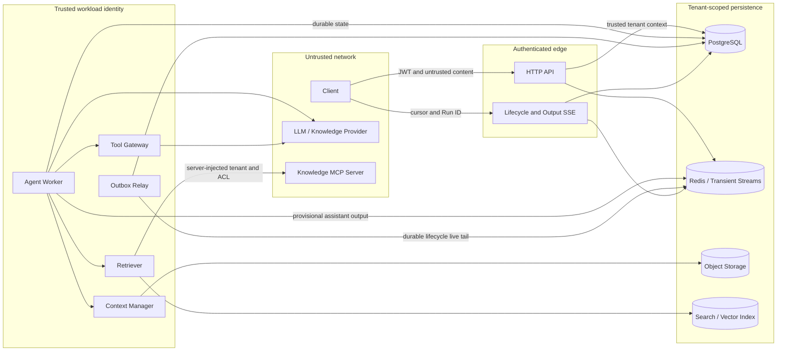

# Multi-tenant threat model and data lifecycle

- Status: Accepted
- Priority: P0
- Owner: Security
- Last reviewed: 2026-08-26

## 1. Scope and security objectives

This threat model covers the MVP control/data plane from authenticated HTTP
requests through Session state, Agent execution, RAG, read-only MCP/tool calls, providers,
SSE delivery, object storage and observability.

Security objectives, in priority order:

1. prevent any cross-tenant read, write or inference;
2. prevent untrusted prompt/retrieval/tool content from changing authorization;
3. make knowledge access policy-controlled, bounded and auditable, while denying
   mutating tools by construction;
4. prevent secrets and tenant content from leaking through logs, traces or
   metrics;
5. preserve integrity under retry, replay, worker crash and message duplication;
6. delete or retain every data copy according to a declared lifecycle.

Availability abuse and cost exhaustion are in scope because an attacker can use
tokens, tools, SSE connections or ingestion to starve other tenants. Formal
certification, customer-managed keys, data-residency orchestration and legal-hold
workflows are explicitly deferred capabilities, not implied claims.

## 2. Assets and trust boundaries

### 2.1 Protected assets

- tenant identity, membership, roles, ACLs and quotas;
- Session/Message/Turn conversation content and context summaries;
- Run/Step/Attempt prompts, decisions, errors and usage;
- knowledge documents, chunks, embeddings, metadata and version history;
- retrieval evidence and ranking output;
- read-only tool definitions, arguments, results and knowledge access records;
- provider credentials, signing keys, encryption keys and webhook secrets;
- Artifact objects, durable events, audit records and deletion state;
- service availability, provider budgets and customer usage boundaries.

### 2.2 Data-flow diagram

Trust is not transitive. Authenticated users can submit malicious content;
retrieved documents and MCP/provider responses remain untrusted; a valid tool
definition does not make model-generated arguments authorized.

## 3. Security invariants

The following are release-blocking invariants:

1. `tenant_id` comes only from the authenticated principal or trusted workload
   envelope. Request bodies, URLs, model text and tool arguments cannot override
   it.
2. Every business key, query, cache key, event, Artifact reference and retrieval
   filter is tenant-scoped. Missing scope fails closed.
3. Authorization is rechecked at the resource boundary. Possession of an ID,
   SSE cursor, object URI or signed URL is not authorization.
4. Retrieval applies tenant/knowledge-base/ACL/version filters before ranking
   and validates the returned identities afterward.
5. Model output is a proposal. It cannot create roles, widen ACLs, register a
   tool, raise a budget, choose an egress destination or mark work complete.
6. Tool schemas reject unknown fields, server-injected fields cannot be model
   supplied, and the Registry/database accept only `READ_ONLY`. Knowledge calls
   have stable invocation identities and audit records.
7. PostgreSQL final commit is authoritative. Cache, queue and event replay cannot
   manufacture a committed Message.
8. Raw secrets, full prompts, document text and unrestricted tool results never
   enter logs, metric labels or error responses.
9. Deletion tracks every derived copy: rows, objects, search chunks, embeddings,
   cache, events and eventually backups.
10. Security controls are never disabled as an overload degradation.

## 4. Data classification

| Class | Examples | Allowed handling |
|---|---|---|
| Public | License, public docs, health status without internals | May be published intentionally |
| Internal | Service version, aggregate capacity, non-secret configuration names | Authenticated operator access; sanitized logs |
| Confidential | Tenant content, prompts, Messages, documents, chunks, retrieval/tool results, user identifiers | Tenant-scoped encryption and authorization; no default logging |
| Restricted | Provider/API credentials, signing/encryption keys, auth tokens, sensitive audit payloads | Secret manager only; never in application data/logs; access audited |

Embeddings are Confidential even when inversion is considered difficult. Hashes,
opaque IDs and metadata can still reveal tenant activity and inherit the source
classification unless a documented transformation proves otherwise.

## 5. Threat analysis

Risk uses likelihood × impact on a 1–5 scale. Scores 15–25 are P0, 8–14 P1 and
1–7 P2. Residual risk assumes the required controls are implemented and tested.

| ID | Threat and attack path | Initial risk | Required controls | Verification | Residual |
|---|---|---:|---|---|---:|
| T-01 | Tenant spoofing through body/header/model argument | 20 | Authenticate once; immutable trusted tenant context; reject conflicting tenant fields | API and unit negative tests | 4 |
| T-02 | IDOR on Session, Run, event or Artifact IDs | 20 | Tenant composite repository keys; resource authorization; opaque IDs are not a control | Cross-tenant API matrix | 5 |
| T-03 | Cross-tenant vector/keyword recall from missing filter | 25 | Mandatory filter type; pre-filter; post-result tenant/ACL validation; fail closed | Canary documents and adapter contract tests | 5 |
| T-04 | Cache-key omission returns another tenant's context/result | 20 | Typed key builder requires tenant; cache value carries tenant checksum; no fallback global key | Property tests and fault injection | 4 |
| T-05 | SSE subscription or cursor enumerates another Run | 20 | Authorize Run before replay and live attach; tenant-scoped stream key; bounded cursor errors | Cross-tenant resume tests | 4 |
| T-06 | Object URI/signed URL leaks an Artifact | 20 | Private bucket; short-lived audience-bound URLs; server authorization; tenant prefix is defense in depth | URL replay/expiry tests | 5 |
| T-07 | Retrieved prompt injection overrides policy or exfiltrates context | 20 | Mark retrieved text as data; instruction hierarchy; tool policy outside model; output/evidence validation | Adversarial RAG corpus | 8 |
| T-08 | Model crafts unauthorized tool arguments or hidden fields | 25 | Strict schema; reject unknowns; server injects tenant/auth fields; policy evaluation after validation | Schema fuzz and privilege tests | 5 |
| T-09 | Retry storms duplicate knowledge-provider load | 16 | Stable invocation key; Attempt ledger; bounded retries, backoff and circuit breaking | Crash/timeout retry test | 4 |
| T-10 | Tool performs SSRF or reaches metadata/internal network | 25 | Destination allowlist; DNS/IP revalidation; proxy egress; block link-local/private ranges unless explicit | SSRF suite and DNS-rebinding test | 5 |
| T-11 | Secrets leak in log/error/trace | 20 | Structured allowlist logging; redaction at source and sink; secret scanners; sanitized provider errors | Golden log and scanner tests | 4 |
| T-12 | Full prompt/tool payload leaks through debug sampling | 20 | Metadata-only telemetry default; content capture off; encrypted restricted break-glass capture with expiry | Configuration and access audit | 4 |
| T-13 | Provider receives data outside tenant policy/region | 20 | Provider policy by tenant/data class; minimum necessary prompt; region allowlist; DPA inventory | Policy-routing integration tests | 6 |
| T-14 | Forged/replayed queue message executes another tenant's Run | 20 | Workload identity; signed/enveloped message; DB lease and tenant/Run re-read; stale fencing token rejection | Replay and tamper tests | 5 |
| T-15 | Expired worker commits after lease takeover | 20 | Monotonic fencing token/version CAS on every mutation and final commit | Dual-worker race test | 4 |
| T-16 | Delete omits vector/cache/backup copy | 16 | Deletion manifest; idempotent workers; tombstone; per-store reconciliation; backup expiry evidence | End-to-end deletion audit | 6 |
| T-17 | MCP server acts as confused deputy or returns cross-tenant IDs | 25 | Server-side capability registry; trusted context injection; response identity validation; least-privilege MCP credentials | Malicious MCP fixture | 6 |
| T-18 | Dependency/build compromise | 15 | Pinned modules; checksum verification; minimal images; SBOM/signing; protected release workflow | CI provenance and vulnerability gates | 6 |
| T-19 | Connection/token flood starves other tenants | 16 | Hierarchical rate/concurrency limits; connection quotas; cost budgets; workload partitions | Tenant-hotspot load test | 6 |
| T-20 | Knowledge ingestion stores malware or active content | 15 | Content-type/size validation; archive limits; malware scan adapter; never execute document content | Malicious file fixtures | 6 |
| T-21 | Memory/summary poisoning persists malicious instructions | 20 | Separate facts from instructions; provenance; bounded memory writes; user-visible deletion; policy scan | Multi-turn injection tests | 8 |
| T-22 | Model attempts to invoke an unregistered mutating tool | 20 | Registry accepts only read-only effects; deployment composes only `knowledge.search`; unknown tools are denied without enumeration | Registry mutation tests | 4 |

Residual risk at 8 requires an explicit monitored risk entry. Prompt and memory
injection cannot be eliminated by prompting alone; deterministic authorization,
tool policy and output validation contain their impact.

## 6. Prompt-injection defense model

### 6.1 Content hierarchy

- Repository-owned system policy is immutable for a Run.
- Tenant configuration can narrow, not widen, platform policy.
- User prompts, conversation history, documents, web/MCP responses and tool
  output are untrusted content.
- Retrieved text is delimited with source identity and a statement that it is
  evidence, not an instruction channel.

### 6.2 Deterministic enforcement

The application—not the LLM—decides:

- tenant and ACL scope;
- allowed providers, retrieval sources and tools;
- argument schema and server-injected fields;
- read-only effect, registered tool identity, and capability grant;
- network destination and credential selection;
- Run budgets, final-state transitions and Artifact visibility.

Model-produced citations are resolved against recorded retrieval evidence. A
citation not present in the authorized evidence set is removed or causes the
configured validation failure; it never triggers an unscoped lookup.

## 7. Read-only tool model

The composed MVP has one tool and one permitted effect:

| Class | Example | Default policy | Retry rule |
|---|---|---|---|
| READ_ONLY | `knowledge.search` over authorized tenant knowledge | Allowed only after registry, capability, schema, tenant and ACL checks | Bounded transient retry |
| Any mutating effect | Not available | No registered definition or adapter; rejected by registry and database constraints | Never executed |

Before execution, Tool Gateway validates schema, canonicalizes arguments,
computes an argument hash, injects trusted tenant context, evaluates policy and
records the Attempt. Runtime human approval is unnecessary because the tool cannot
mutate application or external state. Adding a write tool later requires a separate
security design and schema migration; it is not enabled by merely adding an adapter.

Tool output is size limited, content typed, stored as an Artifact when large and
treated as untrusted input when returned to the model.

## 8. Logging and observability policy

### 8.1 Default allowed fields

- service, environment, version, route template, status/reason code;
- bounded latency, token, step and cost counters;
- opaque tenant-safe correlation IDs where access policy permits;
- `request_id`, `trace_id`, Session/Turn/Run/Step/Attempt IDs as structured
  fields, never metric labels.

### 8.2 Default prohibited fields

- Authorization/Cookie headers, API keys, access/refresh tokens and credentials;
- raw prompts, Messages, documents, chunks, embeddings and tool arguments/results;
- signed object URLs, connection strings and provider raw error bodies;
- unbounded user-controlled strings in metric labels or log field names.

Errors expose stable public codes. Internal provider/database detail is retained
only in sanitized restricted telemetry. Redaction happens before serialization;
sink-side redaction is additional defense, not the primary control.

Debug content capture is disabled in production. A future break-glass mode must
be tenant-approved, encrypted with a dedicated key, access-audited, time-bound
and automatically deleted.

## 9. Data lifecycle and deletion

Default retention is configurable and can be shortened by tenant policy:

| Data | Default | Deletion behavior |
|---|---:|---|
| Durable lifecycle events | 7 days | Delete after terminal reconciliation and `/events` resume window |
| Transient assistant output | Redis TTL 1 h default, 24 h hard ceiling | Best-effort invalidation; final Message remains authoritative |
| Run/Step/Attempt detail | 90 days | Preserve minimal aggregate/audit record when policy requires |
| Prompt/retrieval/tool Artifacts | 30 days | Object delete plus metadata tombstone/reconciliation |
| Committed conversation | Tenant policy | Delete Messages, derived summary/memory and references |
| Knowledge versions/chunks/embeddings | Source policy | Tombstone version; remove index/object copies |
| Security audit | 365 days baseline | Restricted immutable storage; compliance policy may differ |
| Cache/queue transient data | TTL ≤24 h | Best-effort immediate invalidation plus TTL safety net |

Deletion workflow:

1. authorize and persist a deletion request with scope and idempotency key;
2. tombstone the source so it is no longer readable or retrievable;
3. enumerate rows, Artifacts, document versions, chunks, embeddings, cache and
   events into a deletion manifest;
4. execute store-specific deletion idempotently;
5. reconcile the manifest until every online copy is gone;
6. record backup expiry date. Backups are not edited in place; deleted data is
   prevented from normal restoration and ages out under backup retention;
7. retain only the minimum non-content audit proof allowed by policy.

Target for online copies is 24 hours after an authorized deletion; backup expiry
target is 35 days. These are internal lifecycle targets until a contractual SLO
is approved.

## 10. Credential and cryptography baseline

- TLS is required for client and service/provider connections. The current Go
  HTTP server listens without in-process TLS, so production must terminate TLS
  at an approved ingress/service mesh and protect the hop to `serve`; direct
  public exposure of the raw listener is unsupported.
- PostgreSQL, Redis persistence, object storage and backups use encryption at rest.
- Provider credentials live in a secret manager and are selected by trusted
  tenant/provider policy; database rows store references, not secret values.
- Workload identities and short-lived credentials are preferred to static keys.
- Key rotation supports overlapping verification/decryption windows and emits
  an audit event without logging key material.
- Tenant-specific or customer-managed encryption keys are an extension point,
  not an MVP compliance claim.

## 11. Security verification gates

1. Cross-tenant matrix for every repository/API/SSE/Artifact/retrieval/tool path.
2. Property/fuzz tests for tenant cache keys, tool schemas and canonical hashes.
3. Adversarial RAG corpus with instruction injection and false citations.
4. Malicious MCP fixture returning foreign-tenant and schema-invalid results.
5. Knowledge-call crash tests before request, after response and before result persistence.
6. SSRF, DNS rebinding, redirect and private-address egress tests.
7. Golden log/trace/error snapshots plus secret and tenant-content scanners.
8. Dual-worker lease/fencing race and queue replay/tamper tests.
9. End-to-end deletion manifest and backup-expiry evidence.
10. Dependency, license, SBOM, artifact-signing and release-provenance checks.

## 12. Acceptance checklist

- [x] Multi-tenant trust boundaries and assets are explicit.
- [x] Cross-tenant retrieval, cache, SSE and Artifact paths are modeled.
- [x] Prompt injection and persistent memory poisoning are modeled.
- [x] Read-only tool authorization, tenant scoping, retries and SSRF are modeled;
  mutating effects are denied by construction.
- [x] Logs, traces, metrics and debug capture have allow/deny rules.
- [x] Data classes, default retention and multi-store deletion are explicit.
- [x] Provider/MCP, worker lease, queue replay and supply-chain threats are covered.
- [x] High-compliance features are identified as later enhancements, not claims.

## 13. Review triggers

Review this model for any new data store, provider, tool effect, MCP server,
authentication method, public endpoint, conversation topology, debug capture,
retention promise or deployment region. A confirmed security incident triggers
review even when architecture is unchanged.
